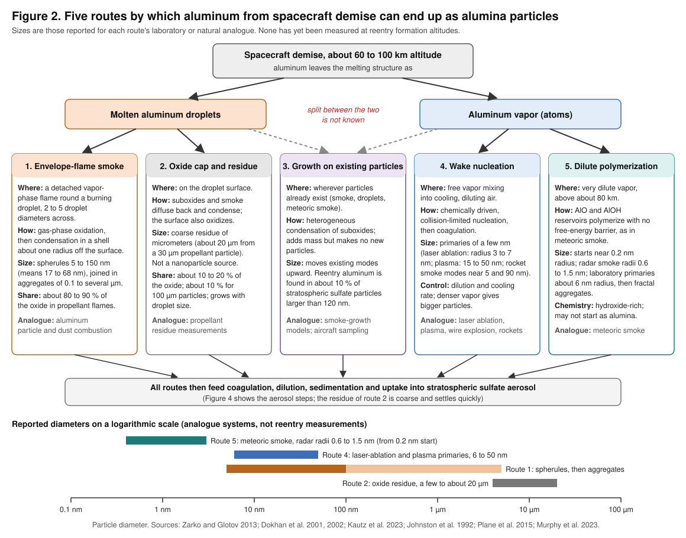
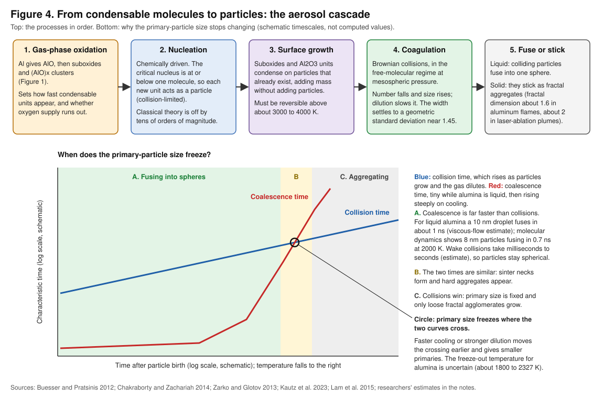

# Suboxide chemistry, not condensation, governs reentry alumina smoke

Aluminum vapor does not turn into alumina (aluminum oxide, Al2O3) by simple condensation. The gaseous Al2O3 molecule is energetically disfavored and hardly exists, so there is no "alumina vapor" to condense. Instead, particles are born through a chain of chemical reactions. The first step, Al + O2 giving AlO + O, is fast, running at close to the rate at which the molecules collide. The second step, oxidizing the aluminum monoxide AlO further, is uphill by 106 kilojoules per mole and is the bottleneck. From there, suboxides (molecules with less oxygen per aluminum than alumina, such as Al2O, AlO2 and Al2O2) and unusually stable (AlO)x clusters lead to the first stable seeds, the Al4O6 cage and larger (Al2O3)n clusters, mostly as the gas cools below about 2000 to 3000 kelvin ([Gobrecht et al. 2022](https://arxiv.org/abs/2110.11139); [Lam et al. 2015](https://arxiv.org/abs/1707.08434)).

Because every new oxide unit is already stable, particle formation is effectively limited only by how often molecules collide. The final size is then set by two things. The first is coagulation, the sticking together of particles that collide. The second is the temperature at which colliding liquid alumina particles stop fusing into single spheres, which lies somewhere between the 2327 kelvin melting point and the roughly 1860 kelvin limit to which molten alumina can supercool. For a reentry wake, this means the dilution and cooling history matters more than any nucleation formula ([Buesser and Pratsinis 2012](https://pmc.ncbi.nlm.nih.gov/articles/PMC3591782/); [DLR levitation study](https://elib.dlr.de/87127)).

There are at least five distinct routes from demise aluminum to particles:

- smoke from a flame around a burning droplet;
- an oxide cap left behind on the droplet;
- growth on particles that already exist;
- nucleation from free vapor in the wake;
- slow, meteoric-smoke-like polymerization at very low density.

Their laboratory and natural analogues give primary particles that range from about 1 nanometer across (meteoric smoke) through a few nanometers (laser ablation) to means of 17 to 68 nanometers (burning droplets) ([Plane et al. 2015](https://doi.org/10.1021/cr500501m); [Kautz et al. 2023](https://www.osti.gov/servlets/purl/2204679); [Zarko and Glotov 2013](https://www.jes.or.jp/mag/stem/Vol.74/documents/Vol.74,No.6,p.139-143.pdf)).

No reentry study has predicted a nucleated size distribution. Emission inventories assume, explicitly as an upper bound, that all ablated aluminum becomes Al2O3. New laboratory work, seen only as a workshop abstract, instead suggests that aluminum alloys evaporate only above about 1300 °C and that the main gas-phase product is aluminum hydroxide ([Barker et al. 2024](https://doi.org/10.1038/s41597-024-03910-z); [Gómez Martín et al., ESA 2025](https://indico.esa.int/event/579/contributions/11325/)). A model that predicts how much vapor condenses, and at what size, therefore has to keep four uncertain choices separate:

- the fraction of aluminum released as vapor rather than as droplets;
- the oxidation pathway, including the hydroxide route;
- the nucleation treatment;
- the coagulation and dilution history.

It also needs one number that the folder does not yet contain: an alumina sintering-rate law.

This report is built from four sets of research notes covering gas-phase chemistry, aluminum combustion smoke, nucleation and aerosol modeling, and analogue and reentry studies. Much of it rests on full texts the researchers read (31 PDFs are in the folder), but some findings come only from abstracts or search summaries, and those are flagged where they appear. Numbers that the researchers derived themselves, rather than found in a source, are labeled as estimates.

## Five formation routes compete, and only two have been studied for reentry

The question "how does aluminum vapor become alumina?" has several answers, because the aluminum leaving a breaking-up spacecraft is not all vapor. Plasma wind-tunnel tests at Stuttgart, reported in a conference abstract, found that aluminum powder in epoxy evaporated and formed AlO, while solid aluminum shed large molten droplets instead ([Kuenstler et al., EGU26-1943](https://meetingorganizer.copernicus.org/EGU26/EGU26-1943.html)). Figure 2 maps the routes that follow from these two starting forms. Below it, the reported diameters for each route's analogue are set on one logarithmic axis, so that the very different size scales can be compared directly.

**Route 1, envelope-flame smoke.** A molten droplet that ignites burns mostly in a detached, vapor-phase diffusion flame. The flame is 2 to 5 times the droplet's diameter, a ratio called the flame standoff ratio; a large ratio means the reaction happens well away from the surface. Alumina nucleates in a shell about one droplet radius off the surface ([Sundaram et al. 2017](https://www.yang.gatech.edu/publications/Journal/PECS%20(Sundaram,%202017)%20nano%20particles.pdf); [Karasev et al. 2006](https://ir.lib.nycu.edu.tw/handle/11536/11587)). The product is spherical primary particles ("spherules") of 5 to 150 nanometers, with means of 17 to 68 nanometers, joined into chain-like fractal aggregates 0.1 to several micrometers across ([Zarko and Glotov 2013](https://www.jes.or.jp/mag/stem/Vol.74/documents/Vol.74,No.6,p.139-143.pdf)). In propellant flames this route carries about 80 to 90 percent of the oxide formed ([Dokhan et al. 2001](https://seitzman.gatech.edu/AIAA-2001-3581.pdf)).

**Route 2, oxide cap and residue.** Some of the gaseous suboxides and smoke diffuse back to the droplet. Together with direct surface oxidation, they build an oxide "cap" or "lobe" that is left behind as a coarse residue of micrometers. In propellant tests this was about 20 micrometers from a 30 micrometer aluminum particle, and it held about 10 to 20 percent of the oxide ([Dokhan et al. 2002](https://seitzman.gatech.edu/jpc20024173.pdf)). It is not a nanoparticle source, but it competes with Route 1 for the same aluminum.

**Route 3, growth on existing particles.** Suboxide vapor can condense on any particles already present, such as smoke, droplets or meteoric smoke arriving from above. This adds mass without adding particles ([Babuk and Budnyi 2017](https://www.matec-conferences.org/10.1051/matecconf/201711001006); [Murphy et al. 2023](https://doi.org/10.1073/pnas.2313374120)).

**Route 4, wake nucleation from free vapor.** Vapor released without a sustained flame mixes into cooling, diluting air. It oxidizes through the AlO chain, and the resulting units grow by coagulation. This is the route most directly analogous to laser ablation and thermal-plasma synthesis, which give primary particles of a few nanometers to a few tens of nanometers ([Kautz et al. 2023](https://www.osti.gov/servlets/purl/2204679); [Johnston et al. 1992](https://scholarsmine.mst.edu/matsci_eng_facwork/224)).

**Route 5, dilute polymerization.** At very low density, above about 80 kilometers, AlO and the hydroxide AlOH can polymerize into smoke without any free-energy barrier, as meteoric metals do. That process starts from molecular sizes of about 0.2 nanometers radius ([Plane et al. 2015](https://doi.org/10.1021/cr500501m); [Plane et al. 2021](https://eprints.whiterose.ac.uk/170006/)).

The comparison that matters most for the model is between Routes 1 and 2, which apply when droplets burn, and Routes 4 and 5, which apply when vapor is released. Most of the quantitative data come from Routes 1 and 2, measured in propellant flames at 7 to 80 atmospheres. Reentry release, at about 60 to 100 kilometers, probably favors Routes 4 and 5. Two reasons point that way:

- In the threshold analysis of Sundaram et al., low-pressure air is the oxidizer environment most favorable to vapor-phase burning. Above about 100 atmospheres in air, the flame temperature falls below the aluminum boiling point; in steam the same happens above about 2 atmospheres and in carbon dioxide above about 5. Reentry air sits far below all of these, so vapor-phase burning is easy there ([Sundaram et al. 2017](https://www.yang.gatech.edu/publications/Journal/PECS%20(Sundaram,%202017)%20nano%20particles.pdf)).
- Analogues for free vapor all give small primaries.

This preference is the researchers' inference, not something that has been measured.

## One fast step, then a bottleneck: the gas-phase chemistry

### The entry reaction is fast and well measured

The first oxidation step is Al + O2 giving AlO + O. Its room-temperature rate constant, measured in a laser-ablation fast-flow tube, is (1.68 ± 0.24) × 10⁻¹⁰ cubic centimeters per molecule per second. That is close to the rate at which the molecules collide, which means aluminum vapor is converted to AlO within a few collisions wherever O2 is present ([Gómez Martín et al. 2017](https://eprints.whiterose.ac.uk/113322/)). The reaction releases only about 14 ± 9 kilojoules per mole, so it barely heats the gas. The high-level quantum calculation of Gobrecht et al. puts the release even lower, at 0.9 kilojoules per mole ([Gobrecht et al. 2022](https://arxiv.org/abs/2110.11139)).

Two independent earlier measurements agree on about 1.7 × 10⁻¹⁰ (Garland and Nelson 1992; Le Picard et al. 1997, the latter over 23 to 295 kelvin). An early high-temperature fast-flow reactor result of 3.2 × 10⁻¹⁰ was later acknowledged by its own group to be in error ([Gómez Martín et al. 2017](https://eprints.whiterose.ac.uk/113322/)). The upper-atmosphere model adopts 1.7 × 10⁻¹⁰ × (T/300)^(1/6), where T is the temperature in kelvin; the weak one-sixth power means the rate is essentially independent of temperature ([Plane et al. 2021](https://eprints.whiterose.ac.uk/170006/)).

The weak point is above 2000 kelvin: no validated measurement exists there, and the high-temperature behavior rests on partly retracted data and theory. AlO can also form by direct three-body recombination, Al + O + M giving AlO + M. Here M is any third molecule (N2 in air) that carries away the 498 kilojoules per mole released when the bond forms ([Gobrecht et al. 2022](https://arxiv.org/abs/2110.11139)).

Figure 1 shows the whole network. Each arrow is tagged with a reaction number, and the key on the right gives each reaction. The colors mark what kind of step it is:

- green arrows are fast steps;
- the red arrow is the bottleneck;
- dashed arrows are three-body steps;
- the blue bottom row is the hydroxide route;
- the dashed red box marks the Al2O3 monomer, the species that hardly exists in the gas.

### Oxidizing AlO is the bottleneck

The second step, AlO + O2 giving AlO2 + O, absorbs 106 kilojoules per mole. Its rate, obtained from the measured reverse reaction by detailed balance (the requirement that forward and reverse rates are consistent with the equilibrium constant), is 3.54 × 10⁻¹¹ × (T/300)^0.19 × exp(−13140/T) cubic centimeters per molecule per second ([Gobrecht et al. 2022](https://arxiv.org/abs/2110.11139)). The researchers evaluated this at 3000 kelvin. Their estimate is about 7 × 10⁻¹³, roughly 250 times slower than the entry reaction. This explains why AlO piles up and glows strongly in aluminum flames, and it makes AlO the species to track as an oxidation tracer.

Two alternatives exist. In cold, dilute gas, AlO instead adds O2 with the help of a third body to form OAlO2, a pressure-dependent step that the upper-atmosphere scheme includes ([Plane et al. 2021](https://eprints.whiterose.ac.uk/170006/)). AlO can also add an oxygen atom, AlO + O + M giving AlO2 + M. That releases 391 kilojoules per mole, but its free energy changes sign near 2900 kelvin, so AlO2 is not favored above that temperature ([Gobrecht et al. 2022](https://arxiv.org/abs/2110.11139)).

### AlO reacts with itself, and the Al2O3 molecule is the second bottleneck

Two AlO molecules can react to give Al2O + O. That channel releases 70 kilojoules per mole and runs at the capture-limited rate of 1.42 × 10⁻⁹ × (T/300)^0.17 cubic centimeters per molecule per second, where capture-limited means every close encounter reacts. It becomes unfavorable above about 1800 kelvin. Alternatively, the two AlO molecules can join through a three-body collision into the ring molecule Al2O2, releasing 548 kilojoules per mole ([Gobrecht et al. 2022](https://arxiv.org/abs/2110.11139)). AlO's large dipole moment, the separation of charge within the molecule, may let these self-reactions run near the collision rate ([Gómez Martín et al. 2017](https://eprints.whiterose.ac.uk/113322/)).

The Al2O3 molecule can only be made from AlO2 or Al2O2, and the routes into it are awkward:

- Oxidizing Al2O2 with water is uphill by 85 kilojoules per mole, and with hydroxyl (OH) by 28 kilojoules per mole.
- Oxidizing Al2O2 with an oxygen atom is the most exothermic option, but it needs a third body. Gobrecht et al. estimate that three-body steps only compete with two-body ones above about 10¹⁴ molecules per cubic centimeter.
- The one clearly favorable two-body route is AlO2 + AlOH giving Al2O3 + H. It releases 72.5 kilojoules per mole and stays favorable up to about 2700 kelvin, but it needs hydrogen-bearing species ([Gobrecht et al. 2022](https://arxiv.org/abs/2110.11139)).

The consequence is stark. When the stellar-wind network was started from an atomic gas, no Al2O3 clusters formed anywhere in the temperature–density grid. The authors concluded that the literature rate constants "are incorrect and need revision or that alternative small Al2O3-cluster formation pathways are missing" ([Boulangier et al. 2019](https://arxiv.org/abs/1908.09633)).

### Three-body steps should matter in a reentry wake

The researchers point out that ambient air at 60 to 80 kilometers holds of order 10¹⁵ to 10¹⁶ molecules per cubic centimeter (a standard-atmosphere figure, not from the sources), which is above the 10¹⁴ threshold. Three-body routes should therefore compete in a reentry wake, unlike in stellar winds, which makes combustion mechanisms more transferable than astrophysical ones. One qualification is mine: standard-atmosphere tables put 80 kilometers nearer 4 × 10¹⁴ molecules per cubic centimeter, so the margin shrinks to a factor of a few at the top of the window and disappears above about 85 to 90 kilometers. The pressure dependence of each three-body rate (its "falloff") has to be checked at the actual wake density rather than assumed.

### Hydrogen chemistry opens a hydroxide route

When water vapor or hydrogen is present, for example from ablating composites or from humid air, aluminum is diverted into the hydroxide AlOH:

- Al + H2O gives AlOH + H, releasing 60.4 kilojoules per mole.
- AlO + H2 gives AlOH + H, releasing 45 kilojoules per mole ([Gobrecht et al. 2022](https://arxiv.org/abs/2110.11139)).

The extracted rate expression for the first of these merged two terms, so it should be checked against the PDF table. In the upper atmosphere the chain AlO, then OAlO2, then reaction with hydrogen atoms, also ends at AlOH. Unlike FeOH or NaOH, AlOH is stable against attack by H and O atoms, so only sunlight breaks it apart. Photolysis does so at about 3.3 × 10⁻³ per second, a lifetime of about five minutes in full sunlight. This makes AlOH, together with AlO and the ion Al+, one of the three major aluminum species above 80 kilometers ([Plane et al. 2021](https://eprints.whiterose.ac.uk/170006/)).

The researchers note that in dry air at high altitude the Al–O-only subset should dominate, with N2 as the third body. However, the SMASI laboratory result, discussed in the reentry section below, reports hydroxide as the main product even for reentry alloys. The hydroxide route therefore cannot be dropped by default.

### The thermochemistry itself disagrees by up to 120 kilojoules per mole

Two sources of formation enthalpies conflict:

- Swihart and Catoire computed formation enthalpies at 298 kelvin with the CBS-Q quantum method: AlO +17.0, linear OAlO −15.9, Al2O −38.7 and planar Al2O2 −94.5 kilocalories per mole. They expect accuracy of 1 to 2 kilocalories per mole in general, but somewhat worse for aluminum oxides ([Swihart and Catoire 2000](https://www.eng.buffalo.edu/~swihart/Reprints/Swihart_CombFlame_2000.pdf)).
- Mass spectrometry over solid alumina gave −44.3 kilocalories per mole for AlO2 and −113.6 for Al2O2 ([Farber et al. 1972](https://dspace.bits-pilani.ac.in/items/891ca999-1a01-44df-ac30-790690a1f400)).

The two sets differ by about 28 and 19 kilocalories per mole respectively, or about 117 and 80 kilojoules per mole. The researchers point out that a gap this large shifts equilibrium suboxide fractions by orders of magnitude at 2000 to 3000 kelvin, so the model must state which thermochemistry set it uses (JANAF, Swihart and Catoire, or the CBS-QB3 values of Gobrecht et al.).

### Published mechanisms differ by five orders of magnitude

A 2026 review compared four published aluminum gas-phase mechanisms (Storozhev, Glorian, Saba and Starik). It found rate constants for the same reactions differing by more than five orders of magnitude, a factor of more than 100,000, and predicted droplet-flame temperatures differing by about 1000 kelvin ([Qiu, Bai and Nilsson 2026, record only](https://lup.lub.lu.se/record/f1aeea3c-eee9-4bd2-9082-e20695f06c77)). One set of notes dates this comparison to 2024 and the other to 2026, but both point to the same Lund record. The table below compares the mechanisms a modeller could adopt, on the same criteria.

| Mechanism | Built for | Size | How particle formation is handled | Main limitation for reentry |
|---|---|---|---|---|
| Glorian / Catoire, as used by [Muller et al. 2017](https://www.eucass.eu/doi/EUCASS2017-174.pdf) | Aluminum droplets burning near 1 atmosphere | Al–O: 10 species, 15 reactions; Al–H–O: 20 species, 44 reactions; plus a surface mechanism of 25 reactions for Al–O | Fast lumped reactions from gaseous Al2O3 to "liquid alumina", made reversible by Muller et al. | Original rate tables paywalled or behind a bot check |
| [Gobrecht et al. 2022](https://arxiv.org/abs/2110.11139) | Hydrogen-rich winds of evolved stars, low density | Al-bearing molecules and AlxOy clusters with x of 1 to 5 and y of 1 to 6 | Explicit cluster chemistry up to the dimer Al4O6, which joins into Al8O12 | The authors warn that the rates do not transfer directly to combustion conditions |
| Savel'ev and Starik 2018 ([abstract](https://www.sciencedirect.com/science/article/abs/pii/S0010218018302542)) | Combustion of aluminized fuels | (Al2O3)n clusters up to n = 75 | Monomer addition only, with interpolated energies for n of 5 to 75 | Counts not found; monomer route is the disputed bottleneck |
| Saba 2021 ([thesis record](https://repo.lib.tut.ac.jp/records/2000304)) | Alumina formation up to the tetramer | About 30 reaction diagrams | Transition-state theory rates, O2 and O as oxidants only, no hydrogen species | Stated valid above about 1400 kelvin; PDF not retrieved |
| [Plane et al. 2021](https://eprints.whiterose.ac.uk/170006/) | Meteoric aluminum at 80 to 110 km | 36 reactions, neutral, ionic and photochemical | A lumped polymerization sink to smoke | Built for very dilute aluminum, not a dense trail |

The table shows that no single mechanism covers the reentry case. A combustion mechanism suits the hot, dense near wake, and the Plane et al. scheme suits the cold, dilute far wake. The researchers note that the Plane and Gobrecht sets share the same Mangan and Plane rate fits, so those two can be merged consistently.

### Equilibrium sets the sequence, but the wake's own dew point must be computed

Figure 3 shows which species and stage dominate as a parcel of gas cools. The cooling curve is schematic, and the temperature bands come from the sources named in the figure.

First-principles equilibrium for an Al–O gas at 4 bar, with an aluminum-to-oxygen ratio of 0.6, gives the sequence on cooling ([Lam et al. 2015](https://arxiv.org/abs/1707.08434)):

- Above about 5000 kelvin, the gas is mainly Al, O, O2, AlO and Al2O.
- On cooling, Al2O2 and Al3O3 take over.
- The alumina stoichiometry, two aluminum to three oxygen as in Al6O9 and Al8O12, overtakes the 1:1 family only below about 2000 kelvin, and only with a slight oxygen excess.
- The Al2O3 molecule "never seems to emerge".

These calculations matched time-resolved spectroscopy of a laser plasma cooling at 25 kelvin per microsecond, that is, 2.5 × 10⁷ kelvin per second.

Two condensation temperatures from the literature should not be used for a wake. The first is the corundum value of 1677 kelvin, the temperature at which half the aluminum has condensed in a gas of solar composition at 10⁻⁴ bar ([Lodders 2003](https://www.ucolick.org/~woosley/ay220-19/papers/lodders03.pdf)). It applies only to very dilute, hydrogen-dominated gas. The second is the 1 atmosphere combustion value. At the hot end, liquid alumina does not boil as a single compound but decomposes into suboxides, aluminum and oxygen. Its apparent volatilization temperature at 1 atmosphere is put at about 4000 kelvin or more ([Illinois thesis, search summary only](https://www.ideals.illinois.edu/items/17098)), while a levitation study quotes a boiling point of 3240 kelvin ([DLR levitation study](https://elib.dlr.de/87127)). This disagreement of about 760 kelvin is unresolved in the notes.

The researchers' recommendation is to compute the dew point directly. This is the temperature at which the Al and O partial pressures first exceed the equilibrium requirement for liquid alumina, and it should be calculated from JANAF data (for example with NASA CEA or Cantera) for the actual aluminum-to-oxygen ratio and wake pressure. Because the wake is far richer in aluminum than stellar gas, they expect it to lie well above 1677 kelvin.

## Classical nucleation theory fails, so particle birth must be treated as chemistry

### Classical nucleation theory gives a nucleus smaller than one molecule

Classical nucleation theory (CNT) is the textbook model in which a supersaturated vapor forms droplets once they exceed a critical radius set by surface tension. It breaks down for alumina:

- With a nanoparticle surface energy of about 1.5 joules per square meter and a bulk free-energy change of about −62 kilojoules per cubic centimeter, CNT gives a critical radius of about 0.05 nanometers. That is one Bohr radius, smaller than a single molecule, and therefore physically meaningless. CNT nucleation rates are generally off by tens of orders of magnitude ([Lam et al. 2015](https://arxiv.org/abs/1707.08434)).
- The deeper reason is that small clusters have neither the structure nor the stoichiometry of bulk alumina.
- Gobrecht et al. add that the concept of surface tension does not apply to sub-nanometer clusters ([Gobrecht et al. 2022](https://arxiv.org/abs/2110.11139)).

The aerosol-synthesis literature reaches the same conclusion from the other direction. For fast oxide chemistry, the product molecules are so concentrated that "their critical nucleation size at typical reactor conditions is smaller than that of a single monomer/molecule". Clusters therefore grow immediately by coagulation, and nucleation is limited only by collisions ([Buesser and Pratsinis 2012](https://pmc.ncbi.nlm.nih.gov/articles/PMC3591782/)). Once formation stops, a simple model that treats all particles as one size reproduces detailed models of the full size distribution to within 20 percent. During formation, however, the same model badly underpredicts the mean diameter, because monomers and particles are averaged together.

### Cluster energies identify Al4O6 as the first stable seed

Quantum chemistry at the CBS-QB3 level gives binding energies per atom that climb steeply with cluster size ([Gobrecht et al. 2022](https://arxiv.org/abs/2110.11139)):

- AlO: 249 kilojoules per mole.
- The Al2O3 monomer: 388, as a weakly bound, flat "kite" shape.
- The dimer Al4O6: 484, a cage with all twelve Al–O bonds 1.744 ångström long.
- The trimer: 515.

The jump of about 96 kilojoules per mole per atom from monomer to dimer is, in the researchers' reading, why Al4O6 is the natural first stable nucleus. Once formed, it does not fall apart at flame temperatures, whereas the monomer readily reverts to suboxides.

Small clusters with a 1:1 aluminum-to-oxygen ratio, (AlO)x with x of 1 to 4, are unusually stable. Gobrecht et al. therefore propose two growth routes that skip the monomer bottleneck. The first adds AlO one unit at a time, which releases about 500 kilojoules per mole per new bond but needs a third body. The second adds AlOH, a two-body step that ejects a hydrogen atom. Both are followed by oxidation of Al3O3 and Al4O4 ([Gobrecht et al. 2022](https://arxiv.org/abs/2110.11139)). Joining two dimers into the tetramer Al8O12 releases more than 800 kilojoules per mole and is effectively one-way, so Gobrecht et al. use it as the hand-off from explicit chemistry to a particle model.

Gobrecht et al. fitted the energy per formula unit as E(n) = a0 + a1 n^(−1/3), where n is the number of Al2O3 units, a0 = −1287.9 kilojoules per mole is the bulk limit, and a1 = 1075.42 kilojoules per mole is the term conventionally ascribed to surface tension. Clusters with n of 3, 4 and 5 are more stable than this fit and n of 8 and 10 less stable. These "magic-number" deviations are exactly what CNT cannot represent. Structure also depends on size, based on calorimetry: below about 4 nanometers alumina is amorphous, from 4 to 11.6 nanometers it is cubic gamma alumina, and only above about 11.6 nanometers is it hexagonal corundum (alpha alumina) ([Gobrecht et al. 2022](https://arxiv.org/abs/2110.11139)).

### Kinetic nucleation studies of aluminum show how far CNT can be off

For pure aluminum vapor at 2000 kelvin, Girshick, Agarwal and Truhlar ran a cluster-by-cluster kinetic calculation using quantum-mechanical free energies for clusters up to 60 atoms. They found:

- the critical size locks at the magic number of 55 atoms once the saturation ratio (vapor pressure divided by equilibrium vapor pressure) exceeds about 4.5;
- steady-state rates are "many orders of magnitude lower" than CNT;
- nucleation begins at a saturation ratio of about 13.3, rather than the 5.1 that CNT predicts ([Girshick et al. 2009](https://comp.chem.umn.edu/Truhlar/docs/868.pdf)).

The same paper gives the self-consistent form of CNT, with free energy of forming an i-molecule cluster ΔG_i/kT = θ(i^(2/3) − 1) − (i − 1) ln S. Here k is Boltzmann's constant, T the temperature, θ the dimensionless surface tension and S the saturation ratio. This form agreed "excellently" with a transient kinetic calculation. The researchers flag this result as relevant to a separate question: whether metallic aluminum droplets nucleate in an oxygen-poor wake core before oxidation. CNT would predict that too early.

Two practical results soften the problem. Tacu, Khrabry and Kaganovich showed that in a cooling gas the nucleation rate rises so steeply that "the expression of the nucleation rate, either from CNT or from kinetic nucleation theory, is of little importance in the determination of the nucleation burst time". They also showed that the mean diameter after the burst is proportional to the initial vapor concentration and inversely proportional to the cooling rate, and they verified this for cooling rates of 10³ to 10⁶ kelvin per second ([Tacu et al. 2020](https://w3.pppl.gov/~ikaganov/pdf_files/Tacu2020.pdf)). Khrabry et al. showed for iron that a size-dependent "Tolman" correction to surface tension reproduces the condensation timeline, mean size and width of a cooling vapor, though not the magic-number spikes ([Khrabry et al. 2024](https://arxiv.org/pdf/2408.16693)).

### Three workable nucleation treatments

The researchers distill the literature into three options for "chemically driven nucleation":

- **A lumped fast sink.** Gaseous oxide goes straight to condensed alumina, as in combustion models. Muller et al. showed that this sink must be made reversible: with an irreversible sink the flame exceeds 5000 kelvin at 10 atmospheres, which is unphysical ([Muller et al. 2017](https://www.eucass.eu/doi/EUCASS2017-174.pdf)).
- **Explicit cluster chemistry.** The (AlO)x, Al2O2 or AlO2 network is followed up to a stable seed such as Al4O6 or Al8O12, and growth then proceeds by collisions ([Gobrecht et al. 2022](https://arxiv.org/abs/2110.11139)).
- **A polymerization sink**, as in the atmospheric scheme ([Plane et al. 2021](https://eprints.whiterose.ac.uk/170006/)).

Option two is the most physical but has the largest rate uncertainty, and it can fail to make any particles when started from atoms. The atmospheric sink also has a reporting problem: its rate constant appears as 5.8 × 10⁻⁸ cubic centimeters per second in the text of Plane et al. but 5.8 × 10⁻⁷ in its Table 1. That tenfold inconsistency in the paper itself should be resolved before the value is used.

If a CNT-type calculation is run as a sensitivity check, it needs physical properties of liquid alumina:

- **Surface tension:** 0.632 − 2.310 × 10⁻⁵ (T − 2327) newtons per meter, fitted over 2375 to 2770 kelvin, from aerodynamic-levitation measurements seen only as abstracts ([Int. J. Thermophys. record](https://ma.x-mol.com/paper/1737562338861223936)).
- **Density:** (2.79 ± 0.01) × [1 − 4.22 × 10⁻⁵ (T − 2500)] grams per cubic centimeter over 2000 to 3100 kelvin ([levitation study](https://link.springer.com/article/10.1023/A:1022650703233)).
- **Molecular volume, a researchers' estimate:** about 0.059 cubic nanometers, giving a monomer radius of about 0.24 nanometers. This is consistent with the 0.208 to 0.260 nanometer "monomeric radius" of Gobrecht et al.

Solid alpha alumina is denser, at about 3.95 grams per cubic centimeter. The researchers note that choosing the solid rather than the liquid density changes the diameter inferred from a given mass by about 10 percent.

## Coagulation and the coalescence freeze-out set the final size

### The aerosol general dynamic equation and how to solve it

Once condensable units exist, their size distribution follows the aerosol general dynamic equation. This equation adds up four effects on the number of particles of each volume: gains from collisions of smaller particles, losses when particles collide with others, a nucleation source at the monomer size, and growth by surface condensation. It can be solved at rising cost by four methods:

- a model that treats all particles as one size;
- moment methods, which track a few averages of the distribution and assume its shape (for example log-normal, or quadrature-based schemes);
- sectional methods, which divide the size range into bins, either by volume or by volume and surface area for aggregates;
- Monte Carlo methods, which follow a sample of individual particles ([Buesser and Pratsinis 2012](https://pmc.ncbi.nlm.nih.gov/articles/PMC3591782/)).

Oxide synthesis aerosols occupy only 10⁻³ to 10⁻⁴ of the gas volume, so the flow can be computed first and the particle dynamics solved afterward along streamlines. A reentry trail is even more dilute, so this one-way coupling should hold even better there.

Figure 4 shows the cascade and the timescale competition that ends it. After growing only two to three times in size, a concentrated aerosol reaches a "self-preserving" distribution, a shape that no longer depends on where it started. Its geometric standard deviation, a measure of the width of a log-normal size distribution, is 1.44 to 1.46 for coalescing spheres. For comparison, ten metals condensed in inert gas all gave 1.48 ± 0.12 ([Buesser and Pratsinis 2012](https://pmc.ncbi.nlm.nih.gov/articles/PMC3591782/)). Lehtinen and Zachariah give fits of this shape for the free-molecular, continuum and constant collision kernels. They also give a simple sectional algorithm in which bin volumes grow geometrically and mass is conserved when colliding particles are split between bins ([Lehtinen and Zachariah 2001](https://mrzgroup.engr.ucr.edu/media/431/download)). Aggregates that do not coalesce have a broader self-preserving distribution. A search summary gives 2.27 in the free-molecular regime, but which size measure that refers to was not verified ([CORE record](https://core.ac.uk/works/49020266)).

### Coagulation in the free-molecular regime

The researchers make three estimates for the coagulation stage, none of which comes directly from a source:

- **Regime.** At mesospheric pressures the gas mean free path is of order 0.1 to 1 millimeter or more, so nanoparticles are deep in the free-molecular regime, where they move ballistically between collisions with gas molecules.
- **Scaling.** From textbook relations, with a constant condensed volume fraction φ, the mean diameter grows as d ∝ φ^(2/5) t^(2/5) T^(1/5), where t is the time spent hot and T the temperature. This is the classic "Ulrich" scaling.
- **Timescale.** For 2 nanometer alumina at 2000 kelvin, the collision rate coefficient is about 1.3 × 10⁻⁹ cubic centimeters per second. The characteristic coagulation time is then about 15 milliseconds at 10¹¹ particles per cubic centimeter (10¹⁷ per cubic meter) and about 1.5 seconds at 10⁹ per cubic centimeter.

The last estimate shows why dilution matters: a hundredfold drop in particle concentration slows coagulation a hundredfold. In an expanding wake coagulation can therefore "freeze" early, and the mixing history matters as much as the cooling rate.

The researchers also note that Tacu's linear dependence on vapor concentration applies to the nucleation burst, while the two-fifths power applies to the coagulation stage afterward. For refractory oxides, whose nucleation is collision-limited, the burst is essentially instantaneous, so the coagulation scaling is more likely to control the final size. Both stages point the same way, toward smaller particles with stronger dilution and faster cooling. Because the exponents differ, the model has to resolve which stage dominates in the wake.

### Coalescence decides whether colliding particles fuse or stick

Primary-particle size is set where the coalescence time, the time for two touching particles to fuse into one sphere, becomes comparable to the collision time. The standard description is the surface-area relaxation law of Koch and Friedlander: da/dt = −(a − a_fc)/τ_s. Here a is the aggregate surface area, a_fc is the area of the fully fused sphere, and τ_s is the time to remove 63 percent of the excess area ([Buesser and Pratsinis 2012](https://pmc.ncbi.nlm.nih.gov/articles/PMC3591782/)). The process runs in three stages:

1. Early, coalescence is fast and particles fuse completely.
2. When the two times are similar, sinter necks form and hard aggregates appear.
3. Later, as the gas cools, coalescence effectively stops. Primary size is frozen, and only loose fractal agglomerates grow.

Sintering also narrows the primary size distribution, because small particles sinter faster.

For liquid alumina, coalescence is extremely fast. The researchers used the Frenkel viscous-flow law, in which the time scales as viscosity times diameter divided by surface tension, with an unverified melt viscosity of 0.03 to 0.1 pascal-seconds. Their estimate is about 0.5 to 1.6 nanoseconds for a 10 nanometer droplet and 5 to 16 nanoseconds for a 100 nanometer droplet. That is many orders of magnitude faster than wake coagulation, which takes milliseconds to seconds. Reactive molecular dynamics, simulations with a force field that allows bonds to form and break, supports this: two 8 nanometer oxide-coated aluminum particles at 2000 kelvin, about 400 kelvin below alumina's melting point, fused completely in 0.7 nanoseconds. The mechanism is aluminum ions diffusing into the shell and softening it ([Chakraborty and Zachariah 2014](https://mrzgroup.engr.ucr.edu/media/1446/download)).

The practical conclusion is that alumina particles stay spherical while liquid and start to aggregate only once they solidify. The solidification point is uncertain:

- Levitated liquid alumina supercools to about 1860 kelvin, roughly 470 kelvin below its 2327 kelvin melting point ([DLR levitation study](https://elib.dlr.de/87127)).
- Nanoparticles have depressed melting points.
- Molecular dynamics finds that 6 and 10 nanometer gamma alumina particles turn amorphous from the surface inward at 900 kelvin ([Gramatte et al. 2022](https://arxiv.org/pdf/2211.16081)).

The researchers therefore recommend bracketing the freeze-out temperature between about 1800 and 2327 kelvin in sensitivity runs.

Below freeze-out, a solid-state sintering law is needed. The one alumina-specific law, two coalescence parameters fitted to flame-made alumina by Johannessen, Pratsinis and Livbjerg, could not be opened ([DTU record](https://orbit.dtu.dk/en/publications/computational-fluid-particle-dynamics-for-the-flame-synthesis-of-/)). A later paper citing it reports geometric volume-mean diameters of 2.8 to 10.7 nanometers for flame-made alumina, attributed to alumina having the lowest diffusion coefficient of the oxides compared ([Aerosol Sci. Technol. paper](https://www.tandfonline.com/doi/pdf/10.1080/02786820290110978)). This sintering law is the single most important missing number in the folder.

Two further effects can shift sizes:

- **Coalescence heating.** Fusing nanoparticles release surface energy. Kinetic Monte Carlo simulations show this can heat them "many hundreds of degrees" above the gas, which delays aggregation and enlarges the primaries, and the effect is stronger at low pressure ([Mukherjee et al. 2003](https://mrzgroup.ucr.edu/sites/default/files/2019-02/2003_jcp_KMC.pdf)).
- **Charging.** In aluminum dust flames, thermally charged particles coagulate more slowly. After 2 milliseconds, the coefficient of variation (standard deviation divided by mean diameter) is 26 percent for a charged aerosol, against 39 percent for an uncharged one. Adding potassium cuts the mean diameter from 72 to 9.3 nanometers for 5 micrometer particles at 3200 kelvin ([Poletaev 2025](https://fas.onu.edu.ua/article/download/347248/342647/827223)).

Coulomb interactions also lower the fractal dimension of flame aggregates to about 1.6, against the 1.8 expected for uncharged Brownian aggregation ([Zarko and Glotov 2013](https://www.jes.or.jp/mag/stem/Vol.74/documents/Vol.74,No.6,p.139-143.pdf)). The fractal dimension measures how compact an aggregate is: 3 is a solid ball, and values near 1.6 to 1.8 are open, chain-like structures. Because a hypersonic wake is partly ionized, the researchers flag charging as worth testing.

## Analogues agree on small primaries and disagree on everything else

### Burning aluminum droplets

The flame around a burning aluminum droplet is held near the alumina decomposition limit, because the heat released by oxidation is less than the energy needed to vaporize the oxide. The adiabatic flame temperature, reached when no heat is lost, depends on the oxidizer ([Sundaram et al. 2017](https://www.yang.gatech.edu/publications/Journal/PECS%20(Sundaram,%202017)%20nano%20particles.pdf)):

- 3968 to 3977 kelvin in pure oxygen at 1 atmosphere;
- 3546 kelvin in air-like 21 percent oxygen;
- 3052 kelvin in water vapor.

The aluminum boiling point rises from 2373 kelvin at 0.1 atmosphere to 4441 kelvin at 100 atmospheres. Low pressure therefore favors vapor-phase burning, which is the regime reentry occupies.

A one-dimensional model with detailed gas and surface chemistry and reversible condensation bounds the peak flame at about 3710 to 3740 kelvin in oxygen and argon at 1 atmosphere ([Muller et al. 2017](https://www.eucass.eu/doi/EUCASS2017-174.pdf)). In the same model, droplets of 40 micrometers and larger burn with the reaction controlled by diffusion. Between 20 and 10 micrometers they move toward burning controlled by reaction kinetics, with AlO appearing at the surface. Laser absorption imaging of a droplet burning in steam found that the AlO profile tracks the alumina cloud, which identifies AlO as the main precursor of alumina ([Wu et al. 2026, abstract only](https://lup.lub.lu.se/record/0f1e4631-b60a-4337-a54a-1f59028fa03a)).

Smoke sizes are better measured than anything else in the folder. Russian measurements over two decades found the following ([Zarko and Glotov 2013](https://www.jes.or.jp/mag/stem/Vol.74/documents/Vol.74,No.6,p.139-143.pdf)):

- Spherules are 10 to 140 nanometers, in charged fractal aggregates 0.1 micrometers to a few micrometers across.
- The mean spherule diameter rises only from 17 to 68 nanometers as the burning particle grows from 4 to 340 micrometers. That is a fourfold increase in primary size for an 85-fold increase in parent size.

The researchers estimate that millimeter-scale reentry droplets would give spherules of about 70 to 100 nanometers if conditions were otherwise similar. This is an extrapolation beyond the measured range.

High-speed imaging of trails behind jetting droplets showed nanoparticles growing from about 40 to 110 nanometers along the trail. Nanoparticle formation accounted for about half of the alumina formation rate during symmetric burning, though this is a share of the rate, not of final mass ([Jüngst et al. 2025, abstract only](https://finn.lub.lu.se/EdsRecord/edsswe,edsswe.oai.portal.research.lu.se.publications.b0089962.6cf0.49c3.9874.0ec6aed90152)). The commonly quoted "1 micrometer smoke" is an aggregate or sedimentation-defined size, not a primary size ([Dokhan et al. 2001](https://seitzman.gatech.edu/AIAA-2001-3581.pdf)).

On the split between smoke and residue:

- Propellant residue was 15.9 and 12.9 percent of total oxide for 30 micrometer aluminum.
- Replacing half that aluminum with 0.1 micrometer powder cut the residue to 2.6 and 1.3 percent ([Dokhan et al. 2001](https://seitzman.gatech.edu/AIAA-2001-3581.pdf)).
- For 100 micrometer particles, the oxide left on the particle was about a tenth of all oxide formed, independent of pressure between 7 and 80 atmospheres ([Glotov and Zhukov 2008, as summarized by Zarko and Glotov](https://link.springer.com/article/10.1007/s10573-008-0101-2)).

No split was found for sub-atmospheric pressure or for millimeter droplets. The closest experimental analogue to shed molten metal is a 2026 study of molten aluminum sprays with a mean droplet size of about 180 micrometers, burning in hot post-flame gas above 2700 kelvin. It showed core-shell structures, ejection of aluminum vapor, and droplet coalescence and breakup ([Ni et al. 2026, abstract only](https://lup.lub.lu.se/record/63218dd1-cd63-4785-bb1f-706b115fbd47)).

### Laser ablation, thermal plasma and wire explosion

Laser ablation gives the clearest timeline of oxidation followed by nucleation. Kautz et al. ablated AA6061 aluminum alloy in air at about 750 Torr, roughly atmospheric pressure ([Kautz et al. 2023](https://www.osti.gov/servlets/purl/2204679)):

- The AlO temperature fell from about 6000 to about 3000 kelvin between 5 and 60 microseconds after the pulse.
- AlO was prominent at 10 to 100 microseconds.
- Cluster ions with roughly Al2O3 stoichiometry appeared at 100 to 500 microseconds and grew larger as the oxygen fraction rose from 5 to 20 percent.
- Agglomerates had a fractal dimension of about 2 and an effective density far below the bulk 3.95 grams per cubic centimeter, which points to small primaries in open structures.

The researchers estimate a cooling rate of about 5 × 10⁷ kelvin per second from these temperatures, far faster than a reentry wake. Reactive ablation of aluminum in O2 gave primary particle radii of 3 to 7 nanometers, with surface areas of 135 to 250 square meters per gram ([Johnston et al. 1992, abstract only](https://scholarsmine.mst.edu/matsci_eng_facwork/224)). Size increased with oxygen pressure and laser fluence, and the gamma phase went directly to alpha at about 1200 °C on heating.

Thermal plasmas give larger particles:

- Aluminum powder burned in a DC oxygen plasma gave means of 36.55 nanometers at a feed of 1.16 grams per minute, and 46.49 nanometers at 3.19 and 3.5 grams per minute. More vapor gave bigger, more agglomerated, mostly gamma and delta alumina ([Jember repository record, abstract only](https://repository.unej.ac.id/handle/123456789/105529)).
- In an inductively coupled plasma, stronger quenching shifted the product from alpha toward delta alumina, and Al and AlO emission were used to place the quench gas ([EPFL record](https://infoscience.epfl.ch/record/85792?ln=en)).

Wire explosion results are similar:

- One study reports an average of 64.9 nanometers, increasing with gas pressure and wire diameter (search summary only) ([HPLPB article](https://www.hplpb.com.cn/article/id/2414)).
- Wire explosion in argon gives particles of about 3 to 40 nanometers ([Kwon et al.](https://arxiv.org/pdf/0708.1828)).
- Nanopowder forms only when the energy input exceeds aluminum's sublimation energy of 33 joules per cubic millimeter ([Pervikov et al. 2021](https://pmc.ncbi.nlm.nih.gov/articles/PMC8585286)).

Across these systems, denser vapor and higher pressure give larger particles, and faster quenching gives smaller ones and metastable phases.

### Meteoric smoke

Meteoric metals ablate at about 80 to 110 kilometers, are oxidized to stable reservoir molecules, and polymerize into smoke "without a free energy barrier" ([Plane et al. 2015](https://doi.org/10.1021/cr500501m)):

- Radar gives smoke radii of 0.6 to 1.5 nanometers at 80 to 95 kilometers, with number densities of 10² to 10⁴ per cubic centimeter.
- Laboratory analogues give primary radii of about 6 nanometers, which then form fractal aggregates.
- Global models use 21 size bins from 1 to 100 nanometers radius.

Models start the smoke at 0.2 nanometers radius, which is molecular size ([Megner et al. 2006](https://doi.org/10.5194/acp-6-4415-2006)). Megner et al. found that the two first-order uncertainties are the sticking probability on collision and the background vertical wind.

For aluminum specifically, the meteoric scheme makes AlOH, not alumina, the main reservoir. Meteoric aluminum input is about 1.4 percent of a cosmic dust input of 28 ± 16 tonnes per day ([Plane et al. 2021](https://eprints.whiterose.ac.uk/170006/)). The researchers point out that a single spacecraft releases up to tonnes along one trail. Reentry vapor is therefore orders of magnitude denser locally than meteoric vapor, so it should coagulate faster and give larger particles than meteoric smoke of the same age, unless the trail dilutes very quickly.

### Solid rocket motor exhaust

Aircraft sampling of Space Shuttle and Titan IV solid rocket motor plumes found three size modes, near 0.005, 0.09 and 2.03 micrometers. The smallest held under 0.05 percent of the alumina mass, far below earlier estimates of up to 10 percent ([Ross et al. 1999, record](https://scholarsmine.mst.edu/chem_facwork/297)). Athena II plume measurements found submicron particles carrying 8 percent of the mass and 37 percent of the surface area ([Schmid et al. 2003](https://impacts.ucar.edu/en/publications/size-resolved-particle-emission-indices-in-the-stratospheric-plum/)). The two studies disagree, and ESA ran ground tests because the size distribution is "essentially unclear" ([Saile et al. 2020](https://doi.org/10.1007/s12567-020-00338-0)).

The researchers read the fine modes as the closest engineered analogue to vapor-derived alumina. Because rocket motor particles grow at tens of atmospheres in the chamber, they treat rocket sizes as an upper bound for growth by coagulation.

### What the analogues say together

The table below compares the analogues on the same quantities.

| Analogue | Conditions | Primary particle size | Aggregates and phase | Main relevance |
|---|---|---|---|---|
| Burning droplets in air or propellant gas | 1 to 80 atm, flame near 3500 to 4000 K | 5 to 150 nm, means 17 to 68 nm | Fractal, dimension about 1.6, charged | Route 1 sizes and smoke share |
| Laser ablation in air or O2 | About 1 atm, cooling about 5 × 10⁷ K/s (estimate) | Radius 3 to 7 nm; amorphous below 10 nm | Fractal, dimension about 2; gamma phase | AlO and cluster timing; oxygen effect |
| Thermal plasma | About 1 atm, strong quench | 15 to 50 nm | Gamma and delta, some alpha | Effect of vapor load and quench |
| Wire explosion | Argon with O2, up to 0.2 MPa | A few nm to about 65 nm | Gamma | Effect of pressure and energy |
| Meteoric smoke | 80 to 110 km, extremely dilute | Radius 0.6 to 1.5 nm (radar), 6 nm (laboratory) | Fractal; hydroxide and silicate rich | Route 5 chemistry and coagulation model |
| Rocket exhaust | Tens of atm, then expansion | Modes near 5 and 90 nm | Mass dominated by a mode above 1 µm | Upper bound for vapor-derived sizes |

The conclusion to draw is that every vapor-derived analogue gives primary particles of a few to a few tens of nanometers, and that these grow with vapor density and pressure. Every rapid-quench analogue gives metastable gamma or delta alumina, or amorphous alumina, rather than corundum. That matters for the refractive index and surface chemistry a climate model assigns to the particles. None of the analogues reproduces the low pressure, strong dilution and atomic-oxygen-rich chemistry of a reentry wake. The researchers infer that reentry primaries should sit at or below the small end of the laboratory range, unless the vapor is held in a dense wake.

## The reentry literature assumes complete conversion and has never predicted a size

### Observations confirm reentry aluminum in the atmosphere

Single-particle mass spectrometry at about 19 kilometers found more than 20 reentry elements in stratospheric sulfuric acid particles, in ratios consistent with spacecraft alloys ([Murphy et al. 2023](https://doi.org/10.1073/pnas.2313374120)):

- About 10 percent of particles larger than 120 nanometers contain aluminum and other reentry metals, and planned constellations could raise this to half.
- The measured copper-to-aluminum mass ratio is 0.12 ± 0.06, against about 0.1 in reentry inventories, which supports a spacecraft origin.
- About 210 tonnes per year of aluminum ablates from spacecraft, against about 20 tonnes per year of meteoric aluminum.

Murphy et al. propose that reentry metals "mix with and condense on meteoric smoke particles", which is Route 3. These measurements see particles only after years of processing and only above 120 nanometers.

Other observations constrain where and when ablation happens:

- Lidar detected a tenfold enhancement of lithium atoms at 96 kilometers about 20 hours after a Falcon 9 upper stage reentered, the first observational evidence that ablation begins as high as 100 kilometers ([Wing et al. 2026](https://doi.org/10.1038/s43247-025-03154-8)).
- AlO emission was seen during the ATV-1 and Cygnus OA6 reentries, the latter at about 70 kilometers ([Ferreira et al. 2024](https://doi.org/10.1029/2024GL109280); [Kuenstler et al.](https://meetingorganizer.copernicus.org/EGU26/EGU26-1943.html)).
- Cygnus NG-20 emitted above background between 87 and 76 kilometers and broke up at about 76 kilometers ([Leiser et al. 2025](https://conference.sdo.esoc.esa.int/proceedings/sdc9/paper/206/SDC9-paper206.pdf)).

Together these support a vapor-release window of roughly 60 to 100 kilometers. Ambient atomic oxygen and O2 change strongly across that window, so the oxidation pathway may change with release altitude.

### Laboratory results challenge the "all Al becomes Al2O3" assumption

The SMASI instrument at Leeds ablates the reentry alloys AA1421, AA6061 and AA7075. Its findings, reported only as a 2025 workshop abstract, are ([Gómez Martín et al., ESA 2025](https://indico.esa.int/event/579/contributions/11325/)):

- Aluminum starts to evaporate only at about 1300 °C (about 1570 kelvin), controlled by its vapor pressure.
- O2 slows evaporation only at concentrations above those near 60 kilometers.
- When the sample is heated slowly, at 4 °C per second, aluminum escapes in bursts as the oxide shell cracks.
- The main atmospheric product is aluminum hydroxide, "not alumina as is commonly assumed".

UK Space Agency researchers argue, also in an abstract, that the catalycity of the particle surface may limit vaporization. Catalycity is the surface's tendency to promote recombination of atoms from the hot gas, which heats it. Low-catalycity alumina heats much less than the high-catalycity aluminum seen in wind tunnels, so the effect "could, potentially, be relatively small" ([Beck and Young, ESA 2025](https://indico.esa.int/event/579/contributions/11327/)). The Stuttgart group states that hydroxide and solid alumina formation "have not been well tested experimentally" ([Kuenstler et al.](https://meetingorganizer.copernicus.org/EGU26/EGU26-1943.html)).

### The only size-resolved reentry study cannot represent nucleation

Ferreira et al. used ReaxFF molecular dynamics on an aluminum slab held at 2200 kelvin and struck by O2 at 2 kilometers per second. They represented a 250 kilogram satellite, 30 percent aluminum, in a worst case of 90 seconds at 86 kilometers ([Ferreira et al. 2024](https://doi.org/10.1029/2024GL109280)). They report:

- an oxygen-limited outcome in which 68 percent of the aluminum mass stays unoxidized;
- about 29.8 kilograms of "AlO particles" per satellite;
- clusters with aerodynamic diameters of 0.4 to 4.2 nanometers;
- up to 30 years to settle from 86 to 40 kilometers;
- more than 360 tonnes per year of aluminum oxides in a megaconstellation scenario.

The researchers argue that the 0.4 to 4.2 nanometer sizes should not be used as a condensation result, for four reasons:

- The clusters are bounded by a periodic box holding about 1500 atoms.
- The run lasts picoseconds, which leaves no time for transport, nucleation, coagulation or cooling.
- The slab is held below aluminum's boiling point, so it does not vaporize.
- Atomic oxygen, a major oxidant at 86 kilometers, is omitted.

What is useful from the study is the oxygen-to-aluminum molar ratio of 0.13. It means oxygen supply, not chemistry, limits oxidation at the surface of a large body, and supply of O and O2 to the vapor will likewise limit how completely the wake oxidizes.

### Inventories and climate models use assumed sizes

Barker et al. assume ablated fractions of 30 percent for core stages, 65 percent for upper stages, 80 percent for ordinary payloads and 100 percent for megaconstellation payloads. They assume aluminum contents of 70 and 40 percent, and they "assume that all ablated aluminium converts to Al2O3, thus yielding an upper estimate" ([Barker et al. 2024](https://doi.org/10.1038/s41597-024-03910-z)). Schulz and Glassmeier put present-day anthropogenic aluminum injection at 211 tonnes per year, the largest of any element, and 807 tonnes per year in a constellation scenario, against 131 tonnes per year of meteoric aluminum ([Schulz and Glassmeier 2021](https://doi.org/10.1016/j.asr.2020.10.036)).

Maloney et al. injected 10 gigagrams (10,000 tonnes) per year of alumina at 60 to 70 kilometers into the WACCM climate model coupled to the CARMA sectional aerosol model. That rate is consistent with about 60,000 satellites by 2040 ([Maloney et al., ESA 2025 abstract](https://indico.esa.int/event/579/contributions/11339/); [EGU25-3866](https://meetingorganizer.copernicus.org/EGU25/EGU25-3866.html)). The results:

- A burden of 20 to 40 gigagrams accumulated poleward of 30 degrees latitude, between 10 and 30 kilometers, within 1 to 2 years.
- Stratopause temperatures changed by up to 1.5 kelvin.
- Southern Hemisphere polar vortex winds changed by up to about 10 percent.

The particle sizes were scenarios, and the full paper with the exact distributions was not obtained.

Radiative transfer using two of those scenarios found that even the sign of the radiative forcing is uncertain, because particle size distributions are poorly constrained ([Bernlochner et al., EGU26-7078](https://meetingorganizer.copernicus.org/EGU26/EGU26-7078.html)). An MIT thesis found that fine alumina gives 14 to 36 percent larger radiative forcing and 1.54 times longer lifetimes than coarse alumina ([Jain 2023](https://dspace.mit.edu/server/api/core/bitstreams/54a15014-cc6d-4c1f-965e-e0b7d6759075/content)). A preprint estimated lifetimes of 1 to 2 years and a forcing of about −0.378 milliwatts per square meter ([ESSOAR preprint](https://essopenarchive.org/doi/full/10.22541/essoar.170110669.90121203)).

These results show that particle size is a first-order control on the climate answer. They also show that no paper yet predicts the size, which is the gap this model would fill.

## What this means for building the model

### A recommended pipeline

The researchers' notes converge on a staged pipeline that can be built cheaply first and refined later.

**Stage 1: release.** Define the aluminum source along the trajectory as two separate streams, vapor and molten droplets, with the split as an explicit parameter. Bracket it from zero to the inventory assumption that all ablated aluminum becomes oxide. Use the SMASI evaporation threshold of about 1300 °C, and the possibility that catalycity limits heating, to argue for the lower end ([Gómez Martín et al., ESA 2025](https://indico.esa.int/event/579/contributions/11325/); [Beck and Young](https://indico.esa.int/event/579/contributions/11327/)).

**Stage 2: wake history.** Take temperature, pressure and dilution (entrainment of ambient air) histories from the wake flow solution, and follow Lagrangian parcels, fluid packets tracked as they move. Particle volume fractions are tiny, so one-way coupling is justified ([Buesser and Pratsinis 2012](https://pmc.ncbi.nlm.nih.gov/articles/PMC3591782/)). The analogues and the scaling laws agree that dilution history matters at least as much as temperature history.

**Stage 3: gas chemistry.** Start from the Al–O subset of the Glorian and Catoire combustion mechanism, with N2 as the third body. Replace its Al + O2 and AlO + O2 rates with the measured value and the Mangan and Plane fits ([Gómez Martín et al. 2017](https://eprints.whiterose.ac.uk/113322/); [Gobrecht et al. 2022](https://arxiv.org/abs/2110.11139)). Add atomic oxygen chemistry, which Ferreira et al. omitted. For parcels released above about 80 kilometers, merge in the Plane et al. 2021 neutral scheme with its AlOH reservoir, and include the hydroxide reactions whenever water or hydrogen is present.

**Stage 4: particle birth.** Use collision-limited formation of oxide units, through a reversible lumped sink to condensed alumina, as the baseline. Run the Gobrecht (AlO)x cluster route, ending at the Al4O6 or Al8O12 seed, as a sensitivity case at the hot end. Run self-consistent CNT only as a further check. The dew point should be computed with JANAF data for the actual aluminum-to-oxygen ratio and pressure, not taken from stellar or 1 atmosphere values.

**Stage 5: particle growth.** Carry a two-moment model, particle number N and total volume V, plus total surface area A. Use the free-molecular collision kernel and assume a self-preserving width of 1.45 to reconstruct the distribution. Apply the Koch and Friedlander area relaxation, with the Frenkel viscous law above the freeze-out temperature and a solid-state law below it. Then check the predicted sizes against a sectional or nodal solver, such as the Lehtinen and Zachariah scheme or an NGDE-type code ([Lehtinen and Zachariah 2001](https://mrzgroup.engr.ucr.edu/media/431/download); [Tacu et al. 2020](https://w3.pppl.gov/~ikaganov/pdf_files/Tacu2020.pdf)).

**Stage 6: hand-off.** Pass the resulting number and size distribution to the long-term atmospheric model, either CARMA in WACCM, as used for reentry alumina by Maloney et al., or the modal MAM4 scheme in CAM6 ([EGU25-3866](https://meetingorganizer.copernicus.org/EGU25/EGU25-3866.html)).

The researchers' rationale for this design is that the zero-dimensional parcel model with moments captures the leading-order dependence on cooling rate and concentration at very low cost. The expensive pieces, the cluster chemistry and the sectional solver, are then used only to check where the cheap model might fail.

### The uncertain parameters to keep separate

The table below lists the parameters that the notes identify as poorly known, each in the same terms: what range the sources give, what it controls, and how well it is supported.

| Parameter | Range or options in the notes | What it controls | Quality of evidence |
|---|---|---|---|
| Fraction of ablated aluminum released as vapor rather than droplets | From near zero to all of it; inventories assume complete conversion to oxide as an upper bound | Total nanoparticle mass versus coarse mass | Weak: workshop abstracts only |
| Smoke-to-residue split for droplets that burn | About 80 to 90 percent smoke; residue share rises with droplet size | How much droplet aluminum reaches nanoparticles | Propellant data at 7 to 80 atm only |
| Oxidation pathway and product | AlO then Al2O3, or AlOH and hydroxide, or nitride near surfaces; oxygen supply may limit it | Particle composition, density, refractive index | Conflicting: chemistry networks versus laboratory abstract |
| Key rate constants | Mechanisms differ by more than a factor of 100,000; AlO + O2 is uphill by 106 kJ/mol | Where and how fast condensable units appear | No measurements above 2000 K |
| Nucleation treatment | Collision-limited sink, cluster network, polymerization sink, or CNT | Initial number of particles | CNT is known to fail; cluster networks can fail to nucleate |
| Coagulation sticking efficiency | Unknown; usually assumed to be 1 | Growth rate in the dilute wake | First-order in meteoric smoke models |
| Freeze-out temperature and sintering law | About 1800 to 2327 K; alumina sintering parameters missing | Primary-particle size | Missing number; Johannessen et al. 2000 needed |
| Dilution and cooling history | From the wake flow solution | Everything downstream | Depends on the wake model |
| Thermochemistry set | Formation enthalpies of AlO2 and Al2O2 disagree by 80 to 120 kJ/mol | Equilibrium suboxide fractions, dew point | Conflicting sources |
| Particle charging | Uncharged versus charged distributions differ in width (39 versus 26 percent) | Width and growth rate | Flame studies only |

The conclusion from this table is that the first three rows decide how much alumina there is and what it is made of. The model cannot settle these alone, so they should be run as scenarios. The middle rows decide size, and they are where the model adds the most value, provided the sintering law is obtained.

### Validation data available now

The datasets the model can be tested against fall into three groups, and they test different stages:

- **The chemistry.** The Al + O2 rate constant ([Gómez Martín et al. 2017](https://eprints.whiterose.ac.uk/113322/)), and the AlO temperature history and cluster timing in ablation plumes versus oxygen fraction ([Kautz et al. 2023](https://www.osti.gov/servlets/purl/2204679); [Lam et al. 2015](https://arxiv.org/abs/1707.08434)).
- **Particle sizes.** Laser-ablation primary radii of 3 to 7 nanometers ([Johnston et al. 1992](https://scholarsmine.mst.edu/matsci_eng_facwork/224)); the dependence of flame spherule size on parent droplet size ([Zarko and Glotov 2013](https://www.jes.or.jp/mag/stem/Vol.74/documents/Vol.74,No.6,p.139-143.pdf)); rocket plume modes ([Ross et al. 1999](https://scholarsmine.mst.edu/chem_facwork/297); [Schmid et al. 2003](https://impacts.ucar.edu/en/publications/size-resolved-particle-emission-indices-in-the-stratospheric-plum/)); and meteoric smoke radii from radar ([Plane et al. 2015](https://doi.org/10.1021/cr500501m)).
- **The reentry boundary conditions.** AlO emission altitudes ([Leiser et al. 2025](https://conference.sdo.esoc.esa.int/proceedings/sdc9/paper/206/SDC9-paper206.pdf)), the timing of lithium release ([Wing et al. 2026](https://doi.org/10.1038/s43247-025-03154-8)), and the end state in the stratosphere ([Murphy et al. 2023](https://doi.org/10.1073/pnas.2313374120)).

There is no dataset of reentry particle sizes at formation altitude. The model can be checked against each stage separately, but not end to end.

### Decisions for you

**Baseline nucleation treatment.**

- *Option one:* use a collision-limited, reversible lumped sink. It is cheap and robust, and the aerosol literature shows that the final size then depends little on the nucleation details. It does not track chemical composition or the hydroxide route.
- *Option two:* use the Gobrecht cluster network as the baseline. It is more physical, but its rate constants are uncertain by orders of magnitude, and the stellar-wind work shows it can produce no particles at all.

My recommendation is option one as the baseline, with option two as a targeted sensitivity run for the hottest, densest parcels.

**Hydroxide chemistry.**

- *Include it from the start:* adding the Plane et al. 2021 neutral scheme costs a few dozen reactions and covers the SMASI hydroxide result.
- *Leave it out:* this keeps the first model dry Al–O chemistry, but it risks building in the "all Al becomes Al2O3" assumption that the newest laboratory evidence questions.

I recommend including it, at least for release above about 80 kilometers.

**What to obtain before fixing parameters.** Three documents change the model most:

- Johannessen et al. 2000, the only alumina sintering law;
- Maloney et al. 2025, the size distributions the climate model expects to receive;
- the Glorian 2015 and 2016 papers, the rate tables.

I recommend obtaining these three before parameterizing Stages 3 to 5. The list at the end of this report gives the others.

## Open questions and gaps

**How much aluminum leaves as vapor is the largest unknown.** Inventories assume complete conversion as an upper bound, the SMASI abstract suggests a high evaporation threshold, and catalycity arguments suggest limited heating. None of these is yet in a peer-reviewed full paper, and no study measured the vapor-to-droplet split for a real alloy structure at reentry heating rates.

**The chemical form of the product is unsettled.** The meteoric scheme and the SMASI abstract both point to AlOH or hydroxide-rich products. The combustion literature and the inventories assume Al2O3. Whether hydroxide smoke later dehydrates to alumina in the mesosphere is not established in any source in the notes. Aluminum nitride near surfaces in nitrogen-bearing oxidizers is also reported ([Bucher et al. 1999, abstract](https://pure.psu.edu/en/publications/condensed-phase-species-distributions-about-al-particles-reacting/)) but has not been assessed for reentry.

**No high-temperature rate data exist for the key steps.** The notes found no validated measurement of Al + O2 or AlO + O2 above 2000 kelvin, and no experimental rate constant for any cluster-forming step (AlO + AlO + M, Al2O2 + O + M, or cluster oxidation). No calculated sticking coefficients exist for AlO or Al2O2 on alumina clusters. The Gobrecht et al. Al + H2O expression needs checking against the PDF table, and the tenfold inconsistency in the Plane et al. polymerization rate needs resolving.

**The thermodynamic anchors disagree.** Alumina's 1 atmosphere boiling or decomposition temperature is quoted as 3240 kelvin in one source and about 4000 kelvin or more in another. The AlO2 and Al2O2 formation enthalpies disagree by 80 to 120 kilojoules per mole. No tabulated alumina dew-point curve for air as a function of pressure and aluminum-to-oxygen ratio was found, so one has to be computed.

**The alumina sintering law and melt viscosity are missing.** The solid-state sintering parameters of Johannessen et al. 2000 were not retrieved. The molten alumina viscosity was not confirmed: one modeling paper used 0.105 pascal-seconds, and levitation values carry an uncertainty of about 50 percent. No molecular dynamics study measured neck growth between alumina nanoparticles as a function of temperature.

**No analogue matches reentry pressure.** No laser-ablation, plasma or flame study measured AlO emission and particle size together at 1 to 100 pascals. No smoke-to-residue split or spherule size exists for sub-atmospheric pressure or for millimeter droplets. No measured geometric standard deviation of spherule sizes was found.

**Size at formation altitude is unmeasured.** The only reentry particle data are stratospheric particles larger than 120 nanometers, sampled years after formation ([Murphy et al. 2023](https://doi.org/10.1073/pnas.2313374120)). The size distributions in the Maloney et al. climate runs were not read, and neither were the assumptions of Ryan et al. 2022.

## Conclusion

The literature changes the modeling question. "What is the nucleation rate of alumina?" turns out to be nearly the wrong question, because nucleation is collision-limited and its details wash out. The questions that decide the answer are, in order:

1. How much aluminum enters the gas as vapor at all, and in what chemical form it ends up.
2. How fast the wake dilutes compared with how fast particles collide.
3. At what temperature liquid alumina stops fusing on contact.

Only the last two can be settled by the aerosol model. The first needs laboratory and flight data that are just now appearing in abstracts. That suggests building the model so that release fraction and product chemistry are scenario inputs rather than hidden assumptions, and putting the modeling effort into the size-setting physics where the analogues give firm guidance.

The analogues point consistently toward small primaries in a dilute wake, at or below the few-nanometer scale of laser ablation, unless droplets burn with envelope flames or vapor is held in a dense near wake. If that holds, the reentry aerosol may be finer than climate-model scenarios assume. The forcing and lifetime results show that this would carry directly into the climate answer.

## Papers in this folder

All 31 PDFs below are in `Literature Review/Alumina Nanoparticles/`. Citations follow the research notes; where the notes say a detail was not verified, that is stated.

### Gas-phase chemistry and thermochemistry

- **Gómez Martín, J. C., Daly, S. M., Brooke, J. S. A., and Plane, J. M. C. (2017).** Absorption cross sections and kinetics of formation of AlO at 298 K. *Chemical Physics Letters* 675, 56–62. DOI 10.1016/j.cplett.2017.02.087. File `GomezMartin_2017_AlO_formation_kinetics_298K.pdf`. It is the source of the recommended Al + O2 rate constant, with a review of earlier measurements and the AlO absorption cross-section needed for AlO diagnostics.
- **Swihart, M. T., and Catoire, L. (2000).** Thermochemistry of aluminum species for combustion modeling from ab initio molecular orbital calculations. *Combustion and Flame* 121, 210–222. DOI 10.1016/S0010-2180(99)00128-5. File `Swihart_2000_Thermochemistry_Al_species_combustion.pdf`. It provides the formation enthalpies of AlO, AlO2, Al2O, Al2O2, the Al2O3 isomers and OAlOH that underlie the Catoire and Glorian mechanisms.

### Clusters and nucleation theory

- **Gobrecht, D., Plane, J. M. C., Bromley, S. T., Decin, L., Cristallo, S., and Sekaran, S. (2022).** Bottom-up dust nucleation theory in oxygen-rich evolved stars. I. Aluminium oxide clusters. *Astronomy and Astrophysics* 658, A167. DOI 10.1051/0004-6361/202141976; arXiv:2110.11139. File `Gobrecht_2022_Alumina_cluster_nucleation_AGB.pdf`. It is the most useful single source: an open, complete reaction network with rate expressions in Table B.1, CBS-QB3 cluster energies to n = 10, and the monomer-bottleneck argument.
- **Boulangier, J., Gobrecht, D., Decin, L., de Koter, A., and Yates, J. (2019).** Developing a self-consistent AGB wind model. II. Non-classical, non-equilibrium polymer nucleation in a chemical mixture. *Monthly Notices of the Royal Astronomical Society*. arXiv:1908.09633. File `Boulangier_2019_AGB_polymer_nucleation_Al2O3.pdf`. It shows that kinetic alumina nucleation from atoms fails with literature rates, and it lists the reactions that make Al2O2, AlO2 and Al2O3.
- **Lam, J., Amans, D., Dujardin, C., Ledoux, G., and Allouche, A.-R.** Atomistic mechanisms for the nucleation of aluminium oxide nanoparticles. arXiv:1707.08434; published version reported as *Journal of Physical Chemistry A* (2015), volume and pages not verified. File `Lam_2015_Atomistic_nucleation_alumina_nanoparticles.pdf`. It gives the equilibrium cluster sequence with temperature and aluminum-to-oxygen ratio, validated on a cooling laser plasma, and it shows why CNT fails for alumina.
- **Girshick, S. L., Agarwal, P., and Truhlar, D. G. (2009).** Homogeneous nucleation with magic numbers: Aluminum. *Journal of Chemical Physics* 131, 134305. DOI 10.1063/1.3239469. File `Girshick_2009_Homogeneous_Nucleation_Magic_Numbers_Aluminum.pdf`. It is the reference kinetic nucleation calculation for aluminum vapor, with the self-consistent CNT formulas, and it shows how far CNT can be off.
- **Tacu, M., Khrabry, A., and Kaganovich, I. D. (2020).** Convenient analytical formula for cluster mean diameter and diameter dispersion after nucleation burst. *Physical Review E* 102, 022116. DOI 10.1103/PhysRevE.102.022116. File `Tacu_2020_Analytical_Cluster_Diameter_After_Nucleation_Burst.pdf`. It gives a closed-form dependence of post-nucleation size on cooling rate and vapor concentration, applied to aluminum.
- **Khrabry, A., Hoffenberg, L. E. S., Kaganovich, I. D., Barsukov, Y., and Graves, D. B. (2024).** Gibbs free energies of Fe clusters can be approximated by Tolman correction to accurately model cluster nucleation and growth. arXiv:2408.16693. File `Khrabry_2024_Fe_Cluster_Free_Energies_Tolman_Correction.pdf`. It is a template for passing cluster free energies into a kinetic condensation model with Tolman-corrected CNT.

### Aerosol dynamics, coalescence and particle structure

- **Lehtinen, K. E. J., and Zachariah, M. R. (2001).** Self-preserving theory for the volume distribution of particles undergoing Brownian coagulation. *Journal of Colloid and Interface Science* 242, 314–318. DOI 10.1006/jcis.2001.7791. File `Lehtinen_2001_Self_Preserving_Theory_Brownian_Coagulation.pdf`. It provides the self-preserving distribution shapes and a simple sectional coagulation algorithm for checking a moment model.
- **Mukherjee, D., Sonwane, C. G., and Zachariah, M. R. (2003).** Kinetic Monte Carlo simulation of the effect of coalescence energy release on the size and shape evolution of nanoparticles grown as an aerosol. *Journal of Chemical Physics* 119, 3391. DOI 10.1063/1.1580098. File `Mukherjee_2003_Kinetic_Monte_Carlo_Coalescence_Energy_Release.pdf`. It shows that the heat released by fusing particles enlarges primaries, especially at low pressure, which bears on the freeze-out choice.
- **Chakraborty, P., and Zachariah, M. R. (2014).** Do nanoenergetic particles remain nano-sized during combustion? *Combustion and Flame* 161, 1408–1416. DOI 10.1016/j.combustflame.2013.10.017 (the notes flag this DOI as recalled, not verified). File `Chakraborty_2014_Do_Nanoenergetic_Particles_Remain_Nano_Sized.pdf`. It supplies reactive molecular dynamics evidence of sub-nanosecond fusion at 2000 kelvin, plus the Frenkel and aggregate sintering-time laws.
- **Gramatte, S., Jeurgens, L. P. H., Politano, O., et al. (2022).** Atomistic simulations of the crystalline-to-amorphous transformation of γ-Al2O3 nanoparticles. arXiv:2211.16081. File `Gramatte_2022_Crystalline_to_Amorphous_Gamma_Alumina_Nanoparticles.pdf`. It shows that nanometer alumina may be amorphous with aluminum-rich surfaces, which affects sintering and the phase assumed for optics.

### Aluminum combustion and flame smoke

- **Sundaram, D., Yang, V., and Yetter, R. A. (2017).** Metal-based nanoenergetic materials: synthesis, properties, and applications. *Progress in Energy and Combustion Science* 61, 293–365. DOI 10.1016/j.pecs.2017.02.002. File `Sundaram_2017_Metal_Based_Nanoenergetic_Materials_Review.pdf`. It is the standard review of flame temperatures by oxidizer, standoff ratios, and the pressure thresholds for vapor-phase burning.
- **Muller, M., Davidenko, D., and Giovangigli, V. (2017).** Computational study of aluminum droplet combustion in different atmospheres. 7th European Conference for Aeronautics and Space Sciences (EUCASS). DOI 10.13009/EUCASS2017-174. File `Muller_2017_EUCASS_Al_combustion_kinetics.pdf`. It gives the species and reaction counts of the Glorian mechanism and shows why condensation must be reversible.
- **Huang, Y., Risha, G. A., Yang, V., and Yetter, R. A. (2009).** Effect of particle size on combustion of aluminum particle dust in air. *Combustion and Flame* 156, 5–13. DOI 10.1016/j.combustflame.2008.07.018. File `Huang_2009_Effect_of_Particle_Size_on_Al_Dust_Combustion_in_Air.pdf`. It documents the transition from diffusion-controlled to kinetically controlled burning as particles shrink, though it has no smoke sizes.
- **Dokhan, A., Price, E. W., Sigman, R. K., and Seitzman, J. M. (2001).** The effects of Al particle size on the burning rate and residual oxide in aluminized propellants. AIAA 2001-3581, 37th Joint Propulsion Conference. File `Dokhan_2001_Al_Particle_Size_Burning_Rate_and_Residual_Oxide.pdf`. It is the source of the "80 to 90 percent of oxide is smoke" figure and the measured residue fractions.
- **Dokhan, A., Price, E. W., Seitzman, J. M., and Sigman, R. K. (2002).** Combustion mechanisms of bimodal and ultra-fine aluminum in AP solid propellant. AIAA 2002-4173, 38th Joint Propulsion Conference. File `Dokhan_2002_Combustion_Mechanisms_of_Bimodal_and_UltraFine_Aluminum.pdf`. It gives residue fractions of 13 to 16 percent and the four candidate origins of the oxide cap.
- **Zarko, V. E., and Glotov, O. G. (2013).** Formation of Al oxide particles in combustion of aluminized condensed systems (review). *Science and Technology of Energetic Materials* 74(6), 139–143. File `Zarko_2013_Formation_of_Al_Oxide_Particles_in_Aluminized_Condensed_Systems.pdf`. It is the best single source on smoke spherule sizes, aggregate fractal dimension, charging and the deposited-oxide fraction.
- **Poletaev, N. I. (2025).** Effect of ionization in an aluminum particle dust flame on the size distribution of Al2O3 nanoparticles (review). *Physics of Aerodisperse Systems* 63, 136–148. DOI 10.18524/0367-1631.2025.63.347248. File `Poletaev_2025_Ionization_in_Al_Dust_Flame_and_Al2O3_Nanoparticle_Size.pdf`. It provides a sectional coagulation model with particle charging and log-normal fits for alumina nanoparticles in flames.

### Laser-ablation analogue

- **Kautz, E. J., Zelenyuk, A., Gwalani, B., Olszta, M. J., Phillips, M. C., Manard, M. J., Kimblin, C. W., and Harilal, S. S. (2023).** Impact of environmental oxygen on nanoparticle formation and agglomeration in aluminum laser ablation plumes. *Journal of Chemical Physics*. DOI 10.1063/5.0167400. File `Kautz_2023_Environmental_Oxygen_Al_Laser_Ablation_Nanoparticles.pdf`. It is the best open study tying AlO emission timing and temperature to cluster and agglomerate size as oxygen varies.

### Meteoric metals and the upper atmosphere

- **Plane, J. M. C., Feng, W., and Dawkins, E. C. M. (2015).** The mesosphere and metals: Chemistry and changes. *Chemical Reviews* 115, 4497–4541. DOI 10.1021/cr500501m. File `Plane_2015_Mesosphere_and_Metals_Chemistry_Changes.pdf`. It is the standard review of meteoric smoke formation, barrierless polymerization, laboratory growth and observed smoke sizes.
- **Plane, J. M. C., Daly, S. M., Feng, W., Gerding, M., and Gómez Martín, J. C. (2021).** Meteor-ablated aluminum in the mesosphere-lower thermosphere. *Journal of Geophysical Research: Space Physics* 126, e2020JA028792. DOI 10.1029/2020JA028792. File `Plane_2021_Meteor_ablated_aluminum_MLT.pdf`. It gives the 36-reaction aluminum scheme for 80 to 110 kilometers, with the AlOH reservoir and a polymerization sink, ready to reuse.
- **Megner, L., Rapp, M., and Gumbel, J. (2006).** Distribution of meteoric smoke – sensitivity to microphysical properties and atmospheric conditions. *Atmospheric Chemistry and Physics* 6, 4415–4426. DOI 10.5194/acp-6-4415-2006. File `Megner_2006_Meteoric_Smoke_Distribution_Sensitivity.pdf`. It is a coagulation model of smoke starting at 0.2 nanometers, showing that sticking efficiency and vertical wind dominate the uncertainty.

### Reentry observations, laboratory tests and molecular dynamics

- **Murphy, D. M., Abou-Ghanem, M., Cziczo, D. J., Froyd, K. D., Jacquot, J., Lawler, M. J., Maloney, C., Plane, J. M. C., Ross, M. N., Schill, G. P., and Shen, X. (2023).** Metals from spacecraft reentry in stratospheric aerosol particles. *Proceedings of the National Academy of Sciences* 120(43), e2313374120. DOI 10.1073/pnas.2313374120. File `Murphy_2023_Metals_Spacecraft_Reentry_Stratospheric_Aerosol.pdf`. It is the observational anchor for reentry aluminum in stratospheric aerosol and the source of the "condense on meteoric smoke" hypothesis.
- **Wing, R., Gerding, M., Plane, J. M. C., et al. (2026).** Measurement of a lithium plume from the uncontrolled re-entry of a Falcon 9 rocket. *Communications Earth and Environment* 7, 161. DOI 10.1038/s43247-025-03154-8. File `Wing_2026_Lithium_Plume_Falcon9_Reentry.pdf`. It gives the first lidar detection of reentry ablation products, at 96 kilometers, which constrains the top of the release window.
- **Leiser, D., Loehle, S., and Fasoulas, S. (2022).** Spectral features for reentry breakup event identification. *Journal of Spacecraft and Rockets* 59, 1496–1506; arXiv:2205.01090. File `Leiser_2022_Spectral_Features_Reentry_Breakup_Al_Alloys.pdf`. It provides plasma wind-tunnel spectroscopy of aluminum alloy demise, with alkali and lithium lines as break-up markers.
- **Leiser, D., Müller, C., Eberhart, M., Löhle, S., et al. (2025).** Early entry analysis of Cygnus NG-20. Proceedings of the 9th European Conference on Space Debris, paper 206. File `Leiser_2025_Early_Entry_Analysis_Cygnus_NG20.pdf`. It gives the observed emission altitudes of 87 to 76 kilometers and break-up at 76 kilometers for a large spacecraft.
- **Ferreira, J. P., Huang, Z., Nomura, K., and Wang, J. (2024).** Potential ozone depletion from satellite demise during atmospheric reentry in the era of mega-constellations. *Geophysical Research Letters* 51, e2024GL109280. DOI 10.1029/2024GL109280. File `Ferreira_2024_Satellite_Demise_Ozone_Depletion_MD.pdf`. It is the only size-resolved reentry alumina study; it is useful for its oxygen-limited stoichiometry, but its nanometer sizes are not a condensation result.

### Emission inventories and context

- **Barker, C. R., Marais, E. A., and McDowell, J. C. (2024).** Global 3D rocket launch and re-entry air pollutant and CO2 emissions at the onset of the megaconstellation era. *Scientific Data* 11, 1079. DOI 10.1038/s41597-024-03910-z. File `Barker_2024_Global_3D_Rocket_Launch_Reentry_Emissions.pdf`. It documents the standard inventory assumptions, including that all ablated aluminum becomes Al2O3 as an upper bound.
- **Schulz, L., and Glassmeier, K.-H. (2021).** On the anthropogenic and natural injection of matter into Earth's atmosphere. *Advances in Space Research* 67, 1002–1025. DOI 10.1016/j.asr.2020.10.036; arXiv:2008.13032. File `Schulz_2021_Anthropogenic_Natural_Injection_Matter_Atmosphere.pdf`. It compares anthropogenic and meteoric injection element by element and supplies the aluminum fluxes used by later studies.
- **Boley, A. C., and Byers, M. (2021).** Satellite mega-constellations create risks in Low Earth Orbit, the atmosphere and on Earth. *Scientific Reports* 11, 10642. DOI 10.1038/s41598-021-89909-7. File `Boley_2021_Satellite_Megaconstellations_Risks.pdf`. It is the widely cited order-of-magnitude argument that constellation aluminum can exceed meteoric aluminum, useful for context only.

## Worth downloading by hand

These papers are named in the notes but could not be retrieved automatically, because they are paywalled, or because the HAL archive, PubMed Central, Wiley or DTIC blocked scripted download. They are grouped by how much they would change the model. DOIs that the notes mark as recalled rather than verified are flagged.

### Highest priority

- **Johannessen, T., Pratsinis, S. E., and Livbjerg, H. (2000).** Computational fluid-particle dynamics for the flame synthesis of alumina particles. *Chemical Engineering Science* 55, 177–191. DOI 10.1016/S0009-2509(99)00183-9. It contains the only alumina-specific coalescence parameters, which the model needs below the freeze-out temperature.
- **Maloney, C., Portmann, R. W., Ross, M. N., and Rosenlof, K. H. (2025).** Investigating the potential atmospheric accumulation and radiative impact of the coming increase in satellite reentry frequency. *Journal of Geophysical Research: Atmospheres*. DOI 10.1029/2024JD042442; NOAA repository https://repository.library.noaa.gov/view/noaa/71517. It holds the size distributions used in the current climate-model runs, which define what the model must hand over.
- **Glorian, J., Catoire, L., Gallier, S., and Cesco, N. (2015).** Gas-surface thermochemistry and kinetics for aluminum particle combustion. *Proceedings of the Combustion Institute* 35(2), 2439–2446. HAL hal-01221250 (https://hal.science/hal-01221250). It has the gas and surface rate tables for the recommended starting mechanism.
- **Glorian, J., Gallier, S., and Catoire, L. (2016).** On the role of heterogeneous reactions in aluminum combustion. *Combustion and Flame* 168, 378–392. DOI 10.1016/j.combustflame.2016.01.022; HAL hal-01665639. It covers the surface mechanism and flame profiles, including how much oxide returns to the droplet.
- **Buesser, B., and Pratsinis, S. E. (2012).** Design of nanomaterial synthesis by aerosol processes. *Annual Review of Chemical and Biomolecular Engineering* 3, 103–127. PMC3591782 (https://pmc.ncbi.nlm.nih.gov/articles/PMC3591782/). It is the best single review of the nucleation, coagulation and sintering toolkit that the pipeline uses; the notes quote it extensively, but the PDF is not in the folder.
- **Qiu, Y., Bai, X.-S., and Nilsson, E. J. K. (2026).** A comprehensive review of aluminum gas-phase combustion kinetics in oxygen and steam environments. *Applications in Energy and Combustion Science* 26, 100471. DOI 10.1016/j.jaecs.2026.100471. It is open access and is the best guide to choosing among mechanisms.

### High priority

- **Ryan, R. G., Marais, E. A., et al. (2022).** Impact of rocket launch and space debris air pollutant emissions on stratospheric ozone and global climate. *Earth's Future* 10, e2021EF002612. DOI 10.1029/2021EF002612; copies at PMC9287058 and https://dspace.mit.edu/handle/1721.1/175965. It should state its reentry alumina assumptions, including any assumed particle size.
- **Catoire, L., Legendre, J.-F., and Giraud, M. (2003).** Kinetic model for aluminum-sensitized ram accelerator combustion. *Journal of Propulsion and Power* 19, 196–202. No DOI is given in the notes. It is the origin of the Al–O–H–C rate set later used by Washburn and Glorian.
- **Beckstead, M. W. (2004).** A summary of aluminum combustion. NATO RTO-EN-023, DTIC ADA425147 (https://apps.dtic.mil/sti/pdfs/ADA425147.pdf). It is the standard single source on burn times, flame structure and rocket motor oxide sizes; DTIC was down during the research.
- **Savel'ev, A. M., and Starik, A. M. (2018).** The formation of (Al2O3)n clusters as a probable mechanism of aluminum oxide nucleation during the combustion of aluminized fuels: numerical analysis. *Combustion and Flame* 196, 223–236. DOI 10.1016/j.combustflame.2018.06.017. It is the only combustion-condition cluster-nucleation model.
- **Panda, S., and Pratsinis, S. E. (1995).** Modeling the synthesis of aluminum particles by evaporation–condensation in an aerosol flow reactor. *Nanostructured Materials* 5, 755–767. DOI 10.1016/0965-9773(95)00292-M, **flagged in the notes as recalled, not verified**. It is a worked model of aluminum vapor cooled at about 1000 °C per second.
- **Mangan, T. P., Plane, J. M. C., et al. (2020).** Kinetic study of the reactions of AlO and OAlO relevant to planetary mesospheres. *ACS Earth and Space Chemistry* (title paraphrased in the notes). White Rose record https://eprints.whiterose.ac.uk/166926. It is the source of the AlO + O2 and OAlO rate fits used by both Gobrecht and Plane.
- **Finke, J., and Sewerin, F. (2023).** Combining a population balance approach with detailed chemistry to model the condensation of oxide smoke during aluminum combustion in spatially homogeneous reactors. *Combustion and Flame* 248, 112510. It is the closest existing combination of detailed chemistry and a particle size model. A 2024 follow-up, *Combustion and Flame* 265, 113464, is **flagged in the notes as known only from a search snippet**.
- **Gong et al. (2023).** Viscosity measurement of molten alumina and zirconia using aerodynamic levitation. *Heliyon*, PMC10730440. It would supply the molten alumina viscosity needed for the viscous coalescence time.

### Useful background

- **Washburn, E. B., Trivedi, J. N., Catoire, L., and Beckstead, M. W. (2008).** The simulation of the combustion of micrometer-sized aluminum particles with steam. *Combustion Science and Technology* 180(8), 1502–1517. It covers the first use of the detailed Catoire mechanism in a droplet model.
- **Karasev, V. V., Onischuk, A. A., Glotov, O. G., et al. (2004).** Formation of charged aggregates of Al2O3 nanoparticles by combustion of aluminum droplets in air. *Combustion and Flame* 138, 40–54. It is the primary paper on charged smoke aggregates from droplets burning in air.
- **Glotov, O. G., and Zhukov, V. A. (2008).** *Combustion, Explosion and Shock Waves* 44, 662–670 (https://link.springer.com/article/10.1007/s10573-008-0101-2). It contains the pressure-independent 10 percent deposited-oxide result; **the title is flagged in the notes as recalled, to be verified**.
- **Saunders, R. W., and Plane, J. M. C. (2006).** A laboratory study of meteor smoke analogues: composition, optical properties and growth kinetics. *Journal of Atmospheric and Solar-Terrestrial Physics* 68, 2182–2202. DOI 10.1016/j.jastp.2006.09.006. It is the laboratory basis for the 6 nanometer smoke primaries.
- **Hunten, D. M., Turco, R. P., and Toon, O. B. (1980).** Smoke and dust particles of meteoric origin in the mesosphere and stratosphere. *Journal of the Atmospheric Sciences* 37, 1342–1357. It is the original smoke coagulation model.
- **Schmid, O., et al. (2003).** Size-resolved particle emission indices in the stratospheric plume of an Athena II rocket. *Journal of Geophysical Research: Atmospheres* 108. DOI 10.1029/2002JD002486. It provides rocket plume size data for validation.
- **Ross, M. N., et al. (1999).** In-situ measurements of the aerosol size distribution in stratospheric solid rocket motor exhaust plumes. *Geophysical Research Letters* 26. **The title and citation are flagged in the notes as unverified.** It is the source of the trimodal rocket plume distribution.
- **Saile, D., et al. (2020).** ESA EMAP sub-scale solid rocket motor alumina tests. *CEAS Space Journal*. DOI 10.1007/s12567-020-00338-0; open copy at https://re.public.polimi.it/retrieve/e0c31c10-537f-4599-e053-1705fe0aef77/SAILD01-20.pdf. It describes ground-test sizing of rocket alumina.
- **Löhle, S., Zander, F., Lemmens, S., and Krag, H. (2017).** Airborne observations of re-entry break-up results and prospects. Proceedings of the 7th European Conference on Space Debris (https://conference.sdo.esoc.esa.int/proceedings/sdc7/paper/410/SDC7-paper410.pdf). It reports the Cygnus OA6 AlO observation.
- **Park, S.-H., Navarro-Laboulais, J., Leyland, P., and Mischler, S. (2021).** Re-entry survival analysis and ground risk assessment of space debris considering by-products generation. *Acta Astronautica* 179, 604–618. DOI 10.1016/j.actaastro.2020.09.034. It contains equilibrium estimates of reentry by-products.
- **EPFL/Empa thesis (2006).** Process monitoring of alumina nanoparticle synthesis by inductively coupled RF thermal plasma. DOI 10.5075/epfl-thesis-3564. It gives Al and AlO emission measurements tied to quench conditions.
- **Classic aerosol papers**, all with DOIs **flagged in the notes as recalled, not verified**:
  - Girshick and Chiu (1990), *Journal of Chemical Physics* 93, 1273, on self-consistent nucleation theory;
  - Koch and Friedlander (1990), *Journal of Colloid and Interface Science* 140, 419–427, on the coalescence law;
  - Kruis et al. (1993), *Aerosol Science and Technology* 19, 514–526, on the number–volume–area model;
  - Lehtinen, Windeler and Friedlander (1996), *Journal of Colloid and Interface Science* 182, 606–608, on the primary-size criterion;
  - Windeler, Lehtinen and Friedlander (1997), *Aerosol Science and Technology* 27, 174–205, on cooling-rate control in free jets;
  - Ulrich (1971), *Combustion Science and Technology* 4, 47–57, on coagulation-controlled scaling;
  - Pratsinis (1988), *Journal of Colloid and Interface Science* 124, 416–427, and Landgrebe and Pratsinis (1990), *Journal of Colloid and Interface Science* 139, 63–86, on moment and sectional methods with collision-limited nucleation.
