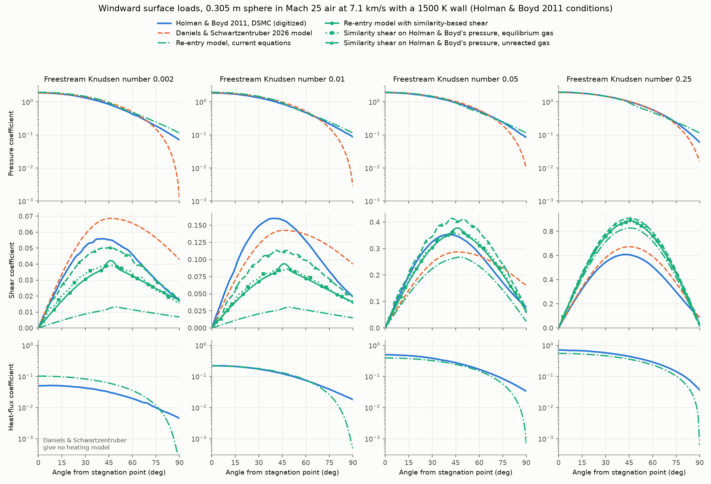
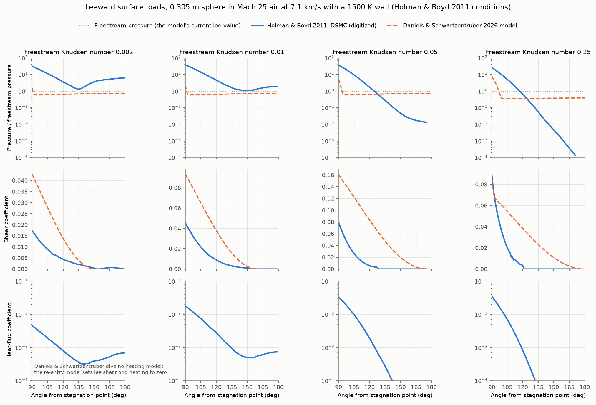
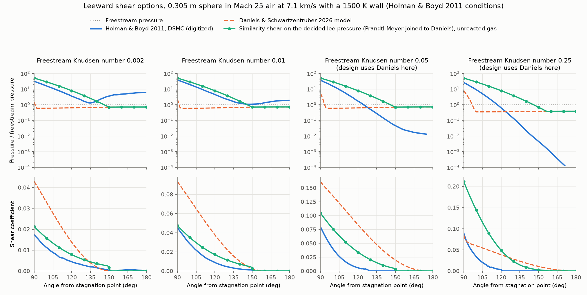
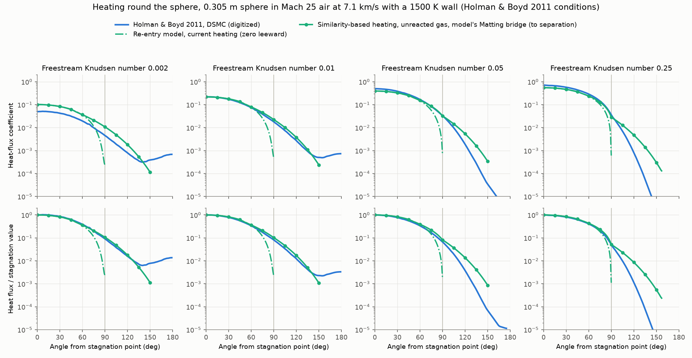

# Shoulder melt loss and interim gas loads: design (DRAFT)

Status, 2026-11-12: Part A (interim gas loads) is decided, through the builder check, and approved by Asha for
building now. Part B (shoulder melt loss) is still being designed: it records what is decided so far and lists the
decisions still open.

Evidence behind this design: the literature report `reports/Film separation at a convex shoulder.md` and its notes in
`research_notes/Film separation at a convex shoulder/` (both at the research root, one level above `Reentry Model/`,
not in git); the reference calculations, digitized data and comparison plots in `analysis/gas_loads/` (see its README),
with the CSVs the tests use in `tests/fixtures/gas_loads/`.

## 1. Why

Slurry (part-solid, part-liquid AA7075) and liquid that run back over the sphere can today only move from column to
column along the surface. On every column-to-column transfer the momentum pointing away from the surface is booked to
the wall (`reentry_model/skyscrapers/skin.py` lines 1236-1239 and 1402-1404; the level-set branch copies the rule in
`levelset/runoff.py`), so metal can never leave the body at or near the shoulder. Asha expects slurry moving fast
enough to leave the sphere there as large drops, a mass-loss route distinct from Girin spraying. The goal is for the
model to track the mass lost this way and to predict the particle sizes it forms, in both the skyscrapers and the
level-set architectures.

Working out that physics exposed two problems with the gas loads it depends on, which Part A fixes first:
- the model's continuum wall shear is about five to six times too low (section A2);
- behind the shoulder the model sets pressure to freestream and shear and heating to zero, while the metal's fate at
  the shoulder depends on exactly those loads.

The gas loads in Part A are an interim, reasonable approximation. Asha intends to replace the analytical
aerothermodynamics with a coupled CFD code later, so the loads must sit behind one replaceable interface (A5).

## 2. Goals, non-goals, anti-goals

Goals
- Interim windward shear that is within about 15 % of DSMC in dense flow, and leeward pressure, shear and heating that
  are a reasonable approximation, all from shared physics usable by both architectures.
- A shoulder melt-loss process that decides, from local fluid mechanics, whether and where metal leaves the surface,
  removes that mass and its heat, and records the drops it forms as a separate source from Girin spraying.

Non-goals
- A plasma-tunnel (cone) configuration. Validation against high-speed video of a melting cone is the eventual target
  (section 5), but the video does not exist yet and no tunnel gas model is built now.
- Replacing the model's thin-air shear blend (SESAM drag table f(Kn)) except where Part A's switch to Daniels and
  Schwartzentruber above Kn 0.05 bypasses it.
- Changing Girin's closure; a separate Girin agent is moving the model away from Girin's assumptions.

Anti-goals
- Counting the same metal twice: metal Girin has already sprayed on the windward side must not be shed again, and the
  element model's rule that sprays everything reaching the last windward row must be replaced, not added to.
- Patching several pressure sources together at the shoulder in a way that creates a spurious pressure-gradient force
  on the film there (see open decision A-1).

## Part A. Interim gas loads

### A1. Conditions used for every comparison

Holman and Boyd (2011, Phys. Fluids 23, 027101): a 0.3048 m sphere in Mach 25 five-species reacting air, freestream
200 K and 7108 m/s, wall at 1500 K, freestream Knudsen numbers 0.002, 0.01, 0.05 and 0.25 (hard-sphere mean free path
over diameter; the model's own Kn_body is about 1.32 times these labels). Their DSMC curves were digitized from the
figures at 1-degree spacing; the digitization reproduces their tabulated drag within 2.4 % and their tabulated nose
heating within 3 % (`analysis/gas_loads/reference/hb_dsmc.csv`). Their rear "pressure coefficient" is read as
p/(0.5 rho U^2): its rear values fall to 3e-5 and 3e-7 in the thin cases, far below p_inf/(0.5 rho U^2) = 0.0023.

Coefficients: Cp = (p - p_inf)/(0.5 rho U^2), C_tau = tau/(0.5 rho U^2), Cq = q/(0.5 rho U^3).

### A2. Windward evidence

Lines: Holman and Boyd DSMC (blue); Daniels and Schwartzentruber 2026, arXiv:2609.28658 (orange dashed); the
re-entry model's current equations, `SurfaceFlow(rarefied_shear="slip", gamma_pm=1.15)` and
`PhysicsHeating(stagnation="fay-riddell", bridging="matting")` (green dash-dot); and three similarity-based shear
variants (green with markers) described in A3.

What the windward plot shows:
- Pressure. The model's modified Newtonian plus Prandtl-Meyer pressure tracks DSMC within about 30 % to 75 degrees
  and is 1.3 to 1.9 times high at 90 degrees (Cp 0.11 against 0.06-0.09). Daniels and Schwartzentruber match DSMC to
  about 70 degrees and then fall toward zero, 5 to 70 times low at 90 degrees, because their hypersonic forebody is
  modified Newtonian by construction (their pressure was validated only at subsonic and low supersonic speeds).
- Shear. The model's continuum shear, mu_e u_e / delta_a (`shared/surface_flow.py:344`), is about 4.5 to 6 times low
  in dense flow (peak C_tau 0.012 against DSMC 0.056 at Kn 0.002). Root cause: the formula spreads the velocity
  linearly over the whole Ranger boundary-layer thickness, which is 3.4 viscous lengths, while the true wall gradient
  is 1.312 edge velocities per viscous length (Homann), and it ignores the cold dense wall gas (Chapman-Rubesin factor
  1.4). Homann times that factor, on the model's own edge state, matches DSMC within 1-7 % from 4 to 20 degrees at
  Kn 0.002 (a scratch check). The post-shock state is not the cause of the
  factor of five; it was included.
- Daniels and Schwartzentruber's shear peak is within 25 % of DSMC in every case, but it decays too slowly: about
  2 to 2.5 times DSMC at 90 degrees for Kn 0.002 to 0.05.
- Heating. The model's stagnation heating is 1.99, 0.99, 0.79 and 0.76 times DSMC (Fay-Riddell, equilibrium, fully
  catalytic), and its Lees angular shape collapses near 90 degrees, 20 to 60 times below DSMC there. Daniels and
  Schwartzentruber have no heating model.

### A3. Windward shear: decided

Decision (Asha, 2026-11-12): use the similarity-based shear below Kn 0.05 and Daniels and Schwartzentruber above it.

Similarity-based shear. Lees (1956) local similarity in Lees-Dorodnitsyn variables with a wall-based xi:
xi = integral of rho_w mu_w u_e r^2 ds, beta = (2 xi / u_e) du_e/dxi, the compressible similar equations
(C f'')' + f f'' + beta (g - f'^2) = 0 and (C g'/Pr)' + f g' = 0 with C = (g/g_w)^(omega - 1), omega 0.7, Pr 0.71,
g the density ratio rho_e/rho with wall value g_w = rho_e / rho_w, and tau_w = rho_w mu_w u_e^2 r f''(0) / sqrt(2 xi).
Reference implementation: `analysis/gas_loads/reference/similarity_shear.py` (passes the Falkner-Skan checks 0.9277,
0.4696, 1.2326 exactly).

Decision (Asha): the edge state for this shear is the unreacted (chemically frozen) post-shock gas: the model's own
Cantera construction with equilibration switched off, so N2 and O2 keep their freestream composition through the
shock and expansion while vibration stays in equilibrium. Evidence: with unreacted gas the similarity shear on Holman
and Boyd's pressure is within about 10 % of DSMC from nose to shoulder at Kn 0.002 (C_tau 0.0185 against 0.0206 at
10 degrees, 0.050 against 0.055 at 45, 0.018 against 0.017 at 90), while equilibrium gas is 25-35 % low. The model's
own pressure and Holman and Boyd's pressure give nearly the same shear, so the pressure is not the issue.

Calls made in this draft (Asha to confirm):
- The unreacted edge state feeds the shear and (by the heating decision in A4) the heating. The wall Knudsen number
  and Girin's closure stay on the equilibrium state.
- f''(0) is precomputed as a table over beta and g_w and interpolated in flight; solving the boundary-value problem per
  patch per step would be too slow.
- The Kn in the switch is the model's own Kn_body (hard-sphere, d = 3.65 angstrom), the quantity the model already
  gates on.
- The windward pressure stays the model's current modified Newtonian plus Prandtl-Meyer at every Kn, because Daniels
  and Schwartzentruber's windward pressure fails near the shoulder.
- Above Kn 0.05, Daniels and Schwartzentruber's shear replaces the model's slip-plus-blend shear entirely (their own
  slip and rarefaction factors apply), which also removes the blend's 45-50 % overshoot at Kn 0.25.

Known limits: at Kn 0.01 the similarity shear is still 30-37 % below DSMC near its peak, the rarefaction effect Holman
and Boyd describe; at exactly Kn 0.05 the similarity solution was the closer of the two at the shoulder (within 7 %,
against Daniels and Schwartzentruber's factor of 2), so the best crossover lies between 0.05 and 0.25. The model's
Newtonian-to-Prandtl-Meyer pressure blend puts a small bump in the similarity shear near 46 degrees.

### A4. Leeward loads

Pressure is plotted as p / p_inf; the grey dotted line is the model's current lee value (freestream).

What the leeward plot shows:
- DSMC pressure falls gradually from 26 to 38 times freestream at 90 degrees. In dense flow (Kn 0.002, 0.01) it
  reaches a minimum of about 1.1 to 1.3 times freestream near 135 to 150 degrees and recovers to 1.9 to 5.9 times
  freestream at the base, where recirculating flow presses on the rear. In thin flow (Kn 0.05, 0.25) the wake is
  almost empty: 0.01 to 0.0001 times freestream at the rear.
- Daniels and Schwartzentruber's pressure drops to about 0.6 times freestream (0.35 at Kn 0.25) by about 93 degrees and
  stays flat: 25 to 33 times below DSMC at 100 degrees, up to about 8 times low at the dense-flow base, and up to about
  1000 times high in the thin-flow rear.
- Daniels and Schwartzentruber's shear decays too slowly: about 3 times DSMC at 100 degrees and 12 to 14 times at
  120 degrees in the thin cases, where DSMC shear is zero beyond about 125-130 degrees.
- DSMC heating behind the shoulder starts at 7-9 % of the nose value at 90 degrees, falls to a floor of 0.2-0.7 % in
  dense flow (rising again toward the base) and to almost nothing in thin flow. The model sets it to zero.

Decision (Asha, 2026-11-12): use Daniels and Schwartzentruber for the leeward pressure, knowing from these plots that
it mispredicts the lee; it is an interim approximation until the CFD coupling replaces it.

Decision (Asha, 2026-11-12), the join at the shoulder: the model's own Prandtl-Meyer expansion continues past
90 degrees (the code currently stops it at 90 degrees and caps it at PM_MAX_DEG) until its pressure falls to Daniels and
Schwartzentruber's lee pressure, and from there the lee pressure is Daniels and Schwartzentruber's. With the model's
gamma_pm this meets at roughly 125 degrees (gamma 1.4) or 150 degrees (gamma 1.15) for the 100 mm sphere at 70 km;
the fall is gradual, as in DSMC, and there is no step at 90 degrees. The pressure fall acts on the film as a
gradient (today the drop at the equator never does). The meeting angle is found per step, not fixed.

Decision (Asha, 2026-11-12), the leeward shear: the same switch as on the windward side. Below Kn 0.05 the similarity
solution (unreacted gas) continues round the body on the joined pressure; once the rising lee pressure stalls the
boundary layer (f''(0) falls to zero) the gas is separated and the shear is zero from there to the base. Above Kn 0.05
the shear is Daniels and Schwartzentruber's.

Evidence (`analysis/gas_loads/plots/leeward_shear_options.py`, `analysis/gas_loads/reference/similarity_lee.py`): with the default
gamma_pm 1.15 the continued expansion meets Daniels and Schwartzentruber at about 150 degrees and the similarity
solution separates at about 151 degrees, matching where DSMC dense-flow shear dies out. From 100 to 120 degrees the
similarity shear is 1.4-1.8 times DSMC at Kn 0.002 and 1.2-1.9 times at 0.01, against 2.9-3.4 and 2.6-4.2 times for
Daniels and Schwartzentruber. In thin flow both are poor (DSMC shear vanishes by about 125 degrees); at Kn 0.25 Daniels
and Schwartzentruber are closer right behind the shoulder (0.95 against 2.4 times DSMC at 90 degrees). Limits: the
joined pressure is 1.3-2 times DSMC from 90 to 130 degrees in dense flow and does not follow DSMC's near-vacuum wake in
thin flow (gamma_pm 1.4 would meet at about 125 degrees and fall faster); local similarity is stretched near
150 degrees, where the acceleration parameter beta reaches about 80, though the shear there is small.

Decision (Asha, 2026-11-12), heating on both sides: the similarity-based heating replaces the current heating
(Fay-Riddell stagnation flux with the Lees shape) round the whole body until the boundary layer separates, and the
heating is zero behind separation. It comes from the same similarity solution as the shear, with the energy equation in
total enthalpy, unreacted gas with real frozen-air properties (Cantera NASA-9 enthalpy, the model's Wilke-Blottner
viscosity, Pr 0.71), q_w = rho_w mu_w u_e r H_e g'(0) / (Pr sqrt(2 xi)), and its stagnation flux takes the place of
Fay-Riddell's as q_c inside the model's existing Matting bridge (n = 1, accommodation 0.8):
q = q_stag [(1 - w) q_sim(theta)/q_sim(0) + w max(cos theta, 0)]. Reference implementation:
`analysis/gas_loads/reference/similarity_heat.py`.

Evidence (`analysis/gas_loads/plots/heating_comparison.py`): in dense flow (Kn 0.002, 0.01) the similarity heating follows the DSMC
shape from the nose to about 135 degrees (10 % of the nose value at 90 degrees, as DSMC), where the current Lees shape is
20-60 times low at 90 degrees because it assumes Newtonian pressure. Its nose value equals the current Fay-Riddell value
in all four cases: twice DSMC at Kn 0.002, within 2 % at 0.01, about 20 % low at 0.05 and 0.25 (open item A-5). Behind
separation DSMC dense-flow heating rises again to 0.3-1.3 % of the nose value from the recirculating flow, which this
design leaves out (zero); in thin flow the similarity heating is 3-40 times DSMC beyond about 110 degrees, where both
are below 1 % of the nose value. Implementation note: the property tables must be smooth (cubic splines); piecewise-
linear tables stop the collocation solver converging, and the cold wall needs a homotopy from a hot wall.

### A4b. Settled after the builder check (2026-11-12, my calls; Asha may overrule)

- One similarity solution, not two: the total-enthalpy form of A4 (`similarity_heat.py`: dissipation, real frozen-air
  enthalpy and viscosity) gives both the shear and the heating, so they share one separation angle. At Kn 0.002 its
  shear differs from the simpler shear-only form of A3 by 6-9 %. Whether it is solved per angle bin each step (with
  continuation along the meridian) or tabulated is the builder's choice, decided by a measured cost; the budget is
  that the load evaluation adds no more than about 2 s to a macro step on the laptop.
- Below the Kn_body 0.05 switch the similarity shear still goes through the model's existing slip factor and, in the
  merged branch (Kn_body 0.01-0.05), the existing SESAM-table blend toward free-molecular shear (non-goal: the blend
  is not replaced below 0.05). The jump in shear at the switch is measured and reported, not smoothed.
- The switch is on the model's own Kn_body (hard-sphere, d = 3.65 angstrom), at 0.05 as written. Kn_body is about
  1.32 times Holman and Boyd's labels, so their "Kn 0.05" case (Kn_body 0.067) falls on Daniels and Schwartzentruber.
- Two edge states are built per step: equilibrium (wall Knudsen number, Girin's closure, as today) and unreacted
  (shear and heating).
- The new loads become the default for sphere flights in both architectures; the current loads stay selectable by
  name so that states saved before this change can resume with the loads they were made with. The droplet stage keeps
  `PhysicsHeating` as it is (its reproduction test must still match to 1e-9; no droplet or wake sweep is re-run).
- The existing `SurfaceFlowResult` fields the level-set stage-3 branch reads (`tau`, `dp_ds` and the others) keep
  their names and meanings, so that branch merges without conflict.

### A5. Replaceable interface

All gas loads (pressure, shear, heating, windward and leeward) are provided through one interface in
`reentry_model/shared/` that takes the freestream, the body state and the surface points and returns the loads, so a
coupled CFD solution can later supply them without touching the code that consumes them. Holman and Boyd's tables are
the natural test data for any provider.

### A6. Acceptance for Part A

Decision (Asha, 2026-11-12, option 1a): the windward pressure stays the model's own, and acceptance is agreement with
the reference calculation, not a tolerance against DSMC.
- Unit: the similarity solver reproduces the Falkner-Skan wall gradients (0.9277, 0.4696, 1.2326) and the cold-wall
  stagnation result of the reference (`similarity_heat.py`: f''(0) 0.5024, g'(0) 0.3313 at a 1500 K wall under the
  Kn 0.002 unreacted stagnation state); any table reproduces direct solves.
- The shared implementation reproduces the reference calculation's shear, heating, pressure and separation angle at
  Holman and Boyd's four conditions (reference outputs committed as test fixtures).
- Known accuracy, recorded in `docs/model_assumptions.md` rather than tested as a limit: with the model's pressure and
  unreacted gas the shear is about 0.75-1.35 times DSMC from 5 to 90 degrees at Kn 0.002 (0.73-0.79 from 5 to
  30 degrees, 0.92-1.04 from 45 to 75, 1.23-1.34 at 90), and about 0.55-1.13 times at Kn 0.01; the heating shape
  follows DSMC to about 135 degrees in dense flow, with the nose value twice DSMC at Kn 0.002 (A-5). The comparison
  plots are regenerated from the model itself.

Decision (Asha, 2026-11-12, option 2a), the mass-centroid leeward rule (`--leeward-test centroid`, the default): the
corners it shelters behind the mass-centroid plane are treated as lying in the separated wake, with the leeward base
pressure (Daniels and Schwartzentruber's) and zero shear and heating, instead of being set to an angle just past
90 degrees (which would now carry shoulder-level loads). The `facing` test gives corners their true-angle loads.
Follow-up (Asha): revisit this shelter rule when the fitted-sphere loading bug discussed earlier is taken up again.
- Every flight result changes intentionally (film speeds, Girin spraying, metal reaching the shoulder); the
  byte-identical comparison baselines are replaced, with old and new results compared side by side.

### A7. Part A open decisions

- A-1 Join at the shoulder: DECIDED (A4), continue Prandtl-Meyer until it meets Daniels and Schwartzentruber.
- A-2 Leeward shear: DECIDED (A4), the same switch as the windward side.
- A-3 Leeward heating: DECIDED (A4), similarity heating to separation, zero behind.
- A-4 Windward heating near the shoulder: DECIDED (A4), the same similarity heating.
- A-5 Nose heating magnitude (deferred, not part of this build): both the similarity and the current Fay-Riddell nose
  heating are twice DSMC at Kn 0.002. The likely cause is chemistry and wall catalysis (energy held in dissociated
  atoms reaches the wall only if they recombine there; DSMC walls are usually non-catalytic). To be settled with the
  post-shock chemistry criterion (equilibrium against unreacted) the shear decision anticipates.

## Part B. Shoulder melt loss

### B1. Physical picture (literature report, sections 2-5)

Two routes, linked:
- Lift-off. The layer leaves where its outward fling over the local curvature beats what holds it on. With M the
  momentum flux per unit width (sum over depth of rho u^2), kappa_flow the surface curvature along the flow, sigma the
  surface tension, Delta_p the gas pressure above the layer minus the pressure of the gas that could get under it,
  and a_n the inward part of the deceleration: lift-off where kappa_flow (M - sigma) > Delta_p + rho a_n h. Curvature
  cancels between fling and capillary hold, so a layer with film Weber number M/sigma below about 0.75 never lifts off
  at any curvature (Owen and Ryley 1985). The near-liquidus slurry recorded in the model (0.23 m/s, 0.83 mm) has a
  film Weber number of at most 0.13 and cannot lift off; fast unsprayed liquid may, aft of the shoulder or at a sharp,
  oxidised, refrozen ridge.
- Arrest and shed. Gas shear drags metal rearward past the shoulder while the deceleration (up to about 10 g) pulls it
  toward the nose; they balance at a depth of shear over (rho times deceleration), about 0.6-1 mm at 10 g. The metal
  stalls into a rim. A liquid rim is capped near Bond number one, thickness sqrt(sigma / (rho a)), about 2 mm at 10 g,
  and breaks into drops about 1.9 times its thickness (Rayleigh-Plateau), so about 2-4 mm: a coarse mode several to
  tens of times larger than Girin drops. Tektite and meteorite arc-jet tests show melt gathering into rims at the edge.
  Rims fill in tens of milliseconds, so shedding is effectively a continuous flux unless rims freeze first.

### B2. Decided

- Purpose: track the mass lost by this route and predict the particle sizes; both architectures.
- Scope: predominantly near-liquidus slurry (908 K liquidus; 0-50 % solid spans 908 to 895.1 K); liquid that escapes
  Girin spraying is covered by the same rule; Girin acts first on the windward side and this process takes only what
  is left.
- Treat the layer as a fluid; compute its Reynolds number and the detachment point, which need not be at 90 degrees.
- Use the local surface curvature, not the sphere's radius (curvature along the flow for the fling, mean curvature
  for capillarity).
- Near-liquidus remelting wrought 7075 flows like a liquid 1.05-1.5 times as viscous with no yield stress, so the
  Weber-number tests apply to it directly.

### B3. Where it plugs in (calls in this draft)

- Skyscrapers: replace the wall-booking of outward momentum at `skin.py` 1236-1239 and 1402-1404 with the lift-off
  test, releasing the excess; add a rim closure for metal gathered above the flowing depth.
- Level set: the same test in `levelset/runoff.py`, with curvature from the level-set field.
- Element surface model: replace "Girin sprays what reaches the last windward row" so metal is not counted twice.
- Shared physics (criteria, rim ceiling, drop size) in `reentry_model/shared/`; bookkeeping (removing mass and
  enthalpy) per architecture.
- Record each release as a new source beside Girin's: drop radius, number, mass, position, angle, release velocity,
  solid fraction, enthalpy, and the route (lift-off or rim).

### B4. Part B open decisions

- B-1 Wetting: bracket lift-off with and without the wetting (teapot) gate, whose thresholds are extrapolated 10 to
  100 times beyond their tests; liquid aluminium does not wet its oxide below about 1273 K (90-97 degrees).
- B-2 Yield stress by metal origin: 10-30 kPa only for refrozen dendritic deposit above its coherency fraction (which
  then cannot shed), none for remelting wrought metal; needs a per-column origin flag.
- B-3 Rim shedding trigger: the Bond-number-one ceiling alone, or also a gas depinning test (critical Weber number about
  14.6 times the contact-angle hysteresis, which is unmeasured for liquid 7075 on its oxide).
- B-4 The pressure "underneath" a lifting layer: the lee pressure from Part A (Daniels and Schwartzentruber, about
  0.35-0.7 times freestream), noting DSMC shows recirculation pressure of several times freestream in dense flow and
  near vacuum in thin flow.
- B-5 What happens to a released drop: recorded at release only, or handed to the existing droplet tools.

## 5. Validation (later)

High-speed video of a cone melting in a plasma wind tunnel (not yet in hand). The model should therefore report what a
video can see: where along the surface metal leaves, rim size, shedding frequency, and drop sizes above camera
resolution. A cone's rim is sharper than the mesh may resolve, so a rule for sub-grid edges will be needed then; in the
tunnel there is no deceleration, so gravity and the gas push set the rim size instead.

## 6. Left to the builder

Numerical details of the f''(0) table (ranges, spacing, interpolation), how xi is integrated on each architecture's
surface, the interface's exact signature, and test organisation, provided the acceptance criteria in A6 hold.
