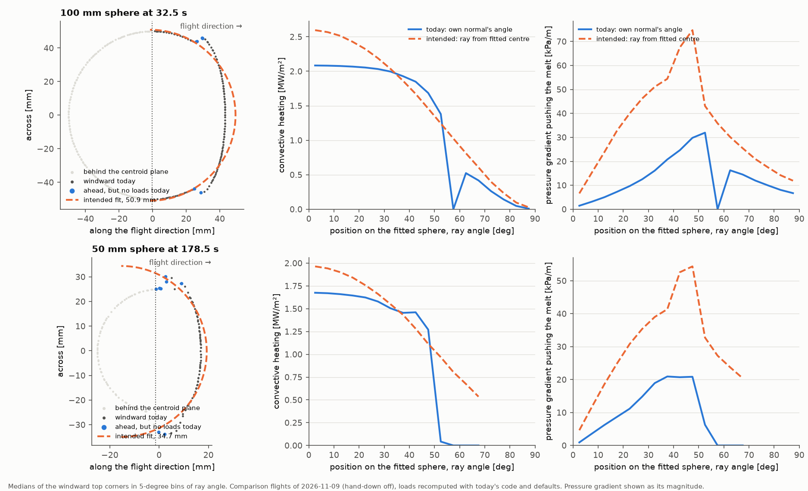
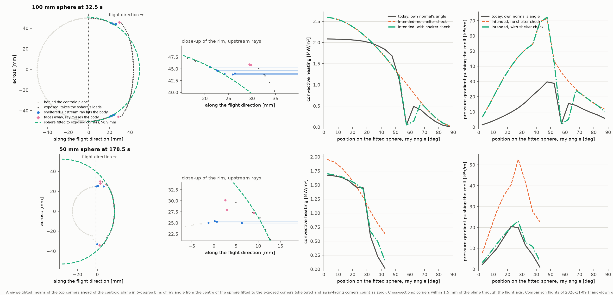
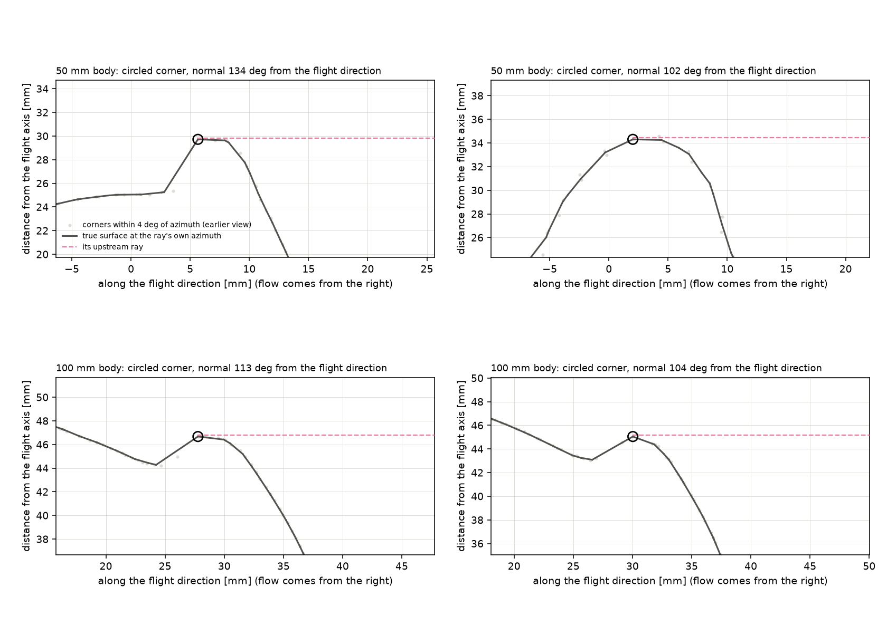

# The skins' windward loads from one fitted sphere, with a shelter test: design

**Status:** the rule was decided by Asha on 2026-11-13. This document awaits her approval. Branch `fitted-sphere-loads`,
cut from main at 4e857e1.

## Why

Asha's intent is that one sphere describes the windward surface the gas sees, and that every exposed top corner takes
the loads that sphere feels at the same place on it.

**What the code does today.** The skins' windward loads are the heating, the surface flow that pushes the melt, and the
spray plan. They read each top corner at its own angle: the angle between the corner's surface normal and the flight
direction (`SkinBody.load_angles`). The sphere is fitted only to the corners whose normals face within 30 degrees of the
flow (`SkinBody._fit_nose`). It contributes only its radius, capped at 1.67 times the windward transverse radius. Its
centre is discarded.

**Why that is wrong for deformed bodies.** On two saved bodies from the comparison flights of 2026-11-09, today's rule
does three things:
- It treats a flattened nose as one large stagnation region. The pressure gradient pushing the melt there comes out 2
  to 5 times weaker than under the intended rule.
- It gives the outer face of a melt rim no loads at all, because its normals turn away from the flow.
- It lets local features of the shape set their own loads.

The investigation, with every number, is in `Reentry Model/output/shape_feedback/report.md` in the main checkout
(git-ignored). Its figures are copied beside this design.

**This is a specification gap, not a coding error.** The code matches the 2026-11-10 fitted-nose design (sub-plan 22
Task 5g) as written. That design treated only the radius as the problem.

## The rule (Asha, 2026-11-13)

1. **Candidates.** The candidates are the top corners ahead of the plane through the body's mass centroid, at right
   angles to the flight direction. This is today's `centroid` test without its condition that the normal face the
   flow.
2. **Shelter.** Each candidate casts one ray:
   - It starts a twentieth of the corner's cell outward along its normal. The cell size is the square root of the
     corner's area.
   - It runs upstream, along the direction of motion.
   - If it crosses any triangle of the top surface (the gas boundary), the corner is sheltered. The corner's own
     triangles count too, as in the level-set test. On both saved bodies, counting or skipping them shelters exactly
     the same corners.
   - A corner whose normal faces away is still exposed if its ray crosses nothing, as at the top of a crest. Asha
     decided this: "Yes, heat them".
3. **The sphere.** Its centre and radius are fitted to the exposed corners (candidates that are not sheltered), by the
   unweighted least squares of `body.fit_sphere`.
4. **The radius cap (Asha: keep it).** The radius the loads read is the smaller of the fitted radius and the flat-face
   bound. The bound is `NOSE_CAP_FACTOR` (1.67) times the windward transverse radius, as today. The angles are still
   measured from the fitted centre.
5. **The angle.** Each exposed corner's load angle is the angle between the flight direction and the ray from the fitted
   centre through the corner. An exposed corner whose ray angle is past 90 degrees is leeward through the angle itself.
6. **The leeward corners.** Sheltered corners and corners behind the plane are leeward, as corners behind the plane are
   today: no heating, no shear and no spraying, through the angle `max(theta, 90 degrees + 1e-6)`.
7. **Who reads it.** Every consumer reads it, through `load_angles` and `nose_radius`, unchanged in their interfaces: the
   heating (`CoupledRun.loads_at`), the surface flow (`flow_forcing`), the spray plan (`girin_plan`'s shear modes and
   its Rayleigh–Taylor mode), and the wet statistics (`windward_corners`).
8. **The direction of the push (my call).** Under this rule, the pressure gradient and the shear on the melt point
   along the fitted sphere's own meridian, away from its stagnation point, laid onto each base's tangent plane. Today
   they point along the meridian of each base normal (`skin.along_meridian`).

   The fitted sphere's meridian is well defined on a flat face, where base normals point almost straight into the flow
   and their small tilts set today's direction. Measured against today's direction:
   - 100 mm body: a median of at most 0.6 degrees, and never more than 5.5 degrees.
   - 50 mm body, beyond 10 degrees from the stagnation point: a median of at most 2.1 degrees.
   - 50 mm body, within 10 degrees of it: a median of 6.2 degrees, with one corner almost reversed.

   `normals` keeps today's direction.

Measured on the saved bodies under this rule:

| | 100 mm sphere, 32.5 s | 50 mm sphere, 178.5 s |
|---|---|---|
| Sheltered corners | 568 of 4,737 | 233 of 1,255 |
| Fitted radius | 50.9 mm | 49.0 mm |
| Body heat input: this rule, then today's | 15.9, then 14.8 kW | 5.8, then 4.7 kW |

Neither body's fit reached the cap: 50.9 mm against 83.8 mm, and 49.0 mm against 58.1 mm.

## Approaches considered

- **Which angle a corner reads.**
  - Its own normal, as today. It needs no fit, but on a deformed body local features set their own loads.
  - The ray from a fitted sphere's centre (chosen). One sphere describes the windward surface, and each corner takes
    its place on it.
- **How to find sheltered corners.**
  - The ray tested against the fitted sphere (rejected). The sphere runs through the middle of the corners, so 52 to
    69 % of the windward corners lie just inside it, and the test would shelter most of the face, nose included.
  - The ray tested against the tops, plus a facing-away check (rejected by Asha). Crest tops that face backwards but
    that nothing shelters would get no loads.
  - The ray tested against the tops alone (chosen). The rays that cross nothing start from the highest point of their
    crest, measured along the exact line the ray follows. A view of every corner within 4 degrees either side merged
    neighbouring lines and made it look otherwise.

- **When to build it, given that the interim gas loads are being built** (branch `interim-gas-loads`, Tasks 1-4 of 8
  committed on 2026-11-13).
  - Before them, merged first. That would change main under their byte-identical check against 4e857e1.
  - Folded into their plan. That would add design work to a build that has already started.
  - After them. That gives no gain, since the work barely overlaps.
  - In parallel, merged after them (chosen by Asha).

  Their provider returns the loads on a sphere as a function of angle (`MeridianLoads.at`), and the caller passes in
  the angle and the radius. This design decides exactly those two inputs. The only shared line is
  `SkinBody.load_angles`, where their Task 7 gives the corners behind the centroid plane pi (the separated wake).

  At the merge (my call), sheltered corners also take pi. An exposed corner whose ray angle is past 90 degrees keeps
  its ray angle, so it takes the provider's lee loads like the fitted sphere's own shoulder. The merge is the plan's
  last task, run once their branch has landed on main.

## The interface (my calls)

- **The option.** `run` and `resume` take `--windward-loads sphere|normals`, `sphere` by default for skin runs.
  `normals` is today's rule exactly, with `--leeward-test` and `--size-feedback` meaning what they mean today. Under
  `sphere`, those two options are refused if given (exit 2), because the rule fixes both. The element model refuses
  the option (exit 2), as it refuses `--geometry-stop`; its own 30-degree cap fit is unchanged.
- **The run name.** It is marked `_windward-normals` for the old rule. The default is unmarked.
- **States saved before the change.** They resume with the rule they were flown with: the class attribute
  `windward_loads = "normals"`, as `leeward_test` and `size_feedback` work today. `resume --windward-loads sphere`
  switches them, and the run JSON records the setting.
- **The library default.** The `SkinBody` constructor defaults to `sphere`, following Asha's instruction for the
  viscosity law that the new physics is the library's default too. Tests whose pinned values belong to the old rule
  name `normals`, as the 14 bridge-law tests name the bridge. The plan re-measures them.
- **The history.** Under `normals` the history is exactly today's: the same columns, with the nose columns carrying
  the 30-degree cap fit. That keeps the old rule byte-identical. Under `sphere`, the existing nose columns carry the
  new fit:
  - `nose_radius_mm` is the radius used;
  - `fitted_nose_radius_mm` is the fit;
  - `nose_bound_mm` is the cap;
  - `nose_cap_points` is the number of exposed corners fitted;
  - `nose_cap_concave` marks a fit with no valid sphere.

  Three new columns follow the leeward ones:
  - `sheltered_corners`, the count;
  - `sphere_centre_mm`, the fitted centre's position along the flight direction from the original centre;
  - `sphere_fit_rms_mm`, the root-mean-square distance of the exposed corners from the sphere.

  A resume that switches the setting adds these three columns to its saved row, or drops them, as the dispersion
  columns are handled.
- **The frames.** Each skin surface frame gains two values per corner, `load_angle_deg` and `sheltered`, so that the
  shelter test can be inspected in ParaView.
- **No valid sphere.** That means fewer than 4 exposed corners, a radius that is not finite and positive, exposed
  corners coplanar to rounding, or a centre on the flow side of the exposed corners' mean point. In that case (my
  call) the shelter test and the exposed set stay as they are. Each exposed corner reads its own normal's angle, and
  the radius is the flat-face bound, or the mesh radius where there is no bound. A flat or dished front is thus heated
  as a flat face heats. The step is marked in `nose_cap_concave`.

## Cost

A plain search over every triangle took 2.5 s on the 100 mm body (9,417 corners, 18,830 triangles). It is built instead
on a grid laid on the plane across the flight direction, so each ray tests only the triangles in its own cell. The target
is under 0.25 s on the 100 mm body (my call), measured on the saved state. Like the centroid plane today
(`_leeward_raw`), the test runs lazily: once per surface refresh, at the first read.

## Verification

1. **The old rule is byte-identical.** `analysis/skyscrapers_port/same_results.py` with `--windward-loads normals`,
   against main at 4e857e1, gives identical results apart from the run names and the new JSON key.
2. **An undeformed sphere.** On the coarse sphere mesh:
   - no corner ahead of the plane is sheltered;
   - the fitted radius is the mesh radius plus the skin's thickness, within 1 %;
   - the centre is within 1 % of the radius of the origin;
   - each load angle is within the faceting of its normal angle (the bound is set in the plan from a measurement).
3. **A synthetic rim** (a sphere with a raised ring of columns):
   - the back of the ring and a band just behind it are sheltered;
   - the crest top is exposed even where its normal faces away;
   - the nose and the far flank are untouched.
4. **The saved bodies.** An analysis script, not a unit test, because the states are outside the repository (1.3 GB
   and 0.26 GB). It reproduces the investigation:
   - 100 mm body: 568 sheltered corners and a 50.9 mm fit;
   - 50 mm body: 233 sheltered corners and a 49.0 mm fit.

   It also measures the test's time.
5. **Resume.** A state saved under `sphere` resumes under `sphere`, an older state resumes under `normals`, and
   `resume --windward-loads` switches and is recorded.

## The level-set design (Asha: change it too)

Section 20.8 of `docs/superpowers/specs/levelset/2026-10-11-level-set-deforming-body-design.md` is amended so the two
architectures share one windward rule:
- Windward patches are those ahead of the mass-centroid plane whose shadow ray does not re-enter metal. Patches facing
  away are no longer leeward for that reason alone.
- Their loads are those of the sphere fitted to them, at the ray angle from its centre, with the flat-face cap.
- The parity switch `--leeward` gains a third value, `sphere`, for this rule, and it becomes the default (my call).
  `shadow` and `centroid` stay as they are for comparison.
- Sections 20.10, 20.11 (item 5) and 20.14 are updated with it, so the parity flights pair the level set's
  `--leeward sphere` with the skyscrapers' `--windward-loads sphere`.

The level set builds this in its own stage 3 work. This branch changes only the design text, so the blocked Task 11 of
`levelset-stage3` is not disturbed.

## Documents to update with the build

- `docs/model_assumptions.md`: a new section on the skins' windward loads. It covers the fitted sphere, the shelter
  test, its straight-line (Newtonian) shadow, which leaves out reattachment heating behind a step, and the
  under-resolved back slope next to a heated crest. The interim gas loads also add a section, so the numbers are
  settled at the merge.
- The root `README.md`'s option list.
- `Reentry Model/CLAUDE.md`'s description of the skins.

## Left to the builder

- The grid's cell size and layout.
- The synthetic rim's exact geometry.
- The tolerance on the undeformed sphere's angles, measured first.
- Internal names.
