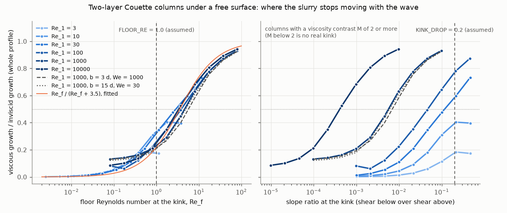
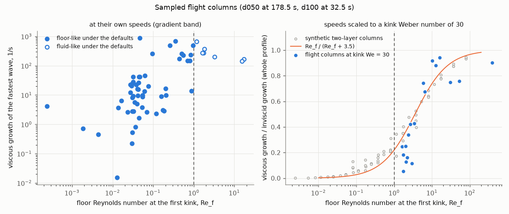

# The viscous check of the floor test: what an Orr–Sommerfeld solver says about FLOOR_RE and KINK_DROP

Task 10 of the kinked-profile dispersion plan (the spec's stage 6), 2026-11-12, branch `kinked-dispersion`. Analysis
only: no model code was changed, and neither constant was changed.

## 1. What you asked for, and whether it is done

You asked for an offline viscous check of the two constants that the new profile path uses to decide where the melt's
gradient instability (Girin's mode, driven by the kink in the speed profile) can grow; this was your decision 4 of
2026-11-11. The first constant is `FLOOR_RE`, the threshold of the floor Reynolds number below which the slurry under a
kink is treated as a rigid floor; it is 1.0 today. The floor Reynolds number is
Re_f = |u_top − u_kink| d / (1.225 ν_below): the speed jump between the surface and the kink, times the kink's depth d,
over the slurry's kinematic viscosity just below the kink times Girin's fastest wavenumber-depth product 1.225. It
compares how fast the wave carries momentum along with how fast the slurry's viscosity spreads it. The second constant is
`KINK_DROP`, the largest ratio of the shear rate below a breakpoint to the shear rate above it (the slope ratio) for that
breakpoint to count as a kink, a candidate floor, at all; it is 0.2 today, a five-fold drop. Both were labelled "assumed
until stage 6". The check was to be an Orr–Sommerfeld solver (the linear stability equation of a viscous shear flow) for
the whole melt column, validated against three published results, run on sampled flight columns and on synthetic columns
across a floor Reynolds number of 1, and used to recommend values, with the decision left to you.

It is done, with four concerns, listed here so that they are not buried. First, Hooper and Boyd's formula as our
research notes transcribe it has its viscosity ratio upside down; the solver matches the paper's own definition to
within 0.02 to 4.7 percent, and the notes' version is wrong by a factor of the viscosity ratio cubed (section 3.2).
Second, the two "earlier" saved states the brief named (d050 at 170.5 s and d100 at 22.0 s) have no flowing top cells,
so the flight sample covers two flight times, d050 at 178.5 s and d100 at 32.5 s, each from three flights saved at that
time (section 3.4). Third, the flight columns with their speeds scaled up were solved at four wavenumbers each, not by
a full search, because one solve of such a column takes up to three minutes; in eight of eighteen the fastest of the four
lay at an end of the set, so their viscous growth may be somewhat underestimated (section 3.4). Fourth, Albert and
Charru (2000), which the brief asked me to read first if it could be obtained, is not available as an open copy; one web
search found only bibliographic records (European Journal of Mechanics B 19, 229–252,
doi 10.1016/S0997-7546(00)00109-6), so nothing in the validations was changed by it.

## 2. What was found, in plain language

**The slurry does not switch from fluid to floor at one value.** As the slurry under a kink becomes more viscous, the
growth of the gradient instability does not drop to zero at a floor Reynolds number of 1. It falls smoothly. It is half
of the inviscid value (the value the broken-line solver gives when the slurry moves freely with the wave) at a floor
Reynolds number of about 3.5, a quarter at about 1, and a tenth at about 0.3. In the idealized two-layer columns this
curve is the same whether the top layer's own Reynolds number is 30 or 10,000, whether the slurry is 3 or 15 times as
deep as the top layer, and whether the Weber number is 30 or 1,000. That collapse is the main result: the floor Reynolds
number is the right variable, as the spec's scaling argument said, but a threshold of 1 sits on the floor side of the
transition, not at its middle, and no single threshold can represent a transition spread over two decades.

**In the flight columns the same curve holds, and the profile path's viscous gate, not the floor test, decides.** With
their speeds scaled until the gradient mode exists, the viscous growth of eighteen sampled flight columns follows the
same curve to within about 0.14 of the inviscid growth on average. All eighteen are fluid-like under the present
`FLOOR_RE`, yet the profile path predicts no gradient-mode growth in twelve of them, because its viscous gate (growth must
exceed twice the layer's effective kinematic viscosity times the wavenumber squared) uses the effective viscosity of the
whole layer down to the rigid front, which the slurry dominates. In those twelve the viscous solver keeps between 5 and
74 percent of the inviscid growth, e-folding times of microseconds to milliseconds.

**Raising `FLOOR_RE` alone would not help the flight columns.** At 3.5 the wall moves up to the bridge's base in about
half the scaled d050 columns, but the bridge above it is itself curved, so its inviscid growth is still about 95 percent
of the whole profile's, and four columns would then spray at nearly the full inviscid growth where the viscous solver
says a quarter to two fifths. Replacing the switch (and the gate, for this mode) by a smooth factor, the floor Reynolds
number over itself plus 3.5, matches the viscous solver far better than any threshold, on both the idealized and the
flight columns.

**`KINK_DROP` does not matter in idealized columns, and the data cannot separate 0.2 from 0.5 in the flight columns.**
Where the shear stress is continuous across a kink, the slope ratio is the inverse of the viscosity ratio, and every kink
that is floor-like has a slope ratio far below 0.2, so any value from 0.05 to 1 gives the same verdict on every synthetic
column. In the flight columns `KINK_DROP` moves the walls a great deal (raising it to 0.5 would move 46 of the 69 sampled
walls closer to the surface), but on the eighteen scaled columns it changes no verdict at the present `FLOOR_RE`.

**At their own speeds the flight columns do not grow by Girin's mode, as the profile path says, but the viscous solver
finds a slower instability of another kind.** Surface tension holds the gradient mode back at the flights' speeds
(the Weber number of the layer above the kink has a median of 0.0095, against a threshold of 3), and the profile path
sprays from no sampled column. The viscous solver nevertheless finds a growing wave in all 69 columns: a short wave that
lives inside the bridge's viscosity gradient, growing at a median of 6 to 15 per second in the d050 states and about 200
per second in the d100 states. It is not an artefact of the cells, but whether it can deform the surface enough to spray is
not known (section 3.4).

## 3. The evidence

### 3.1 The solver

The solver is `analysis/kinked_dispersion/orr_sommerfeld.py`; its entry point is
`growth_rate(k, y, U, mu, rho, sigma, top="free")`, which returns the complex wave speed c (metres per second) of the
most unstable wave of wavenumber k (per metre), whose growth rate is k times the imaginary part of c (per second). The
column is the skins' own: its flowing cells from the top, each with its own viscosity and density, the bottom face of
the last flowing cell being a no-slip wall, as in the skins' momentum step. The base speed inside each cell is straight
in each half-cell. The speed at a face between two cells is found as the skins find it, by requiring the shear stress to
be the same on both sides of the face; the surface speed is extrapolated from the top two cell centres, as the
straight-segment fit does. The kink this leaves at each cell's centre is where the skins' finite volumes lump the push
(the pressure gradient and the deceleration) that bends the profile.

At a face where the viscosity or density changes, the disturbance must keep velocity and both stresses continuous across
the displaced face. At a kink inside uniform fluid the solver uses the Orr–Sommerfeld equation itself. At the free
surface it uses zero tangential stress, the kinematic condition and the normal-stress condition with a surface tension
of 0.80 newtons per metre; with no viscosity these reduce exactly to the broken-line solver's conditions. Gravity, the
deceleration and the gas's own disturbance are left out, as in Girin's theory and the broken-line solver, and the
disturbance sees each cell's viscosity at its base shear rate, as if the melt were Newtonian. Each cell is discretized
with Chebyshev polynomials, with the stream function and its vorticity both as unknowns, so that no fourth derivative is
formed: an earlier version that formed it lost up to 0.4 percent of Girin's growth to round-off at a Reynolds number of
100,000, which the second-order form removed. The eigenvalues are found by a shift-and-invert transform about a point
above the unstable region, which keeps them accurate although the problem's matrices are badly conditioned (inverting
the matrix directly lost 1 percent of a growth and reversed one validation's sign); on long flight columns the same
transform is solved by ARPACK, an iterative method, with a check that it reached far enough from the shift. Spurious
eigenvalues are excluded twice: any growth faster than twice the column's speed range is discarded, and the chosen
eigenvalue's eigenfunction must be resolved, which means that its last two Chebyshev coefficients in every cell are below
a thousandth of its largest.

The surface condition contains one modelling choice that the papers do not settle. When the surface tilts, the gas's
base shear stress can be taken to act as a fluid's stress (then the tilt adds nothing, as at every internal face; this is
the default) or as a pull along the tangent only (then the normal stress gains a term of relative size one over the
Reynolds number). Switching between them changes the gradient mode's growth by less than 1 percent and the flight
columns' own-speed modes not at all, and changes one slow mode of a uniform film with no kink by a factor of five
(section 3.3), so the choice does not affect the recommendations.

### 3.2 Validations

Every validation in the table below is in `tests/test_kinked_dispersion_orr_sommerfeld.py`, and every value was the
same at doubled resolution to at least six digits. The table compares the solver with each reference on the same
quantity; it shows that the solver reproduces each one well inside the 5 percent tolerance, the largest difference being
one of Hooper and Boyd's cases, where their asymptotic formula itself is least accurate.

| Check | Reference value | Solver | Difference |
|---|---|---|---|
| Damped capillary wave on deep liquid at rest (Lamb's exact relation), wave speed | 0.957637 − 0.153018 i | the same to 13 digits | 1.2 × 10⁻¹³ relative |
| Girin's profile, Reynolds number 10⁴, growth at the broken line's fastest wavenumber (surface speeds per layer depth) | 0.24690 | 0.24685 | −0.020 % |
| Girin's profile, Reynolds number 10⁵, the same | 0.24690 | 0.24689 | −0.0026 % |
| Girin's profile, fastest wave over all wavenumbers, Reynolds number 10⁴: growth, and its wavenumber times the layer depth | 0.24690 at 1.2259 | 0.24685 at 1.2263 | −0.020 % and +0.036 % |
| Girin's profile, fastest wave over all wavenumbers, Reynolds number 10⁵ | 0.24690 at 1.2259 | 0.24689 at 1.2259 | −0.0026 % and 0 |
| Hooper and Boyd, short-wave parameter 5, viscosity ratio 0.5 (growth in units of the lower fluid's shear rate) | 1.6667 × 10⁻³ | 1.6610 × 10⁻³ | −0.34 % |
| Hooper and Boyd, parameter 5, ratio 2 | 1.3333 × 10⁻² | 1.2708 × 10⁻² | −4.69 % |
| Hooper and Boyd, parameter 10, ratio 0.5 | 4.1667 × 10⁻⁴ | 4.1658 × 10⁻⁴ | −0.022 % |
| Hooper and Boyd, parameter 10, ratio 2 | 3.3333 × 10⁻³ | 3.3219 × 10⁻³ | −0.34 % |
| Charru and Hinch, thin lower layer the more viscous: sign of the long-wave growth, and Yih's wave speed | unstable; 0.1817 | unstable; 0.1840 | +1.25 % |
| Thin lower layer the less viscous | stable; −0.1606 | stable; −0.1604 | −0.14 % |
| Thin upper layer the more viscous | unstable; −0.02271 | unstable; −0.02271 | below 0.01 % |
| Thin upper layer the less viscous | stable; 0.08032 | stable; 0.08031 | −0.01 % |

Some of these numbers need their context. On Girin's profile (a straight shear layer over liquid at rest, here with a
wall twelve layer depths down and a Weber number of 10,000, compared with the broken-line solver on the same geometry)
the viscous growth differs from the inviscid one by two parts in ten thousand at a Reynolds number (surface speed times
layer depth over kinematic viscosity) of ten thousand, and by eight times less at a hundred thousand, as a correction
proportional to one over the Reynolds number should; the brief's criterion, "within 5 percent, with a smaller error at
10⁵", is met with a wide margin. For Hooper and Boyd the reference is their Eq. 15: the growth rate equals the lower
fluid's shear rate times m(1 − m)²/[2(1 + m)] divided by the square of the short-wave parameter (the wavenumber times the
square root of the lower fluid's kinematic viscosity over its shear rate), with m the lower fluid's viscosity over the
upper fluid's. The research notes (`fulltext_viscous_papers_read.md`, lines 34 and 37, which the brief quotes) define m
the other way round, as the upper fluid's over the lower's; the paper's tangential-stress condition (its Eq. 5c) and its
sentence "suppose m < 1, i.e. the lower fluid is the less viscous" both fix it as I use it. With the notes' definition the
formula is wrong by a factor of m cubed, 8 for m of 0.5. The remaining errors fall as the fourth power of the short-wave
parameter, which is the truncation of their asymptotic series, not a solver error: the case at parameter 5 and ratio 2 is
the mirror image of a case at parameter 2.5 and ratio 0.5. Charru and Hinch's rule, "stable if the thinner layer is the
less viscous, and unstable otherwise", holds in all four arrangements, and the wave speed matches Yih's leading-order
formula (their Appendix C), measured relative to the interface's speed in units of the lower layer's shear rate times its
depth. A further test checks that the shift-and-invert and ARPACK solutions equal scipy's QZ algorithm on the same
problem to a billionth of the speed scale.

### 3.3 Synthetic two-layer columns

The synthetic columns isolate the floor question. Each has a top layer of depth d over a slurry down to a wall at
depth b, under a free surface, with the shear stress continuous at the kink (a two-layer Couette column). In the top
layer's units (its depth, its velocity jump and its density all 1) a column is fixed by four numbers: the top layer's
Reynolds number Re_1 (its velocity jump times its depth over its kinematic viscosity), the slurry's viscosity over the
top layer's, M, the depth ratio b over d, and the Weber number (density times velocity jump squared times depth over
surface tension). The slope ratio at the kink is then 1 over M, and the floor Reynolds number is Re_1 over 1.225 M; a test
pins that this is what the profile path's own `dispersion.floor_reynolds` computes on the same column. The main grid has
b = 15 d, as in the d050 thick columns (830 micrometres of flowing depth under a 55-micrometre bridge), a Weber number of
1,000, and Re_1 of 3, 10, 30, 100, 1,000 and 10,000, each with ten values of M spanning three decades so that the floor
Reynolds number runs from about 80 down to about 0.08; a shallow slurry (b = 3 d) and a Weber number of 30 were run at
Re_1 = 1,000 as sensitivities. All 80 cases took 222 seconds on four processes.

The left panel shows the main result: plotted against the floor Reynolds number, the viscous growth over the inviscid
growth falls along one curve for every top layer with Re_1 of 30 or more and for both sensitivities; the right panel
shows that against the slope ratio the same data do not collapse at all. The one-parameter curve Re_f / (Re_f + c),
fitted over floor Reynolds numbers from 0.3 to 80, gives c = 3.5, with a root-mean-square difference of 0.045 and a
largest difference of 0.10 over 28 columns. The table below gives, for each series, the floor Reynolds number at which
the viscous growth falls to half the inviscid, and the share kept at two lower values; it shows that the half-way point
lies between 2.9 and 5.7 in every series with a nearly inviscid top layer, and that a fifth to a third of the growth
survives at the present threshold of 1.

| Series | Re_f where half the growth is left | Share left at Re_f = 1 | Share left at Re_f = 0.3 |
|---|---|---|---|
| Re_1 = 30 | 2.9 | 0.32 | 0.13 |
| Re_1 = 100 | 3.8 | 0.25 | 0.10 |
| Re_1 = 1,000 | 4.6 | 0.23 | 0.16 |
| Re_1 = 10,000 | 3.3 | 0.25 | 0.13 |
| Re_1 = 1,000, slurry 3 d deep | 5.7 | 0.21 | 0.15 |
| Re_1 = 1,000, Weber number 30 | 4.9 | 0.20 | 0.14 |

Two features of the curve need explaining. Below a floor Reynolds number of about 0.3, the series with a moderately
viscous top layer (Re_1 of 3 to 100) keep falling in proportion to the floor Reynolds number, at about half of it (for
example to 0.013 of the inviscid growth at a floor Reynolds number of 0.025), which is what one expects if the wave
survives only through the slurry's small motion. The series with Re_1 of 1,000 and 10,000 instead level off at 0.13 and
0.09 of the inviscid growth: there the slurry is effectively rigid, and what remains is a slow viscous mode of the
straight top film itself, which the inviscid theory calls stable (Ghosh's result for a straight film on a wall); it grows
at 0.021 to 0.035 velocity jumps per layer depth, a tenth of Girin's mode, and the surface-condition choice of
section 3.1 changes it by about 7 percent. A third, separate mode appears in a uniform film with no kink at all, at 0.013
times the shear rate; it depends on the surface-condition choice by a factor of five, so I do not rely on it.

The binary floor test can be scored against the viscous solver on these columns, calling the gradient mode "alive" where
it keeps at least half its inviscid growth. On the 57 main-grid columns with a positive inviscid growth, and with the gate
as the profile path applies it, the test with `FLOOR_RE` = 1 agrees with the viscous verdict on 52, with 3 on 54, with
10 on 51 and with 0.3 on 48; its mean error in growth, as a share of the inviscid growth, is 0.21, 0.20, 0.21 and 0.25.
No threshold does much better than 0.2, because the transition it replaces is spread over two decades. The smooth factor
Re_f / (Re_f + 3.5) applied to the inviscid growth, with no gate, has a mean error of 0.05 on the same columns. `KINK_DROP`
from 0.05 to 1 changes none of these numbers. The gate also matters here: in the series with Re_1 of 3 and 10 it removes
the mode in every column, and with Re_1 of 30 and 100 in eight and six of nine, although in the columns it removes the
viscous solver keeps up to 18, 40, 60 and 49 percent of the inviscid growth in those four series.

### 3.4 Flight columns

The 69 flight columns come from six saved states. From d050 at 178.5 s: the Task 4 fixture's 36 columns (24 of the
spec's thick set, 6 plug columns and 6 others, from the hand-down-off flight) and 8 and 7 more, sampled the same way, from
the parts-melting comparison flight and the spread-60 flight saved at the same time. From d100 at 32.5 s: 6 columns from
each of the three flights saved then (hand-down off, parts-melting and spread-60), all "other" columns, because at that
time no column falls in the thick set or is a plug.
The snapshot states the brief named, d050 at 170.5 s and d100 at 22.0 s, have no flowing top cells. The sampled columns
are committed (`flight_columns.npz`, 0.27 MB), so the sweep needs no saved state. Every column was run at its own speeds,
and every fourth (18 columns) also with all its speeds scaled up until the Weber number of the layer above its first kink
reached 30, a factor of 14 to 930, as a what-if for the faster shear that hard deceleration would bring; the cells'
viscosities were held fixed although the slurry would thin under faster shear, which would raise the floor Reynolds
number further.

**At their own speeds.** Sixty-two of the 69 columns have a kink; their floor Reynolds numbers have a median of 0.050
(the middle 80 percent between 0.024 and 1.15) and their slope ratios a median of 0.045, so 55 of the 69 are floor-like
under the defaults. The Weber number of the layer above the kink has a median of 0.0095 and a largest value of 1.9,
below the threshold of 3 at which the inviscid gradient mode first exists, so the profile path sprays from none of the
columns (the inviscid growth on the whole profile is positive in 7 columns, and the cut and the gate remove it in all
seven). A useful number for the future is the floor Reynolds number each column would have when its speeds have risen
enough to reach the Weber threshold of 3: it has a median of 0.70 to 2.5 in the d050 states and 7.4 to 8.2 in the d100
states. By the curve of section 3.3, a d050 column would keep a sixth to two fifths of the inviscid growth when the mode
first appears, so the floor matters there; a d100 column would keep about seven tenths, so the floor hardly matters.

The viscous solver nevertheless finds a growing wave in every one of the 69 columns at their own speeds. The table
below compares the growth by state; it shows that the d100 columns grow 13 to 38 times faster than the d050 ones, at growth
rates that would e-fold within about five milliseconds.

| State | Columns | Viscous growth, median (per second) | Middle half (per second) | Wavenumber times kink depth, median | Wave speed over surface speed, median |
|---|---|---|---|---|---|
| d050 fixture, 178.5 s | 36 | 8.6 | 2.7 to 21 | 8.8 | 0.62 |
| d050 parts-melting, 178.5 s | 8 | 15 | 6.8 to 95 | 4.3 | 0.63 |
| d050 spread-60, 178.5 s | 7 | 5.7 | 0.37 to 11 | 6.7 | 0.48 |
| d100 hand-down off, 32.5 s | 6 | 200 | 155 to 333 | 7.2 | 0.29 |
| d100 parts-melting, 32.5 s | 6 | 218 | 180 to 263 | 7.1 | 0.32 |
| d100 spread-60, 32.5 s | 6 | 204 | 143 to 268 | 7.4 | 0.29 |

These are short waves, with a wavelength of about 0.9 of the kink's depth (wavenumber times depth about 7), travelling at
a speed found inside the bridge, not at the surface. Four checks say what they are. They are not an artefact of the stepped viscosity: when every cell is
split into four with the viscosity interpolated between neighbours, so that the steps are four times smaller, the growth
of the three fastest d100 columns falls by about a fifth and converges (from 688 to 565 to 531, from 664 to 579 to 557,
and from 486 to 423 to 409 per second). They do not depend on the surface condition (identical growth with either
closure) or on surface tension (doubling it changes 688 per second to 688). The fastest of all, in the d050 fixture
(889 per second), is different: a long wave at the band's end, faster than the surface, which doubling the surface
tension slows to 677 per second. So within the solver's assumptions these are genuine viscous instabilities of the
bridge's viscosity gradient, of the family Hooper and Boyd found at a single viscosity jump. They are outside Girin's
theory and outside the profile path, which is inviscid. What is not known is whether they can spray: their wave travels
at a depth inside the bridge, and the solver gives growth, not the surface amplitude at which crests would break.

**At speeds scaled to a kink Weber number of 30.**

The left panel shows the own-speed growth just described against the floor Reynolds number (the seven columns without a
kink are not drawn). The right panel is the test of the floor law on real profiles: each blue point is a scaled flight
column's viscous growth over its inviscid growth on the whole profile, over the synthetic columns (grey) and the fitted
curve. The flight points follow the curve: the mean difference is 0.14 of the inviscid growth, and on the verdict ("keeps
at least half its growth") the curve agrees with the viscous solver in all 18 columns. The points well below the curve near
a floor Reynolds number of 2 are mostly the d050 columns whose fastest wave lay at an end of the four wavenumbers tried
(eight of the 18 did), so their true growth may be somewhat higher.

All 18 scaled columns are fluid-like under the defaults (floor Reynolds numbers from 1.6 to 394, median 3.2). In the
six whose layer above the wall is not dominated by slurry (the five d100 columns and one d050 parts-melting column) the
gate passes the mode and the profile path's growth is the inviscid one, against a viscous 75 to 94 percent of it. In
the other twelve, all d050 columns, the gate's damping is 2 to 29 times the growth, so the profile path predicts no
gradient-mode growth, while the viscous solver keeps 5 to 74 percent of the inviscid growth, between 113 and 340,000 per
second. A gate computed over the layer above the first kink instead, which I tried as the obvious repair, is worse: it
passes the mode where the viscous growth is small and gives a mean error of 0.34.

The candidate constants were scored on these 18 columns in the same way as on the synthetic ones. The table below
compares the profile path as it is with two alternatives; it shows that raising `FLOOR_RE` to 3.5 makes the flight
verdicts worse under the present gate, that `KINK_DROP` of 0.5 changes nothing at the present `FLOOR_RE`, and that the
smooth factor is the best of all.

| Variant (with the present gate unless stated) | Verdicts agreeing with the viscous solver | Mean error over the inviscid growth | Floor-like columns |
|---|---|---|---|
| FLOOR_RE 1.0, KINK_DROP 0.2 (today) | 16 of 18 | 0.26 | 0 |
| FLOOR_RE 1.0, KINK_DROP 0.5 | 16 of 18 | 0.26 | 2 |
| FLOOR_RE 3.5, KINK_DROP 0.2 | 12 of 18 | 0.33 | 10 |
| FLOOR_RE 3.5, KINK_DROP 0.5, without the gate | 13 of 18 | 0.32 | 10 |
| Smooth factor Re_f / (Re_f + 3.5) on the whole profile's growth, no gate, no wall | 18 of 18 | 0.14 | none needed |

Why does a higher threshold do worse here? At 3.5 the wall of eight d050 columns moves from the rigid front, 750 to
7,400 micrometres down, to the bridge's base, 15 to 185 micrometres down. The bridge above that wall is itself curved, so
the inviscid growth of the profile above it is still 94 to 97 percent of the whole profile's in five of them; and the gate,
now computed over the thin bridge alone, lets four of them through at that growth, where the viscous solver says 25 to 42
percent. The floor test was designed for a straight runny layer over a kink; in the flight columns the runny layer is
curved, and the curvature alone carries most of the instability.

### 3.5 Resolution and run time

Resolution was checked by doubling every region's Chebyshev degree and solving again at the same wavenumber. Every
validation gave the same value to at least six digits. In the sweeps, four synthetic columns (one each from Re_1 of 3,
30, 100 and 10,000) changed their growth by at most three parts in a hundred billion, and seven flight columns (six at
their own speeds, spread through the list, and the smallest scaled column) by at most six parts in a million, the
largest change being in the slowest-growing column checked (0.37 per second); the wave speed moved by at most a hundred
millionth of the surface speed. The two largest scaled columns could not be checked: at doubled resolution each needs a
dense solve of more than ten thousand unknowns, and one ran for more than 25 minutes without finishing, so I stopped it.
A unit-tier test also re-solves a fixture column at doubled resolution.

The extraction of the 69 flight columns, loading each saved state once, took 41 seconds. The synthetic sweep's 80
columns took 222 seconds on four processes. The flight sweep's 87 cases (69 at their own speeds and 18 scaled) took 27
minutes on four processes, 6,452 process-seconds in all, on a machine shared with other jobs; one own-speed column takes
from half a minute to six minutes, and one scaled solve up to three minutes. The resolution re-solves took 3 and 23
seconds.

## 4. What it means for the research

The floor test's physics is right but its form is not. The floor Reynolds number does decide how much of Girin's growth
survives a viscous slurry, on idealized columns and on real ones, so the spec's scaling argument is confirmed as the
right variable. But the slurry stops moving with the wave gradually, over two decades of that number, so a switch at any
value misjudges the growth by about a fifth of the inviscid value on average, and at 1.0 the switch sits where a quarter
of the growth still survives.

For the flights so far this changes nothing that has been sprayed: at the slip-regime speeds of d050 at 178.5 s and d100
at 32.5 s surface tension holds the gradient mode back in every sampled column, with or without the floor. It matters
for the phase you expect to spray, under hard deceleration. There, in d050-like columns, the mode first appears while
the slurry is half-way through the transition (a floor Reynolds number of about 0.7 to 2.5 at the Weber threshold), so
the floor will cut the growth to between a sixth and two fifths, not to zero; in d100-like columns it hardly matters. And
in d050-like columns the profile path's viscous gate, not the floor test, is what currently decides whether the mode
sprays: it removes the mode altogether in the cases where the viscous solver keeps a quarter to three quarters of it.

The own-speed modes inside the bridge are a separate question that this check opens rather than answers. If they could
break the surface they would be a spraying mechanism the model does not have, active already in the slip regime, at
growth rates of hundreds per second in the d100 columns; if they only stir the bridge they matter for heat and mixing,
not for droplets.

## 5. What you need to decide

**`FLOOR_RE`.** There are three options. The first is to keep 1.0. Nothing changes in any run; columns with a floor
Reynolds number between 1 and about 3.5 keep being treated as fluid (their full inviscid growth) although the viscous
growth is a fifth to a half of it, and columns below 1 as floors (no gradient growth) although a tenth to a quarter
survives. The second is to raise it to 3.5, the half-way point of the idealized columns (2.9 to 5.7 across all series).
At the flights' own speeds this makes five more of the 69 sampled columns floor-like (60 instead of 55) and changes no
spraying, since the mode is held back by surface tension; under hard deceleration it moves the wall to the bridge's base
in about half the d050 columns, and with the present gate it would let four of eighteen scaled columns spray at nearly
the full inviscid growth where the viscous answer is a third, so the flight verdicts get worse (12 of 18 agreeing instead
of 16). The third is to replace the switch, for the gradient mode's growth, by the factor Re_f / (Re_f + 3.5) applied to
the inviscid growth on the whole profile, with Re_f at the first kink, and to drop the viscous gate for that mode. That
is a change to the model, not a constant: it needs a spec amendment and code in `dispersion`, `melt_profile` and `spray`,
the wall would still be needed for the release depth and for the gas-driven mode's film depth, and the 3.5 rests on these
columns alone. It matches the viscous solver best, with a mean error of 0.05 on the idealized columns (against 0.20 to
0.28 for the thresholds tried, 0.1 to 30) and 0.14 on the flight columns with all 18 verdicts right (against 0.26 and 16 today).

I recommend the third option, and keeping `FLOOR_RE` at 1.0 until it is built, because raising the threshold on its own
makes the flight columns' verdicts worse under the present gate.

**`KINK_DROP`.** I recommend keeping 0.2. It changes no verdict in the idealized columns, and none on the scaled flight
columns at the present `FLOOR_RE`. Its effect is on where the walls land: at the flights' own speeds, 0.5 would move 46
of the 69 sampled walls closer to the surface (median depth from 74 to 37 micrometres) and 0.1 would make 23 floor-like
columns fluid-like. That moves the release depth of the gradient mode and the film depth of the gas-driven mode, but no
viscous result here says which walls are right, because at those speeds the gradient mode does not exist. If you take
the third option above, `KINK_DROP` keeps only that role.

**The viscous gate.** This was not one of the two constants, but it decides the outcome in the d050 columns under hard
deceleration. The options are to keep it as it is (it removes the mode in 12 of 18 scaled columns where the viscous
solver keeps 5 to 74 percent), to compute its effective viscosity over the layer above the first kink (which I tested
and which is worse, a mean error of 0.34), or to drop it for the gradient mode as part of the third option above. I
recommend the last.

**The modes inside the bridge.** You may want a follow-up that computes the surface amplitude of these modes relative to
their internal amplitude, and their sensitivity to the slurry's shear-thinning and to the deceleration's normal
acceleration, before deciding whether they need a place in the spray model. Leaving them as a noted open item costs
nothing now.

## 6. What was verified, what was assumed, and what is unknown

Verified: the solver against Lamb's capillary wave, Girin's profile at two Reynolds numbers, Hooper and Boyd's
short-wave growth and Charru and Hinch's sign rule with Yih's wave speed, each well inside 5 percent, and against scipy's
QZ algorithm; every validation, four synthetic cases and the sampled flight cases unchanged at doubled resolution
(section 3.5); and the collapse of the growth against the floor Reynolds number across six top-layer Reynolds numbers,
two slurry depths and two Weber numbers.

Assumed: a Newtonian disturbance viscosity at each cell's base shear rate (the slurry law is shear-thinning, which would
make the slurry yield more to the wave and the floor weaker); no gravity or deceleration in the disturbance (deceleration
pressing the melt onto the body would steady long waves, not the short ones); no disturbance of the gas; no surface
tension at internal faces; density jumps below 1 percent ignored at faces; the surface-condition closure of section 3.1;
the base profile built from cell-centre speeds by the skins' stress-continuity rule; and, for the scaled flight columns,
viscosities held fixed while the speeds were multiplied by 14 to 930, which makes those columns what-ifs, not flight
states. The verdict threshold "keeps at least half its inviscid growth" is my choice; the mean errors do not depend on
it.

Measured once or in one setting: each sweep was run once; the flight sample covers two flight times of two flights;
the curve's constant 3.5 comes from Couette columns with one sharp viscosity step, and the flight columns agree with it
only to about 0.14; the scaled flight columns were solved at four wavenumbers each. Unknown: whether the modes inside the
bridge can spray; what Albert and Charru (2000) would add on surface tension in two-layer Couette flow; and whether the
straight-film mode found at high Reynolds numbers (section 3.3) is known in the literature.

## Files

- `analysis/kinked_dispersion/orr_sommerfeld.py`: the solver.
- `analysis/kinked_dispersion/floor_sweep.py`: the sampling of flight columns (`extract`), the sweeps (`run`) and this
  report's figures and summary (`plot`).
- `tests/test_kinked_dispersion_orr_sommerfeld.py`: the validations; all but one run in the unit tier, and Girin's
  fastest wave over all wavenumbers is marked `reference` (about six minutes).
- `reports/kinked_dispersion_orr_sommerfeld/`: `flight_columns.npz` (the 69 sampled columns, 0.27 MB), `synthetic.csv`,
  `flight.csv`, `resolution_*.csv`, `timing_*.json`, `summary.json` and the two figures.
