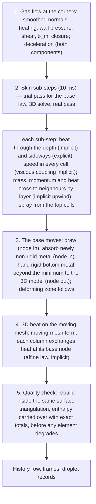

# The flowing layer in layered skins on a moving 3D mesh (Step 3 amendment) — Design

Date: 2026-10-11
Status: draft for Asha's review. Designed with Asha in the brainstorming sessions of 2026-10-09 to 2026-10-11; every
decision is listed with its date in §16, and the ledger `.superpowers/sdd/18-melt-layer-skin/progress.md` holds the
discussion behind each. Amended 2026-10-12 (while planning sub-plan 20): the booking of swept volumes (§5.2), the rebuild
transfer (§5.3), level 2 of the ladder (§11.1), with the measurements behind each.
Supersedes: `2026-10-07-melt-layer-skin-design.md` (one-dimensional skins under melting patches on a fixed mesh), whose
stage 1 was built and failed its box test (§2); the derived surface of `2026-09-27-surface-recession-remeshing-design.md`
§5 and §8 (the geometry follows the mesh here, not the reverse). Reuses from that design its dense band (§6), its mesh
generation and validity gate (§7.3–7.4) and its measured costs (§2).
Amends: `2026-09-20-melt-spraying-design.md` §5 (mesh), §8 (melting), §9 (film and spraying) and §10 (geometry and
accounting), and therefore sub-plans `01-mesh-active-set.md`, `02-material-properties.md`, `03-thermal-core.md`,
`05-flow-regime-gate.md`, `06-melt-film.md`, `07-spraying.md`, `09-melting-body.md`, `10-coupled-loop.md`, `13-cli-wiring.md`,
`14-verification-runs.md`, `15-documentation.md`, `16-surface-recession.md`, `17-remeshing.md` and `18-melt-layer-skin.md`
(06, 09, 16, 17 and 18 moved to `deprecated/` on 2026-10-11; this design's own sub-plans are 19–22).
Nothing in Step 1 changes. Step 2's thermal model changes in one way: with skins on every corner from the start, the
outer metal is resolved by the skins before melting too, so the Step 2 verification against SESAM is re-run (§11).
Numbers marked *measured* come from runs; *estimated* are calculations made for this design, to be measured in the
build stage named.

## 1. Purpose

The one-dimensional skins of the 2026-10-07 design were built (sub-plan 18, stage 1) and failed the box test: on an
8 × 10 × 10 mm block heated at 6 MW/m² they stalled for 0.15 s after the first layer of elements died together, and on
finer meshes they emptied elements before anything melted (§2). The diagnosis found the cause in the architecture, not
in a parameter: on a fixed mesh the surface recedes element by element, a death uncovers tilted and cooler faces,
skins created on faces turned away from the heat take metal from the elements the heated skins need, and creating a
skin on a small element kills it. Two fixes were tried and neither met the criterion, so the design was reopened.

Asha redefined the skin on 2026-10-09: it is the outer surface front of the metal, resolved in 10 µm cells; the 3D
elements are a coarser reservoir; the skin takes metal from below only to replace what left it; the film is the
liquid top of the skin. The sessions that followed found that the flowing layer — liquid and slurry, up to 3.4 mm deep
late in the flight — must be represented in one place that can move it, that a speed profile through that layer has
to be resolved because liquid rides on slurry a thousand times more viscous, and that the 3D model's surface must be
exactly where the rigid metal ends. This design therefore has three parts:

1. **Columns on the corners** of the 3D mesh's surface triangulation, each carrying a layered skin that holds the
   whole flowing layer above the rigid metal, with heat conducted through the depth and sideways, and a speed in every
   cell (§5, §6).
2. **A moving 3D mesh** whose surface nodes are the columns' bases, so the 3D model holds only rigid metal and its
   outer surface is the rigid front; a deforming zone, an element-quality check and an exact rebuild replace element
   death (§5.3).
3. **Girin's spraying from the top cells** of the skins, with the film thickness b read as the whole flowing depth
   (§8).

Deliverables: (1) the flowing layer resolved to 10 µm at the surface, with its velocity profile, its inertia and the
pressure of its own thickness; (2) a surface that moves continuously with the metal, inward as it melts and sprays and
outward as runoff freezes, with no element-sized steps; (3) exact books for mass, energy and momentum; (4) the
verification ladder of §11; (5) a droplet population that no longer depends on the macro step or the surface mesh.

## 2. Facts this design relies on

| Topic | Fact | Source |
|---|---|---|
| Stage 1 skins failed the box | q6p box (8 × 10 × 10 mm, 6 MW/m² projected, 700 K, Scheil, 2 s) against the fine box: at 0.05 s the skins' recession is −41.8 % at 1.0 s; the element model on the same coarse mesh −10.6 %; largest absolute differences over the curve 0.34 and 0.38 mm. The stall at 0.80–0.95 s follows the first layer's synchronous death: flux per area on the uncovered faces 5.77 → 4.08 MW/m², base temperature 892.5 → 882.8 K, 42 skins created on lateral faces not facing the heat against 18 on heated ones. On 1.0 and 0.5 mm meshes recession starts at 1.10–1.37 s against 0.70 s. | measured 2026-10-09 (`analysis/box/`, `diag_stall.py`) |
| Two fixes failed | Drawing through a dead element (`draw_through`) and leaving exposed faces without created skins (`cover_exposed`), alone and together, at 0.05–0.5 s: largest relative errors 14–72 %, none within 5 %. | measured 2026-10-09 (`experiments/x1/`) |
| Columns on triangles accumulate an offset | A closed triangulation has two triangles per vertex (18 078 patches, 9 041 nodes on the 2 mm sphere). On a toy flat patch with one column per triangle, a triangle receding twice as fast as its neighbours leaves an offset between its mass and the drawn surface of 205 step-recessions after 400 steps with averaging and memory, 201 with least-squares corners: it grows without limit whatever rule places the corners. One column per corner has no offset. | computed 2026-10-10 (`experiments/figs/option3_offset_schematic.py`); measured 2026-09-27 |
| δ_m on single patches | Per patch, 100 mm flight at 0.0125 s, frames every 10 s: deepest δ_m 387 µm at 50 s, 364–372 µm at 80–90 s, 405 at 100 s, 432 at 110 s, 485 at 120 s; at 120 s 3.8 % of wet patches deeper than 469 µm (400 µm of solid metal when liquid). Median 228–314 µm. | measured 2026-10-10 (`work-2026-10-07-dt-continuum/runs/default_d100`) |
| The flowing layer deepens late | Same flight: mean non-rigid depth over wet windward patches 0.06 mm at 50–60 s, 0.30 mm at 85 s, 0.59 mm at 95 s, 1.19 mm at 105 s, 2.51 mm at 115 s, 3.38 mm at 120 s (mean; the median per step is not recorded). | measured 2026-10-10 |
| Deep liquid is not a small term | With the deep runoff on, 100 mm to 120 s: 0.285 kg left the elements as liquid below the conjugate depth, against about 1.1 kg sprayed; sprayed mass +7.1 %, mass at 120 s −16 %. | measured 2026-10-02 (shared context, amendment of 2026-10-02) |
| Slurry viscosity | Li Yageng et al. (2014): η = [0.871 − 0.00849 γ̇^0.74924] exp(3.7311 f_s) Pa·s, 0.87–5.6 Pa·s, measured at f_s = 0.1–0.5 and γ̇ = 61–490 1/s (γ̇ held at most 367 1/s); log-linear bridge to liquid aluminium's 1.3 mPa·s over 906.4–908 K. That is 670–4 300 times the liquid. | Step 4 plan §4; `2026-10-02-spheral-large-fragments-design.md` |
| Liquid over slurry | Under a push of 5·10⁴ Pa/m in the viscous limit: 0.3 mm of liquid moves at about 1 m/s, 1 mm of slurry at 1 Pa·s at about 2 cm/s; the slurry's shear rate is about 20 1/s, inside Li's range. | estimated 2026-10-11 |
| The pressure gradient reaches every depth | Across a 0.4 mm layer the pressure changes by about 100 Pa (ρ_l a z at 10.5 g), 1.4 % of the 7 kPa stagnation pressure; the push along the surface varies with depth by z/R_n, under 0.5 %. | estimated 2026-10-09 |
| Inertia matters in deep layers | Lubrication speeds G h²/(3μ) at 45° from the nose over 50–120 s: 0.05–3.0 m/s for 0.3 mm, 0.6–34 m/s for 1 mm, against a Bernoulli bound √(2Δp/ρ_l) of 1.9–2.5 m/s. Viscous spin-up time h²/ν: 0.17 s (0.3 mm), 1.8 s (1 mm), against a crossing time of about 0.03 s. | estimated 2026-10-09 from the 0.0125 s flight's history |
| The deceleration may out-push the pressure gradient | Newtonian estimate with the fitted nose radius (100–240 mm): ρ_l a R_n /(2 p_s) exceeds 1 from about 55 s (up to 2.9 at 108 s), so the net push along the front may point toward the nose. | estimated 2026-10-09 |
| Thickness pressures are comparable to the drive | ρ_l a_n ∂h/∂s for a slope of 0.1 at 10.5 g: about 2.5·10⁴ Pa/m, against a gas-pressure drive of 2–6·10⁴ Pa/m; capillary length √(σ/(ρ_l a)) about 1.8 mm at peak deceleration. | estimated 2026-10-11 |
| Sideways conduction in a deep skin | Ratio to through-depth conduction ≈ (h/L_T)²: for a 3.4 mm layer 0.1 % over 100 mm, 46 % over 5 mm, 290 % over 2 mm; for 0.4 mm, 4 % over 2 mm. Thermal diffusivity 40 mm²/s (k 128 W/m/K, ρ 2813, c_p 1132). Péclet number across 2 mm: about 50 at 1 m/s, 2.5 at 0.05 m/s. | estimated 2026-10-10 from `AA7075_scheil.json` |
| A fixed Cartesian grid is unaffordable | 10 µm cells over the windward half's outer 400 µm: about 6·10⁹; over 3.4 mm: about 10¹¹. Brackbill's capillary limit at 10 µm: about 5·10⁻⁷ s, about 1.4·10⁸ steps over 70 s of melting. | estimated 2026-10-11 |
| Moving nodes and element quality | Pushing only the boundary nodes of the 2.74 mm mesh inward: none inverted to 1.25 mm; worst radius ratio 0.289 → 0.076 at 1.0 mm; 1 319 inverted at 2.0 mm. Safe to about 40 % of the local cell when only the surface moves. | measured 2026-09-27 |
| Moving mesh in the backends | skfem assembles 87 632 tets in 0.004 s on a fixed mesh and 0.074 s if geometry is recomputed (310 k tets: 0.015 against 0.262 s); dolfinx 0.11 recomputes geometry anyway (0.031 s either way; 0.11 s at 310 k); `mesh.geometry.x` is writable in place. | measured 2026-09-27 |
| Rebuild cost | gmsh volume generation about 18 s plus 76 µs per tetrahedron at 4 threads; 15 mm band at 2.16 mm: about 310 000 tets, about 42 s per rebuild; peak memory 0.5 GB at 749 k tets. | measured 2026-09-27 |
| The converged population depends on the surface mesh | Current model, 100 mm to 120 s at 0.0125 s: 1.4 mm surface elements against 2.0 mm move the droplet count by −9.9 % and the thick share by +5.9 points, far beyond the scatter between seeds; the medians by under 0.4 %. | fact 101 (measured 2026-10-08) |
| Liquid properties | ρ_l 2400 kg/m³, μ_l 1.3 mPa·s, σ 0.80 N/m; solid ρ 2813 kg/m³; T_rigid (half liquid, Scheil) 895.10 K, liquidus 908 K. | `AA7075_scheil.json`; amendment of 2026-10-06 |

## 3. Scope

In scope: the corner columns and the two surfaces (§5.1–5.2); the moving 3D mesh with its deforming zone, quality
check and rebuild (§5.3); the layered skin — cells, heat, flow, sideways exchange, base (§6); time-stepping and the
skin–3D interface (§7); spraying from the skins (§8); what is retired (§9); settings, outputs, code (§10); verification
(§11).

Out of scope, recorded in §13: a volume-of-fluid patch study (level 4 of the ladder, later); fragmentation of the body
(the validity gate stops the run, as the remeshing design decided); local mesh repair in place of rebuilds; a finer skin
surface than the 3D mesh's surface triangulation (a grid study, not a design change).

## 4. Architecture

The trajectory still advances first in each macro step, as today; the order above is what follows it. It is
first-order operator splitting, as the current model is, and its error is bounded by the step-halving tests of §11.
New modules: `reentry_model/columns.py` (the corner columns, dual cells and their graph), `reentry_model/skin.py`
(rewritten: the layered skin), `reentry_model/movemesh.py` (deforming zone, quality, rebuild driver, reusing
`remesh.py` from the remeshing design where it exists). `body.py` orchestrates; `heating`, `surface_flow` and `spray`
are evaluated per corner; each thermal backend gains the moving-mesh term and the nodal base law.

## 5. Geometry

### 5.1 Columns on the corners

Every corner (vertex) of the 3D mesh's surface triangulation carries one column. A column owns the corner's dual cell:
a third of each surface triangle that touches the corner, bounded by the segments from each touching edge's midpoint
to the adjacent triangles' centroids. Its area A is the dual cell's area; its neighbours are the corners joined to it
by a triangle edge; the face it shares with a neighbour has the length of the two dual segments across that edge. On
the 2 mm sphere this is about 9 000 columns (9 041 corners), half the number of triangles.

The triangulation's connectivity is fixed for the whole flight: no corner is created or removed and every column
keeps its state. The corners move as described in §5.2; with every move they are also nudged along the surface (a
tangential Laplacian step — each corner part of the way toward its neighbours' mean, projected onto its tangent plane,
clamped to 0.35 of the mean edge — which evens out triangle shapes). On a curved surface that nudge alone sweeps a
second-order volume of either sign at each corner (up to about 1 µm of equivalent depth on the 100 mm sphere, fact
105), which a column with an empty skin could not supply; so the smoothing is made volume-neutral per corner: each
corner is moved along its normal by minus the volume its smoothing swept, divided by its dual area, so that the
smoothing sweeps no volume at any corner and the base still moves only by metal crossing it (§5.2). Columns move with
their corners and keep their mass. (Decided 2026-10-12, Asha, on the recommendation of sub-plan 19's final review;
built in sub-plan 20.) With each corner booked its own sweep (§5.2), three such corrections leave the worst corner's
sweep at 3·10⁻¹¹ m on the 100 mm sphere, from 0.46 µm before them (measured 2026-10-12). A history column records the
worst triangle quality (smallest inscribed-to-circumscribed radius ratio) on the surface; local remeshing of the surface
is out of scope unless that number shows real degradation (§13). Measured while planning sub-plan 19 (2026-10-11, one
run each, on the 100 mm sphere receding at its nose by 0.5 mm per step in proportion to how directly each corner faces
the flow): without the tangential smoothing the worst surface triangle fell to 0.36 and the mesh failed at 25 mm of
nose recession; with it the worst stayed at 0.71 and the mesh lasted to 29.5 mm.

Each column has a direction: the smoothed normal at its corner (area-weighted vertex normal after the smoothing pass),
recomputed every macro step. Heating, wall pressure, shear, δ_m and the closure are evaluated per corner from the
smoothed normals, so a pit or bump one column wide does not change its own heating.

### 5.2 The two surfaces

A column has a **base**, its corner on the 3D mesh's surface, which is the rigid front or, where the non-rigid layer is
thinner than the skin's minimum (§6.1), the bottom of the minimum skin, in rigid metal below the front; and a **top**,
the base plus
the skin's thickness along the column's direction, which is the metal's free surface. The skin's thickness is the sum
of its cells' thicknesses, each cell's being its mass over its area and its own phase's density (liquid about 15 %
less dense than solid), so melting swells the column and freezing shrinks it by the right amount. A verification
setting holds every cell at the solid's density (`--skin-swell off`, 2026-10-14): levels 2 and 2b run with it, because
their references hold one density and the swelling alone melts the exact plates sooner (§11.1); the swelling itself is
verified at level 1.

- The base moves only by metal crossing it (§6.6): inward when the skin takes rigid metal from the 3D model, outward
  when rigid metal at the skin's bottom passes to the 3D model. The 3D model's surface is therefore always exactly where
  the skin's metal ends: at the rigid front wherever the non-rigid layer is at least the minimum, and below it where the
  skin carries rigid metal to make up its minimum.
- The top moves with the skin's mass: outward as runoff piles material on, inward as spray and runoff remove it.

The top surface's normals and areas serve the gas-facing quantities and the runoff graph; the base surface is the 3D
model's boundary. Each corner is credited with what its own motion swept: every surface triangle's exact prism
between its old and new positions is shared among the triangle's corners in proportion to their own first-order
sweeps, A_t (u_k · n_t)/3 for corner k (A_t the triangle's area, u_k the corner's displacement, n_t the triangle's
outward normal), the second-order rest of the prism in proportion to those; a corner sliding along a flat face sweeps
nothing, and a corner that does not move is credited with nothing its neighbours swept. The prisms tile the swept
region to third order and that remainder is spread in proportion to what each corner swept, so the 3D model's volume
equals its metal exactly. (Amended 2026-10-12, Asha. Sub-plan 19 credited a third of each prism to each corner; while
planning sub-plan 20, the level-2 box's side walls were credited with metal its receding front swept, handed it down,
bulged out by 0.33 mm and folded the surface within 1.3 s.)

### 5.3 The moving 3D mesh

**Deforming zone.** When base nodes move, the 3D nodes within a depth D below the surface move with them: each interior
node by a weighted average of the movements of the surface nodes near it, with a weight that falls linearly from one at
the surface to zero at depth D, smoothed laterally so that neighbouring columns that move differently shear the
elements gradually. Every element in the zone is compressed or stretched by about the same factor, (D − r)/D for a
uniform recession r, instead of the top layer alone collapsing. D defaults to the remeshing design's 15 mm dense band.

**The heat equation on a moving mesh.** Nodes that move through the metal add the arbitrary Lagrangian–Eulerian term:
the enthalpy equation is solved in the frame of the moving nodes, ρ (∂h/∂t)|mesh − ρ w·∇h = ∇·(k∇T), with w the node
velocity interpolated within each element, in the conservative form that satisfies the discrete geometric conservation
law (a uniform temperature stays exactly uniform while nodes move, §11). It is applied as a remap at each move — the
operator-split, Lagrangian-plus-remap form of the method: the nodal enthalpy is carried to each moved node along its
displacement by its gradient (exact for uniform and linear fields), then one uniform offset on the moved nodes sets the
total to its old value less what the corners swept (refined while planning sub-plan 19). In the skfem backend only elements in the zone
have their matrices recomputed each step (a full recompute costs 17 times a fixed assembly, §2); the FEniCSx backend
recomputes geometry anyway.

**Quality check.** After the base moves, every element in the zone is checked for its signed volume and its radius
ratio. A rebuild is triggered before the worst falls below the remeshing design's threshold (radius ratio 0.05), or when
the zone has compressed to half its depth, whichever comes first, with a minimum gap of 20 macro steps between rebuilds
unless an element would invert. A step that would invert an element is refused and the rebuild done first. A base
node does not move by micrometres per step, as first assumed: under 6 MW/m² at 0.5 s macro steps a base moved 1.3 mm on
2 mm elements and 5.2 mm on 4 mm elements in one step, which the mesh refused even after a rebuild (measured
2026-10-12). So a macro step runs as equal parts, none moving a base more than a quarter of the mean surface edge (§7.1),
and the check acts in time.

**Rebuild.** The 3D mesh is regenerated by gmsh inside the current base surface, keeping that surface's triangulation
exactly — the corners and their columns are untouched — with the dense band's size field (§2: about 310 000
tetrahedra; about 42 s by the 2026-09-27 design's measurement of its own path, 1.6–2.1 s for this one as built in
sub-plan 19, on one gmsh thread because fenicsx_env's gmsh segfaults on four; fact 102). Enthalpy is carried over by
the L2 projection of the old field onto the new mesh (its consistent mass matrix against the old field integrated over
the new elements by a 4-point rule), which keeps each region's energy where it was and reproduces a linear field
exactly; what the quadrature misses is made exact by a uniform enthalpy offset over the new deforming zone, reported with
every rebuild and summed. (Amended 2026-10-12, the fallback this section provided for once the residuals proved large:
sub-plan 19 interpolated at the new nodes, and under real melting its residuals were one-signed and ten times those of
its prescribed motion -- on the level-2 plate two rebuilds moved 2 768 J, 4.9 % of the heat absorbed, from the cold
bulk to the melting front, and the centre melted 9.5 % ahead of the exact solution; with the projection the two
rebuilds left 14 J and the centre is within 0.7 % at 2 s. The projection is local to the quadrature's accuracy, not
exact element by element; an intersection-based (supermesh) transfer stays the further fallback.) The rebuilt boundary
is checked to be exactly the corner triangles. The remeshing design's validity gate applies: a non-manifold surface, more than one connected body, or a
non-positive volume stops the run with a message. With a 15 mm zone rebuilt at half compression, the 100 mm flight's
77 mm of nose recession needs about ten rebuilds, about 7 minutes (estimated).

**The fine band** (decided 2026-10-14, Asha, option 1; built 2026-10-15). On 2 mm elements the 3D model cannot follow
the temperature just below the rigid front — the layer ahead of the front, to 1/e of its rise, is 2.2–3.4 mm thick on
the hot plate — and the plates melted 2–6 % late (§12). So a skin run's 3D mesh is finer to 4 mm below its surface while
the surface keeps its 2 mm triangulation: gmsh fills the volume under the fixed surface with elements of 0.7 mm asked,
growing to the surface size over one surface element below the band, at the start and at every rebuild alike, the sizes
read from the mesh's parameters (`movemesh.refined_mesh`, `--fine-band 4 --fine-size 0.7`). Under a fixed 2 mm surface
gmsh fills the band coarser than asked (1 mm asked gave shortest edges of about 1.1 mm and recovered about half of the
delay; 0.7 mm asked matches 1 mm elements throughout on both plates). On the 100 mm sphere it takes the 3D model from
177 000 to 1.21 million elements and a 3D step from 0.16 to 1.17 s; the strong-melting reference case (6 MW/m² for
1.5 s) costs 1 010 s against 695 s, the extra in the 3D solves (153 s), the moves' remap of the larger mesh (119 s) and
its one rebuild (55 s), and removes 172.0 g against 172.9 g. Prism layers pushed in from the surface were tried first and
dropped: they fold over their neighbours at a 90-degree edge unless each corner steps the layer's depth away from every
face around it, and at the plate's corners, where three faces meet, three 1 mm layers could not be built above a
radius ratio of 0.054 however they were tapered, so a single sharp feature would have taken the layers away everywhere.

**No element death.** The domain shrinks continuously by node motion and is cleared by rebuilds; there are no element
fill fractions, no deaths and no death threshold. Metal below the rigid front can be partly melted — less than half
liquid — and its latent heat is carried by the 3D enthalpy, as now; it does not move.

## 6. The skin

### 6.1 What a skin holds

Every column carries a skin from time zero. The skin holds all metal outward of the rigid front: every cell that is
more than half liquid, and the metal needed to reach its minimum. The **minimum mass** is the larger of the mass of
800 µm of solid metal over the column's area and the mass that fills δ_m plus 50 µm as liquid, so Girin's sheared layer
is always inside the skin with a margin (§2: δ_m reached 485 µm; the second term decides only beyond 888 µm). Where the
non-rigid layer is thinner than the minimum, the skin's bottom is rigid metal: the skin-3D interface then lies below the
rigid front, off the steepest part of the temperature profile, which the skin's fine cells resolve (option B′, Asha,
2026-10-16; 400 µm before, when the level-2 cold plate's interface sat on its rigid front -- its non-rigid layer is
0.39–0.49 mm thick -- the 3D base node rose 1.6 K above T_rigid within each part before absorption reset it, and the plate
melted 3.6 % slow from 1.0 to 2.0 s; with 800 µm 1.7 %, §12). At time zero each skin takes its minimum from the 3D model
at the initial temperature; nothing is created later.

A skin is thicker than its minimum wherever the flowing layer is deeper or runoff has piled material on. It returns to
its minimum only by losing material — spray, runoff on, or rigid bottom metal passing to the 3D model — and never goes
below it, except where the metal beneath is exhausted at the end of the fragment's life (a recorded shortfall, §10.2).
The film, the deep account and every rule that moved metal between them and the elements are gone (§9): the film is the
liquid at the top of the skin, and what was the deep liquid is the flowing material lower in the same skin.

### 6.2 Cells

Each cell holds its mass, its enthalpy and its velocity (a two-component vector in the column's tangent plane).
Temperature, liquid fraction and density follow from the material's enthalpy law (`Material.enthalpy`,
`temperature_from_enthalpy`, `liquid_fraction`), so the skin uses the 3D model's material exactly.

**Target sizes.** A cell's target thickness depends on its depth below the top: 10 µm (production) or 20 µm
(development) within the **fine zone**, the top 400 µm (`--skin-fine-zone`; set apart from the minimum by option B′,
2026-10-16, so that the 800 µm minimum's lower half takes graded cells, not fine ones); below it, each cell's target is 10 %
thicker than the one above. The deepest layer seen in the flight (about 3.4 mm) then needs about 47 fine and 36 graded
cells (estimated); a column at its 800 µm minimum holds 40 fine and 19 graded cells, 59 in all (measured; 40 before
option B′, 80 had the fine zone been the whole minimum).

**Split and merge.** Cells move with the material through the depth. After each sub-step's exchanges, a cell more than
1.5 times its target is split in two, sharing its specific enthalpy and its velocity; a cell less than half its target
is merged into its neighbour, taking the mass-weighted velocity. Mass, enthalpy and momentum are exact; merging two cells
of different speeds loses kinetic energy of order 0.5 J/kg against an enthalpy of order 10⁶ J/kg, which is neglected and
stated (§14). Spray thins the top cell until it merges; cells beneath rise toward the top, and a coarse cell rising into
the fine zone is split there, at least 400 µm down. Material arriving or leaving at the bottom joins or leaves the
bottom cell. The whole column is never re-divided, so the top cells change only by material that reaches them.

### 6.3 Heat

On each sub-step the skin's enthalpy equation is solved:

- **Through the depth, implicitly**: backward Euler with the cells' conductivities at their current temperatures,
  Newton in the temperature with a backtracking line search on each column's residual (the solver built and reviewed in
  stage 1), the convective heat flux at the top cell and the radiation εσ(T_top⁴ − T_amb⁴) from it over the column's
  top area, and the base law at the bottom (§7.2). All columns are solved side by side.
- **Sideways by conduction, explicitly** (stage 2): each cell exchanges heat with the neighbouring columns' cells at
  the same depth below the top (the neighbour's temperature interpolated between its cells), across the shared face's
  length times the overlap of the two cells' depth ranges. Stable for sub-steps below Δx²/(4α), estimated at about
  25 ms at 2 mm spacing (§2). Measured (2026-10-17), the smallest columns set the limit: on the 100 mm sphere's 2 mm
  surface the dual areas range from 1.26 to 4.59 mm² (median 3.31), a stable cycle is 3.8 ms, and every 10 ms
  sub-step runs three, the sideways conduction taking three fifths of a step's time on the level-3 flight. **From
  stage 3 it is implicit** (Asha, 2026-10-17; sub-plan 21's amendment of that date), solved with the sideways
  transport of §6.5, so a sub-step has no sideways stability limit.
- **Sideways with the flow**: enthalpy moves with the mass of §6.5, at the donor cell's specific enthalpy.

The 3D model's radiation is off on the base surface, which is no longer the free surface. Every quantity that reads a
wall temperature reads the column's top cell.

### 6.4 Flow

Each cell's velocity obeys a momentum balance in the column's tangent plane. The column is thin against the distances
along the surface over which conditions change (§2), so the pressure inside the layer varies with depth only through
the deceleration's component into the surface, and every layer feels the same push along the surface:

  G = −∇_s p_w − ρ_l a_t + ρ_l a_n ∇_s H − σ ∇_s κ,

with p_w the wall pressure from the surface-flow evaluation, a_t and a_n the deceleration's components along and into
the surface (a_n positive pointing out of the front face, as the deceleration pulls in the body's frame), H the
column's top height (its total thickness) and κ the top surface's curvature from the column heights on the triangulated
surface. (Sub-plan 21 Task 5, 2026-10-20: with g the acceleration the metal feels in the body's frame, minus the
body's own, the second and third terms are ρ_l g_t and ρ_l (g·n) ∇_s H — the deceleration pulls the metal toward the
nose along the surface and out of the front face, on the leeward face too; and −∇_s p_w is the surface flow's own
gradient of p_w(θ) along the meridian, since differentiating the corners' values amplifies the scatter of their
normals some 25 times.) The third term lowers the pressure under a thicker column on the front face, so pile-ups attract material at
long wavelengths — the front-surface Rayleigh–Taylor mechanism, as a flow; the fourth, surface tension, resists them and
dominates below the capillary length (about 1.8 mm, §2). Both thickness terms were added on 2026-10-11. (Sub-plan 21
Task 6b, Asha, 2026-10-21: κ is taken in its thin-film form, the base surface's curvature plus the linear response of the
curvature to the column heights -- minus the top surface's cotangent Laplacian of the heights over each column's
area, the area that turns its volume into its height, as stability requires; a thick layer's bump curvature therefore
stays about 2H/R high, the prism columns of §14 assumption 10 (Asha, 2026-10-22) -- and surface tension acts only where
a column's top cell flows. Task 5's curvature of the top surface itself, built on Task 2's operator, made
surface tension run backwards at corners touching an obtuse triangle, which copy their neighbours' curvature and so
cannot see their own height: unstable at any sub-step, about 1 300 1/s for 0.3 mm of liquid on the 2 mm sphere. The
thin-film form drops the slope's nonlinear part, about 1.5 times the slope squared, within assumption 1 of §14.)

Through the depth, neighbouring cells drag on each other with the viscosity at their interface: liquid aluminium's
1.3 mPa·s where both are fully liquid, Li et al.'s slurry law at the interface's solid fraction and shear rate with
the existing bridge near the liquidus, and the cells' shear rate found by fixed-point iteration (at most five passes,
held at no more than 367 1/s, as the Step 4 plan does). The interface's drag puts the two half-cells' viscosities in
series, as the stress's continuity requires, each cell's at its own shear rate -- the stress on its faces over its
viscosity -- since a rate taken across a jump from liquid to slurry would give the slurry the liquid's (sub-plan 21
Tasks 3 and 4, 2026-10-19/20). The
bottom cell is held still by the rigid front (no slip);
the gas shear τ acts on the top cell. Rigid cells inside a skin — at or below half liquid — that are joined to the
substrate, the run of rigid cells up from the column's bottom such as the skin's solid minimum, have zero velocity: they
are anchored. A crust, rigid cells with flowing metal between them and the substrate, floats: it moves as one piece,
dragged by the gas shear on its top, pushed like the rest and dragged by the slurry beneath (Asha, 2026-10-20, revising
the 2026-10-11 assumption that a crust is anchored; an assumption, §14). The through-depth viscous coupling is
an implicit tridiagonal solve per column per sub-step, of the same shape as the heat solve.

Each cell also gains or loses momentum with the mass crossing to and from neighbouring columns (§6.5); velocities are
carried between tangent planes by projection onto the receiving column's plane. The droplets carry momentum away from
the top cells at their release speed (fact 29's sink). The profile is computed, not assumed: no base-layer thickness,
no shape factor and no single viscosity enter.

The two thickness terms are stiff at the grid scale: a capillary disturbance one column wide relaxes in about 3 ms
in a thin liquid layer, under the 10 ms sub-step (estimated). They are therefore treated implicitly, linearised in the
column heights, inside the transport solve of §6.5.

### 6.5 Sideways exchange and the arrival rule

Each sub-step, the mass crossing each shared face at each depth is the normal component of the donor cell's velocity
times its thickness times the face's length; it carries the donor's specific enthalpy and momentum. The exchange is
linearly implicit and upwind, as the runoff transport is today: positive, conserving mass, enthalpy and momentum to
round-off, and stable however fast the flow.

Depth positions are matched by fraction of the **flowing layer**: material leaving the donor between fractions σ₁ and
σ₂ of its flowing depth joins the receiver between the same fractions of its flowing depth, where the receiver flows
continuously from its top downward. Where the receiver's top is rigid — a solid skin, as on the leeward side, or a crust
on slurry — arriving material lands on top of its top cell. Nothing passes through rigid metal (decided 2026-10-11).
(Sub-plan 21 Task 6d, 2026-10-22: landed metal flows on within the same sub-step's solve, coasting at the mass-weighted
velocity it arrived with, projected onto the column's plane; the drag of the rigid metal beneath reaches it at the next
momentum step. Before, it waited a flow sub-step, so a front crossed rigid metal at one column a flow sub-step.)

Runoff reaching the cold leeward skins lands on top and freezes from below in the skin's own heat equation; the skin is
then above its minimum, and its oldest rigid metal at the bottom passes to the 3D model (§6.6), so the skin keeps
resolving the outermost layer — now the fresh deposit — and the 3D surface moves out by the deposit's volume.

### 6.6 The base

After the sub-steps, each column's base moves by the metal crossing it:

- **Draw.** A skin below its minimum mass takes rigid metal from the 3D model at its base until the minimum is
  restored. The base node moves inward by the drawn volume over the dual area.
- **Absorb.** Metal at the base that has become non-rigid (above T_rigid) joins the skin: the depth along the column's
  direction from the base node to where the 3D temperature falls to T_rigid is absorbed, by the line method of the
  rigid-substrate amendment's `nonrigid_depth` (the build extrapolates the node's temperature along the 3D gradient,
  which agrees with the line method within 0.07 mm on 2 mm elements, measured 2026-10-14). The base node moves inward by
  that depth, at most what the part's draws and hand-downs leave of its move allowance (§7.1); the rest waits for the
  next part. (Amended 2026-10-14, Asha. A cap of a quarter of the mean edge per macro step stranded non-rigid metal in
  the 3D model: on a plate started at 880 K, whose exact non-rigid layer — melt front to T_rigid — is 1.5–1.7 mm thick,
  the skins held only 0.54–0.59 mm, 1.0–1.3 mm of non-rigid metal stayed below the base 7–8 K above T_rigid, and the
  plate melted 4–8 % slow; the stranded metal's draws at T_rigid's enthalpy were also what buried superheated cells.
  When the body starts near its melting range the non-rigid layer is genuinely thick, so the base sitting above T_rigid
  is physics, and the skins must absorb it as fast as the T_rigid isotherm advances.)
- **Hand down.** Rigid cells at the bottom of a skin above its minimum pass to the 3D model, oldest first, as far as
  the skin stays at or above its minimum and no cell handed is warmer than the base node by more than the fault
  tolerance below (5 K); warmer metal stays in the skin until it has cooled to that. The base node moves outward by
  their volume. (Amended 2026-10-26, Asha. Where runoff froze onto cold metal on sub-plan 21 Task 8's pushed plate, the
  deposit, growing 0.6–1.75 mm in a 0.0625 s part on 850–735 K metal, was handed down while still warmer than the node
  by 35–67 K/mm of depth: 1.1–3.2 move allowances a part, so parts were rejected down to 0.0104 s and the melting macro
  step cost about ten times its usual processor time. Held until it cools, no part was rejected on a reduced pushed
  plate to 1.0 s, against 4 of 17, and the skins held 1.18 g above their minimum at 1.5 s, 1.2 % more cells.) In a
  part a column hands down at most what moves its base by the move allowance (§7.1), a cell going in part, and the
  rest waits for the next part, as absorption's rest does. (Amended 2026-10-27, Asha, option 1 of sub-plan 21 Task 9's
  third hand-back. The tolerance releases a held cell whole once it is near its node's temperature, and the deep cells
  of a thick skin are large: on Task 8's full pushed plate at 1.5 s the lowest held cells were 0.18 mm of solid metal
  at the median and up to 0.79 mm, against a 0.556 mm allowance. Such a release does not shrink with the part, so from
  1.56 s splitting failed -- the same 1.026 allowances at parts of 62.5 to 7.8 ms -- eight of the last fifteen parts
  were kept over the allowance at the split limit, the 12.4 g held came down in 0.039 s and the mesh failed at 1.60 s.
  With the cap the reduced pushed plate split no part after 1.3 s.)

Metal crossing the base carries its own enthalpy — the 3D field's enthalpy in the swept volume for a draw or absorption,
the cells' enthalpy for a hand-down — and the other side gains or loses exactly that: the moving mesh books an
outward sweep at the handed metal's own enthalpy, at each corner the mean of the metal handed there. (Amended
2026-10-26, Asha. Sub-plan 20's build booked outward sweeps at the base node's enthalpy, harmless while hand-downs were
thin and at the node's temperature; where runoff deposits the handed metal is warmer, and the reconciliation put the
difference into the skin's new bottom cell, often a sliver of a cell: a 0.316 mm hand-down at 818.0 K over a node at
810.8 K raised a sliver of 1.4 % of a cell to 3 709 K, bottom cells merged up to 266 K above their node on the reduced
pushed plate and up to 1 253 K on Task 8's. Flow-off results move by up to 0.22 K in the skins.) The 3D field's enthalpy in the
swept volume is taken along the field's linear profile below the base node, T(s) = T_b − g s with g the gradient along
the outward normal: each draw within a step takes the next layer down at that layer's enthalpy (capped at T_rigid), and
the moving mesh books an inward sweep at the same profile's average over the swept depth. (Amended 2026-10-12, Asha.
Sub-plan 20's build valued both at the base node's enthalpy. On the level-2 plate at 0.5 s steps the base swept 1.55 mm
through a profile falling 22 K/mm, which on the steep Scheil curve overstated the metal by about 99 000 J/kg; that
excess predicts 0.72 mm of extra melting, and 0.76 mm was observed, the centre 97 % ahead of the exact solution. At
0.25 s the prediction is 0.46 mm against 0.45 mm observed.) Temperatures are never
overwritten: a cell receiving metal takes the mixture's temperature from its total mass and enthalpy. Because the base
is the rigid front, the metal crossing it is close to the bottom cell's temperature: a bottom cell more than a set
tolerance (provisionally 5 K) outside the temperatures of the metal that crossed, read after the reconciliation — for
a draw or an absorption between the base node's and the 3D profile's at the depth swept, for a hand-down the handed
cells' and the cell it uncovers', as the hand-down left it — means the coupling has not converged and is counted as a fault, not absorbed (§10.2).
(Amended 2026-10-12, Asha: the comparison was with the node alone, which counted the profile valuation's colder drawn
metal as faults, 812–1 694 on the level-2 plate at 0.1–0.5 s steps and none at 0.05 s. Amended 2026-10-26, Asha: it
ignored hand-downs, so where runoff deposits it counted the warmer cell a hand-down uncovers, 6–30 K above the node,
rather than the superheating; on the reduced pushed plate to 1.0 s it counted 199 faults before the fixes above and
200 after, where the comparison with the handed cells counts 270 and none. Amended after the build, 2026-10-26, Asha:
judged against the handed cells alone it counted the cell a hand-down uncovers where the skin warms steeply above its
base, which the reconciliation had not heated, 1 900 of 1 942 faults on Task 8's full pushed plate to 1.5 s.) A column whose
flowing material drains away entirely draws rigid metal back to its minimum; no skin is ever created or removed.

### 6.7 Depths read from the skin

- **Liquid depth**: the fully liquid cells contiguous from the top, interpolated within the boundary cell.
- **Flowing (non-rigid) depth**: from the top to the first point at T_rigid. It lies within the skin by construction.
- **Girin's film thickness b** is the flowing depth (decided 2026-10-11). The rigid-substrate amendment's regime test
  compares it with δ_m: the thick branch where it is deeper, the thin branch where it is not.
- **Resolved sheared depth**: the depth over which the computed velocity falls to a set fraction of the top speed,
  recorded beside Girin's δ_m (§8) for comparison.

## 7. Time-stepping and the skin–3D interface

### 7.1 Two clocks

The macro step Δt (`--dt`, 0.5 s by default, provisional) is the trajectory's and the gas flow's. The skins and the 3D
conduction run it as equal parts, so that no base moves more than a quarter of the mean surface edge in one part by
drawing and handing down: a part whose draws would move a base further is restored and run again as shorter parts (a
hand-down is capped at the allowance, §6.6, and absorption takes what is left of it, so neither splits a part), and the
next macro step starts with as many parts as this one's largest move called for (Asha, 2026-10-12; the cap on
hand-downs amended 2026-10-27, Asha, because a held cell released whole does not shrink with the part, so splitting
for it was in vain). While any skin's top is non-rigid at the macro step's start, no part is longer than 0.0625 s (Asha,
2026-10-12, option 1: long parts during melting were rejected for their moves and needed many passes; fact 126), nor
in the macro step in which a top is about to become non-rigid: its rise over the last macro step, carried on across
this one, reaches T_rigid (Asha, 2026-10-16: with the 800 µm minimum the level-2 cold plate's top stood at 884.8 K at
0.5 s, the step in which it melted ran as one part, and the plate was 14.2 % ahead at 1.0 s, failing level 2; capped
one step early it is 3.2 % ahead, and its run is a third faster). The
heating is evaluated once per macro step and interpolated linearly in time between the last macro step's and this
one's, each part taking it at its middle, so that a macro step receives the trapezoid of the two; a 0.5 s macro step
tracks the flight's heating, whose shortest time scale is about 7 s (fact 128). The sub-step δt (`--skin-substep`, 10 ms) is the skins': heat,
flow, sideways exchange and spray. The macro step's default is fixed by the convergence study of §11, level 3.
(Measured 2026-10-12 on the level-2 plate over 2 s: the skins' work, counted as passes times sub-steps, is 1 346
sub-step passes with 0.05 s macro steps, 1 630 with 0.1 s, 2 151 with 0.25 s and 2 437 with 0.5 s, because a longer
part needs more damped passes; a large macro step no longer saves time.)

### 7.2 The interface

The stage 1 interface carries over with the base node in place of the facet. Each column runs a trial pass over the
sub-steps with its base held at the start-of-step 3D temperature, recording the energy through its base and its
sensitivity to the base temperature, giving an affine law q_b = a + b T_b per column (slope clipped at zero, as stage 1
decided). The 3D solve applies that law at each base node over its dual area, implicitly, with no radiation; the real
pass then runs with the base at the new 3D temperature and books everything. The mismatch between what the real pass
sent and what the 3D solve received is booked to the node as a deferred load, so energy is exact. The step repeats
until the total mismatch is within 10⁻³ of the energy throughput, or no base temperature moves more than 0.05 K
between passes (at most 12 passes): each repeat re-linearises at a temperature moved only a fraction ω of the way to the
last 3D answer, Aitken's method choosing ω from the last two passes (damped repetition, the default; Asha, 2026-10-12).
Repeats are counted. The first rules, one repeat when any column's mismatch exceeds 10⁻³ ("column") or when the
total does ("total"), or none, stay selectable.

Why damping (measured 2026-10-12, sub-plan 20's Results). Once the skins near melting, a base held above the melting
band for a whole step melts the skin, which then draws metal at T_rigid and melts that too, so the heat sent down
falls off a cliff — at the plate's centre from +5.0 to −7.1 MW/m² between 30 and 60 K above the start-of-step base
temperature. The 3D surface's admittance (about 29 000 W/m²K at 0.5 s) is four times the law's slope there, so an
undamped repeat jumps the cliff and back: at 0.5 s the passes alternated between about 828 and 927 K, half the absorbed
heat stayed in the deferred mismatch, and the plate never melted. Damped, every step converges, with at most 0.3 % of a
step's heat deferred. At 0.05 s the base moves only about 3 K per pass, which is why the one-repeat rule passed level
2 there.

## 8. Spraying

Girin's model is applied per column from its top cells, with the film thickness b the flowing depth (§6.7), δ_m from
Girin's Eq. (2) as today, the regime test of the rigid-substrate amendment, and the thin, thick and front-surface
Rayleigh–Taylor modes as they stand. The release in a sub-step leaves from the top cells, liquid first. Exposed slurry
sprays only under `--slurry-spray on` (off by default), by the cascade rule of the 2026-10-07 design §8, which carries
over unchanged with its slurry properties. The droplets' momentum leaves the top cells (§6.4).

The modes are the element model's as amended on 2026-10-22 on branch `we-critical-308` and brought into this line
(Asha, 2026-10-28; sub-plan 22 Task 1a, facts 161–169): Girin's critical surface Weber number, 3.08 by default, gates the
thick branch only; Girin & Kopyt's thin, rarefied and regime-2 branches are gated by the wave fitting in the molten
region and by a viscous film on the rigid floor (`spray.viscous_film`: Lamb's damping plus Hunt's Stokes layer, the
column releasing nothing where Γτ* ≥ 1, and a depth under the floor's Stokes depth outside the inviscid mode and
recorded), whose floor depth on the skins is the flowing depth.

**The droplet's size cap is per crest** (Asha, 2026-10-24). A droplet holds no more liquid than one crest of its own
wave can give, (4/3)π r³ ≤ λ² h, so r ≤ (3 λ² h / (4π))^⅓: λ is the wavelength of the mode that sprays the column — the
thick branch's 2π δ_m / Δ_f, Girin & Kopyt's λ* on the thin, rarefied and regime-2 branches, the Rayleigh–Taylor λ* —
and λ² because a crest repeats every wavelength in both surface directions, so the column's area does not enter; h is
the depth of the run of cells the release may take, the liquid depth (§6.7) with `--slurry-spray off` and the flowing
depth with it on. It is evaluated once, at the start of the macro step, from that step's gas state, δ_m and the column's
depth then, and holds for every sub-step of it; the release in each sub-step still takes at most what the admitted run
then holds. A quarter of the body radius caps the radius as before. It replaces, on the skins, the element model's cap by
the film on the patch, r ≤ (3 m_f / (4π ρ_l))^⅓, which depends on the mesh facet's area and bound on 67 % of the thick
branch's release rows on the element model's 100 mm flight (24 % of its mass) and set essentially every Rayleigh–Taylor
droplet (about 2 mm); the element model keeps that cap. The shared spray physics takes h as `cap_depth`, and a column
with no such depth releases nothing. A Rayleigh–Taylor droplet, whose radius is its wavelength, is then set by the cap
on any layer: about 4.6 mm at λ = 2 cm and h = 1 mm (measured in sub-plan 22 Task 1b: 3.1, 4.6 and 6.7 mm on 0.3, 1.0 and
3.3 mm of liquid at the nose under 103 m/s²); where the Rayleigh–Taylor criterion reads the cap's own depth h it admits only
λ* < 2π h, so the droplet is under (3π)^⅓ h, about 2.1 h, and inside the size bins' 10 mm top while h stays under about
4.7 mm.

**Where liquid lies on slurry** (Asha, 2026-10-29, option B). The skins read their depths as the element model does
(the rigid-substrate amendment of 2026-10-06): b, the regime test and the viscous film's floor read the flowing depth,
but the front-surface Rayleigh–Taylor mode reads the liquid pool — its depth criterion, its bounded growth and the depth
it sheds in a growth time — the molten region a wave must fit in is the contiguous region of columns with liquid, and
where Girin's closure does not apply a liquid lying on slurry takes no shear mode. The shared spray physics takes the
pool's depth as an optional argument (`rt_layer`) that the element model never passes. Girin is evaluated once, at the
start of each macro step, from that step's surface flow and the skins' depths then, the mode, radius and rates of each
column held for the macro step and only what the admitted run of cells holds re-checked in each sub-step; his surface
velocity is his closure's (Asha, 2026-10-29, confirming sub-plan 22 Task 1c's choices).

**The cascade** (Asha, 2026-10-29, option i) is built as the 2026-10-07 design §8 has it: with `--slurry-spray on`, in
each sub-step the release works down the top cells in time order, the liquid at its mode's rate and then, once nothing
liquid covers it, the exposed slurry at the rate of its own mode, from its first cell's properties (Li et al.'s
viscosity with the bridge at the cell's solid fraction and the shear rate of its own sheared layer, its mixture density,
0.80 N/m), evaluated once a macro step and holding for slurry at least as warm as that cell. Measured in sub-plan 22
Task 1c (a fact, not a design): the viscous film blocks the slurry's modes wherever its viscosity exceeds about ten
times the liquid's, so the cascade releases only exposed slurry within about 0.6–0.8 K of the liquidus, in the upper part
of the bridge (906.4–908 K, which has no data) where Scheil's curve leaves a few per cent of solid; on the 100 mm
sphere's 9 417 columns nothing at or below 907.0 K sprays, at 93 s or at 120 s under 103 m/s². On a heated surface that
is exactly the slurry beneath the liquid and a top just entering the bridge, so the cascade is not inert: on sub-plan
21's heated state at 93 s a flow sub-step takes 0.35 g of slurry beside 6.6 g of liquid, and on the 4 mm test sphere
heated at 3 MW/m² from 890 K a 0.25 s step sprayed 4.98 g of slurry and 0.79 g of liquid against 1.54 g of liquid with
the flag off.

Droplet records are combined per column, per mode, per macro step, summing number and mass over the sub-steps; a
column's radius is fixed within a macro step by that step's gas state and δ_m, so combining changes no radius, and the
size histograms accumulate each sub-step. Two source columns are added: `solid_fraction` and `h_kg`. (Built in sub-plan
22 Task 2, 2026-10-29, facts 174–176: the liquid's mode's record is what the release took from the fully liquid cells
and the slurry's what it took from the others, a row each per column and macro step at its plan's radius, in the
element model's columns and written by its row writer. On a skin record the position and angle are the column's top
corner where the plan was evaluated, b is the depth the mode read — the flowing depth, or the slurry's own layer — the
release velocity is the mean velocity of the metal released, the droplets' momentum of §6.4, Girin's closure velocity
staying the gates', and the droplet Weber and Ohnesorge numbers are by the phase's own properties; `solid_fraction` and
`h_kg` are mass-weighted over the cells released, and the element model's rows carry 0 and its film's liquid enthalpy.
The histograms accumulated in the sub-steps are the records' to the round-off of numpy's weighted histogram, which is
the whole step's.)

## 9. What is retired and what is kept

| Mechanism | With this design | Why |
|---|---|---|
| Element fill fractions φ_e, `PHI_DEATH`, element death, hand-over at a death | retired | the moving mesh shrinks the domain; rebuilds clear compressed elements |
| Film account `m_f`, deep account `m_d` | retired | the film is the skin's liquid top; deep liquid is the skin's lower flowing cells |
| Feed rule and gate, deep runoff, deep surfacing, molten cascade, interior feed to the nearest patches | retired | no liquid exists outside the skins |
| Freeze-back rule (capped or energy-limited) | retired | freezing is the skin's own heat equation |
| Stage 1's 2s return device | retired | handing rigid bottom metal to the 3D model is part of the base rule |
| Film lubrication flux (`film.lubrication`, `deep_flux`) and the patch-graph runoff | replaced by §6.4–6.5 | the profile is resolved through the depth |
| Rigid-substrate regime test | kept, reading the skin's depths | decided 2026-10-06 and 2026-10-11 |
| Girin's δ_m, spray modes, droplet size laws | kept, per column | unchanged physics |
| Slurry cascade | kept behind `--slurry-spray`, off | decided 2026-10-07 |
| Surface flow and heating once per macro step | kept, per corner | the gas state changes over seconds |
| Dense band size field, gmsh generation, validity gate | kept from the remeshing design | measured there |

`--surface-model elements` keeps the current element model, unchanged, for comparison (§11, level 3). (Built in sub-plan
22 Task 3, 2026-10-29, fact 177: what remained of these mechanisms on this line was stage 1's one-dimensional skins of
sub-plan 18 under the element model's patches — `skin1d.py`, `MeltSettings(surface_model="skin1d")` and `MeltingBody`'s
branches for them, with 22 history columns and eight results that held 0 or nan in every element run — and they are
removed; on the command-line test's short melting case every remaining output of the element model is unchanged to the
last bit.)

## 10. Settings, outputs and code layout

### 10.1 Settings

| Setting | Default | Run-name suffix when not default |
|---|---|---|
| `--surface-model skin\|elements` | `skin` | `_surface-elements` |
| `--skin-min-thickness` (mm of solid) | 0.8 | `_skinmin<value>mm` |
| `--skin-fine-zone` (mm below the top in fine cells) | 0.4 | `_skinfine<value>mm` |
| `--skin-cell` (µm, fine zone) | 10 | `_cell<value>um` |
| `--skin-growth` (ratio below the fine zone) | 1.10 | `_growth<value>` |
| `--skin-substep` (ms) | 10 | `_sub<value>ms` |
| `--skin-preset dev\|production` | `production` | `_skin-dev` (20 µm cells) |
| `--deform-depth` (mm) | 15 | `_deform<value>mm` |
| `--skin-swell on\|off` (each cell at its phase's density, §5.2) | `on` | `_noswell` |
| `--fine-band` (mm below the surface, §5.3; 0 none), `--fine-size` (mm asked) | 4, 0.7 | `_fine<depth>x<size>mm`, `_fine0` |
| `--slurry-spray on\|off` | `off` | `_slurryspray-on` |
| `--skin-flow on\|off` (sub-plan 21 Task 6c; on needs `--removal girin`) | `off` | `_skinflow-on` |
| `--skin-flow-cycles` (flow sub-steps in each skin sub-step, fixed) | chosen each skin sub-step (Task 6d) | `_flowcycles<value>` |

Constants in code with their measurement or reason: the split and merge bounds (1.5 and 0.5 of target), the δ_m margin
(50 µm), the rebuild threshold (radius ratio 0.05) and gap (20 steps), the base temperature-jump tolerance (5 K), the
interface tolerance (10⁻³). Defaults marked provisional are fixed by stage measurements and recorded with them. A
malformed value exits with code 2.

(Built in sub-plan 22 Task 3, 2026-10-29, facts 178–179.) With `--thermal fem` the surface model is the skins unless
`--surface-model elements` is given; an element-model thermal run's name ends in `_surface-elements`, after the element
model's own suffixes and before the seed's, and a skin run's name carries only its non-default settings, `_slurryspray-on`
after the flow's. `--removal` not given is Girin's, except for the heat-only skins, whose liquid leaves as it forms
(instant removal): with the skins Girin's removal is required with the flow and is the removal of a flow run, and a
melting run with no flags runs the heat-only skins while the flow is off by default. Contradictory settings exit with
code 2: Girin's removal without the flow, instant removal with it, `--slurry-spray on` without the flow or with the
element model, and the element model's own settings (its runoff, deep runoff, molten cascade, rigid substrate and size
feedback) given to the skins. With the flow on, the skins spray by the shared spray physics with the command line's
constants and the run writes `particles.npz` and `size_distribution.csv` through the element model's writer; the
per-step summary waits for the skin history's droplet columns (§10.2, sub-plan 22 Task 4) and is recorded as not
written.

### 10.2 Outputs

History, per macro step: column cells (total), deepest column (mm), columns above their minimum, flowing depth (mean,
max), liquid depth (mean, max), b over δ_m on the wet windward columns (median), resolved sheared depth over δ_m
(median), largest speed in any cell, worst surface triangle quality, corner-to-corner roughness of the top surface (the
largest height difference between neighbours over their spacing), worst element radius ratio in the zone, rebuilds
(cumulative) with each rebuild's pre-correction energy and mass residuals, drawn, absorbed and handed-down mass
(cumulative), shortfall mass (cumulative), base temperature-jump faults (cumulative), interface mismatch and repeats,
momentum balance residual, the droplet-momentum ratio Π of fact 29, and the wall time split into skins, 3D solve and
rebuilds. Surface frames gain per corner: top temperature, liquid and flowing depths, skin thickness, top speed and base
position. Results gain the cumulative quantities; droplet records gain `solid_fraction` and `h_kg` (§8: on a skin
record mass-weighted over the cells released, on the element model's 0 and its film's liquid enthalpy; sub-plan 22 Task
2).

### 10.3 Code

- `columns.py` (new): dual cells, areas, face lengths and neighbours from the surface triangulation; smoothed normals;
  tangential smoothing; surface gradient and curvature operators on the corner graph.
- `skin.py` (rewritten): per-cell arrays with variable counts per column (packed storage); the through-depth heat and
  momentum solves; sideways conduction; the implicit upwind exchange; split and merge; base operations; depths.
- `movemesh.py` (new): deforming-zone node motion, quality check, rebuild driver (gmsh with a fixed surface
  triangulation), enthalpy transfer with exact totals, validity gate.
- `body.py`: the macro step of §4; `heating.py`, `surface_flow.py`, `spray.py` per corner; `material.py`: the slurry
  viscosity law; thermal backends: the moving-mesh term and the nodal base law with radiation off; `coupled.py` and
  `cli.py`: outputs and settings.
- Built in the prototype work copy, in the four stages of §11.2, each with its own sub-plan under
  `docs/superpowers/plans/melt-spraying-subplans/` and dated amendments to the sub-plans listed in the header. Stage 1's
  code in `prototype/work-2026-10-08-skin/code/` is retained for reference; its skin conduction solver and conservative
  cell operations are reused.

## 11. Verification and acceptance

### 11.1 The ladder (approved 2026-10-11)

**Level 1 — each piece against an exact solution.**
- Skin heat with a receding top: steady ablation with liquid removed as it forms — recession speed
  q/(ρ (L + c_p ΔT)) and an exponential temperature profile beneath the top.
- Skin swelling (added 2026-10-14, Asha): a column 8 mm deep started at 880 K under 2 MW/m², liquid removed as it
  forms, melts sooner with the skins' density law (§5.2) than at the solid's density by the amount the exact
  one-dimensional slab does with the same two laws (0.113 mm on average over 0.7–1.0 s), within 5 %; each run within
  3 % of its own reference at 0.9 and 1.0 s. Measured (20 µm cells, 10 ms sub-steps): the advance 1.3 % above the
  exact one, the runs within 2.4 % (one density) and 1.4 % (swelling), the 20 µm cells' whole-cell removal.
- Flow in a column: shear alone gives a linear profile; the push alone a half-parabola; liquid over slurry two joined
  profiles with the known kink at the viscosity jump; a layer pushed from rest (Stokes' first problem) its known
  spin-up.
- Sideways exchange: a warm spot carried by a uniform flow keeps its heat and arrives where it should; conduction
  between columns reproduces a known two-dimensional steady temperature; mass, enthalpy and momentum close to round-off.
- Moving mesh: a uniform temperature stays exactly uniform while nodes move or the mesh is rebuilt; a move carries a
  linear temperature field to the moved nodes to within its books' offset; a rebuild carries total energy and mass over
  exactly after correction, with its pre-correction residual reported; a heated front moving into a bar follows its
  exact solution.
- Thickness pressures: a small bump on a flat layer under deceleration grows at the thin-film Rayleigh–Taylor linear
  rate, and bumps shorter than the surface-tension cutoff decay.

**Level 2 — the plate** (amended 2026-10-12, Asha; it replaces the q6p box, whose 90-degree edges fold the fixed surface
triangulation within 1.4 s, §13). A plate 8 mm deep and 110 × 110 mm across, of 2 mm elements at 700 K, Scheil, no
radiation, its front face heated at 6 MW/m² within 32 mm of its centre, the flux falling to zero at 45 mm along a half
cosine (each column receiving what its top dual cell's projection catches), for 2 s. With flow off and liquid removed as
it forms: the centre's recession (within 3 mm of the centre) within 5 % at 1.0, 1.5 and 2.0 s of both the stage 1 fine
box and a new independent one-dimensional reference with 1 µm cells (the centre is one-dimensional: the heated region
reaches half again the diffusion length 2√(αt), about 19 mm at 2 s, beyond it); mass closed to 10⁻¹², energy to 10⁻⁸;
the fold of the crater's wall reported every step. **Level 2b — the hot plate** (added 2026-10-14, Asha): the same plate
started at 880 K under 2 MW/m², where the non-rigid layer is 1.5–1.7 mm thick and the skins' absorption is exercised as
it is not at 700 K; against the one-dimensional reference's recession and non-rigid depth, the recession within 5 % at
1.5 and 2.0 s (the onset at 1.0 s reported), the skins' flowing depth at the centre within 10 % of the exact non-rigid
depth, and the centre's base within 1 K of T_rigid. Both plates run with the skins at the solid's density
(`--skin-swell off`, decided 2026-10-14, Asha): the one-dimensional references and the fine box hold their metal at one
density, while the skins' law swells the liquid by 15 % (§5.2), which alone melts the exact plates sooner — by
0.033 mm (cold, 4.2 % at 1.0 s) and 0.094 mm (hot, 11.9 %) when it is given to the non-rigid metal — and had hidden a
numerical delay of about the same size. Both plates have the skin runs' fine band (§5.3). Measured with swelling off
and the fine band (2026-10-15): the hot plate passes at 0.5 s (5.6 % late at 1.0 s, not judged; 1.9 and 0.7 % late at
1.5 and 2.0 s; flowing depth within 0.7 %; base at most 0.10 K above T_rigid) and at 0.05 s (2.5, 1.6 and 1.0 % late;
flowing depth within 0.5 %); the cold plate passes at 0.5 s (4.9 % ahead, 2.5 and 3.3 % late against the reference;
2.8 % ahead, 3.1 and 3.0 % late against the fine box) and at 0.05 s (1.6 % ahead, 2.2 and 2.7 % late; 0.3, 2.8 and
2.5 % late against the fine box). On 2 mm elements throughout the cold plate had failed at 0.05 s (6.2, 6.2 and 6.4 %
late), §12. The band costs the plates 50–80 % more wall time and rebuilds every 1 mm or so of recession instead of
2 mm, their 4 mm deforming zone compressing its fine elements directly. With the 800 µm minimum and the cap's look-ahead (2026-10-16, measured once
each, on battery power so the wall times are indicative): the cold plate 3.6 % ahead, 0.0 and 0.9 % late at 0.05 s
(fine box 1.6 % ahead, 0.6 and 0.6 % late) and 3.2 % ahead, 0.4 % ahead and 0.9 % late at 0.5 s (1.2 % ahead, 0.2 and
0.6 % late); the hot plate 1.5 and 0.8 % late at 1.5 and 2.0 s at 0.05 s and 2.8 and 1.1 % at 0.5 s (its onset 3.1 and
9.0 % late at 1.0 s, not judged: at 0.5 s its top crosses T_rigid inside the first step, before the look-ahead has a
rise to read), the flowing depth within 1.2 %, the base at most 0.09 K above T_rigid, the books to 2·10⁻¹⁰. Measured while planning sub-plan 20 with the skins swelling (2026-10-12, 20 µm
cells, 0.05 s steps): within 1.9, 0.1 and 0.7 % of the reference (0.789, 2.712, 5.219 mm), mass to 10⁻¹⁵, energy to
2.4·10⁻⁹. With
flow on and a push along the face: mass, momentum and energy close exactly and the result is physically sensible (no
exact reference exists).

**Level 3 — flights.** The Step 2 verification against SESAM with skins on every corner, against Step 2's thresholds
(it replaces the bit-for-bit match before melting that skins everywhere give up). Measured for stage 2 (2026-10-16/17,
the four no-melt flights, each once; fact 149): **both judged flights pass** — the 100 mm sphere under SESAM-equivalent
heating 0.68 % (convective power, of SESAM's peak), 0.96 % (point-wise, continuum), +0.46 % (heat by the end of the
hypersonic phase), 1.21 % (energy-equivalent temperature) and 6.61 % (radiated power, of SESAM's peak) against the
element model's 0.46, 2.23, +0.31, 1.20 and 6.66 %; the 50 mm sphere 0.51, 0.83, +0.15, 1.38 and 3.07 % against 0.37,
2.36, +0.03, 1.22 and 3.40 % — and both physics-heating flights take in what the element model does (0.745 against
0.744 and 0.771 against 0.770 of SESAM's heat), every surface's hottest point 2-3 K above the element model's; no
rebuild, no base fault, the books to 1-5·10⁻¹², the skins drawing 0.66 g (100 mm) and 0.12 g (50 mm) to top up their
minimum. The flights took 14.6-21.9 h each before option A (71.9 s a macro step alone on the laptop; 51-108 s side by
side on the Mac Studio) against 8-39 s for the element model. The 100 mm flight to 120 s and the
50 mm flight: convergence under halving of the macro step, 10 against 20 µm cells, and a skin surface at 2 against
1 mm spacing; **acceptance**: the droplet count, the thick share of the sprayed mass, the medians by number and mass, the
sprayed mass and the mass at 120 s each agree within the scatter between seeds under halving of the macro step and under
refinement of the surface. A comparison with the element model's flight (sanity check, not a reference). Cost per
macro step and peak memory reported.

**Level 4 — later.** A volume-of-fluid study of a small patch of the layer under flight conditions (pressure gradient,
deceleration, shear, heating, slurry depth) to test the velocity profile, inertia and sideways heat; a code coupling a
level set to the volume fractions for curvature is a reasonable choice. Noted, not scheduled.

Levels 1 and 2 test against physics with known answers; level 3 against SESAM where it applies and against itself as
resolution is refined. Nothing tests the melting flight against an independent reference until level 4.

### 11.2 Build stages (approved 2026-10-11)

1. **The moving 3D mesh alone**, with a prescribed surface motion: deforming zone, quality check, rebuild and transfer.
   Level 1's moving-mesh checks.
2. **Skins on every corner, heat only** (complete 2026-10-17: levels 1, 2 and 3 pass): layered cells, conduction through the depth and sideways, split and merge,
   draw, absorb and hand-down moving the 3D nodes; liquid removed as it forms instead of flow and spray. Level 1's heat
   checks, level 2 with flow off, level 3's SESAM verification. The skins' run time is measured here: if it is too slow,
   it is found before the flow is built on it.
3. **Flow in the columns**: per-cell velocity, viscosity from the cells, sideways exchange of mass, momentum and heat,
   the arrival rule, both thickness pressures. Level 1's flow and Rayleigh–Taylor checks; level 2 with flow on.
4. **Spraying and the flight**: Girin from the top cells, droplet records; the old film, deep account and their rules
   removed. Level 3.

Each stage is tested and measured before the next begins.

## 12. Risks and approximations

- **Run time** is the main unknown: about 420 000–490 000 skin cells (estimated before option B′, whose 800 µm minimum
  puts 59 cells instead of 40 in a column at its minimum; on the 100 mm sphere's strong-melting case with development
  cells it ended with 333 000 cells against 248 000, measured 2026-10-16), an implicit sideways solve per sub-step, and
  moving-mesh assembly in the zone. Measured in stage 2 (heat) and stage 3 (flow). Stage 2's level-3 flight of the
  100 mm sphere, which never melts, took 14.6 h, 72 s a macro step against 0.04 s for the element model: four fifths
  in the skins, three fifths of a step in their explicit sideways conduction (§6.3) and 12 % in measuring the body's
  mass at every trajectory evaluation (2026-10-17, facts 147 and 148); option A removed the repeated work, a third of
  a step on the flight's first six, without changing a result.
- **The body's mass is the faceted mesh's.** A skin body's mass is the 3D model's volume times the density plus the
  skins' metal, so it carries the volume the 2 mm surface triangulation cuts off the sphere: 0.06 % lighter than the
  exact sphere for the 100 mm body and 0.24 % for the 50 mm, where the element model's thermal body takes the exact
  sphere's mass. The lighter body slows marginally sooner: level 3's largest hypersonic speed difference from SESAM is
  5.2 and 6.1 m/s with skins against 3.9 and 3.6 m/s for the element model, of 7 500 m/s, and the heat measures do not
  notice it (fact 149). Left as it is (Asha, 2026-10-17): the mesh's own volume is the consistent choice for a body
  whose metal moves between the skins and the 3D model, and matching the element model would change every skin result
  for a difference of a few hundredths of a per cent.
- **Capillary stiffness at the grid scale**: the capillary length (about 1.8 mm) is close to the column spacing, so the
  surface-tension cutoff is barely resolved and grid-scale Rayleigh–Taylor growth is possible if the implicit treatment
  is not adequate. Level 1's linear-growth test and the roughness history column watch for it.
- **The flowing-layer coordinate**: matching depth by fraction of the flowing layer is the usual shallow-flow choice
  and inexact where neighbouring depths differ greatly; sideways conduction uses true depth to avoid the known error of
  scaled-depth grids.
- **Momentum between tangent planes** is carried by projection, not parallel transport; on 2 mm spacing over radii of
  curvature of 30–240 mm the angle between neighbouring planes is under about 4°.
- **Folds sharper than one triangle** (found while planning sub-plan 19): the fixed 2 mm surface triangulation cannot
  follow a fold where neighbouring triangles' normals differ by more than about 75–95 degrees. Elements whose four
  nodes lie on such a fold are flattened by their own corners' motion, and a rebuild inside the same surface cannot undo
  it, so the run fails. A recession law that sharpens the shoulder reached it after 25–30 mm of nose recession. Decided
  2026-10-11 (Asha, option 1): measure it with heating-driven recession in stage 2 before building anything for it; the
  fold angle is reported every step, and local refinement (§13) is built only if real flights approach the limit.
- **Deposit folds** (measured 2026-10-27, sub-plan 21 Task 9): where runoff freezes on cold metal the deposit is handed
  down and the base grows out under it, unevenly at the scale of one triangle. On Task 8's pushed plate it made a
  one-column ridge along the flow in the heating's taper (corners 1-1.5 mm proud of their neighbours 2 mm away, the
  triangles either side tilted about 35 degrees), and the runoff spilled over the plate's square edge and piled up
  across its side face (skins up to 7.9 mm) to its back edge. The heated face's own sharpest fold rose about 90 degrees
  a second from 1.0 s on the full plate (24 degrees, 69 at 1.5 s) and 100-130 a second on reduced plates once deposits
  formed, toward the limit above: the full plate failed at 1.60 s, the reduced plate without the fault tolerance's
  hold at 1.92 s, and Task 8's own code folded the reduced plate's face past 100 degrees by 1.3 s. With a part's hand-down capped at the move allowance
  (§6.6) the full plate split no part from 1.5 s and still failed at 1.80 s, at its spilled edge, the face's own fold
  then at 99 degrees.
  Decided 2026-10-27 (Asha, option 2 of Task 9's third hand-back): the pushed plate is judged at 1.5 s and the fold is a
  watched risk for sub-plan 22's flight, whose history reports it every step -- the sphere has no square edges, but its
  runoff also freezes downstream of the heat. The fallback (option 3) is a hand-down limited by its neighbours' depth,
  as the rim limit for absorption below, or local refinement (§13), once it is known whether the ridge is a rivulet of
  runoff freezing or a grid-scale product of the flow.
- **Thick columns on concave surfaces**: column tops could cross where a skin is thicker than the local concave radius
  of curvature; not expected at millimetre depths, watched through the top surface's triangle quality.
- **Slurry rheology**: Li et al.'s law was measured to 490 1/s at solid fractions 0.1–0.5; the bridge to the liquid has
  no data.
- **Transfers between meshes**: the rebuild's projection keeps energy local to its quadrature's accuracy (14 J over two
  rebuilds of the level-2 plate). Each move's gradient remap still closes its books by one uniform offset on the moved
  nodes: 442 J over the plate's 42 moves, 0.8 % of the heat absorbed, one-signed (measured 2026-10-12); reported every
  step, and the next thing to make local if a flight shows it.
- **Piecewise-flat surface**: a column is credited with its own share of the prisms its corner's triangles swept, exact
  in total (§5.2).
- **The interface's cost** (measured 2026-10-12): damped repetition takes a median of 4 passes per step at 0.05 s and
  15 or more per part once melting is under way at larger steps; the skins' passes are almost all of a step's time.
  With the profile valuation and the parts, the plate at 0.05 s costs 1 346 sub-step passes against 880 with damping
  alone and about 400 with the one-repeat rule. Diagnosed on the 100 mm sphere's first 1.5 s of melting (2026-10-12):
  at 0.5 s macro steps 53 % of the time went on parts that converged and were then rejected for moving a base too far,
  and the accepted parts needed 4.4 passes on average; at 0.125 s steps 7 % and 2.0 passes, at 0.0625 s none and 1.8.
  The three cost 1 454, 425 and 341 s. With parts of at most 0.0625 s while melting under a 0.5 s macro step (§7.1),
  the melting steps cost 122, 121 and 226 s against 123, 307 and 1 041 s.
- **Melting late on 2 mm elements** (investigated 2026-10-14; resolved 2026-10-15 by the fine band, §5.3, which brings
  both plates within 3.3 % at 1.5 and 2.0 s at both macro steps). The onset excess once measured at 0.1 and 0.25 s macro
  steps (+8.0 and +12.7 % at 1.0 s on the level-2 plate) was cured by the part cap while melting (§7.1): without the
  cap the 0.25 s case is +11.7 % again, with it +4.4 %. What remains, compared like with like (skins at the solid's
  density, §11.1), is a delay: on 2 mm elements the plates melt 2–6 % late at 1.0–2.0 s (cold at 0.1 s steps 6.2, 5.4,
  4.8 %; hot 4.9, 3.7, 2.5 %). It is the 3D model's resolution in depth below the rigid front: on the narrow cold plate
  the onset is 0.060 mm late at 1.0 s on 2 mm elements and 0.002 mm ahead on 1 mm ones; on the hot plate 0.044 against
  0.024 mm at 0.8 s, and the surface runs 1.0 K cold before melting on 2 mm elements against 0.35 K on 1 mm. The layer
  ahead of the rigid front is 2.2–3.4 mm thick on the hot plate (to 1/e of its rise), about one 2 mm element. Not the
  cause: the skins' cells (one-dimensional at 20 µm: 1.1 % slow), the moves' book-closing offsets (spread over the whole
  body: no change), the depth of the skins' minimum (1.2 mm instead of 0.4: no change at 0.8 s). Element layers of 1 mm
  in depth under the 2 mm surface edges reproduce the 1 mm results up to the first rebuild (cold: 0.001 mm ahead at
  0.8 s, 0.008 mm late at 1.0 s), but a rebuild meshes the volume isotropically again and the run is then worse than on
  2 mm elements (0.21 mm late after a rebuild at 1.1 s), so the refinement must be made again at every rebuild: the
  fine band is (§5.3).
- **The late slow bias** (investigated 2026-10-15/16). With the fine band the level-2 cold plate (700 K, 6 MW/m²)
  melted 3.6 % slow from 1.0 to 2.0 s; the hot plate's rate was within 1.6 %. Not the skins: one skin column standing
  for the whole 8 mm plate, with no 3D model, is within 1.1 % of the exact solution and 0.7–1.1 % slow late, and 10 µm
  cells changed nothing in the plate (3.5 %). Two mechanisms at the skin-3D interface. (1) A rebuild resets surface
  elements the deforming zone had compressed (made finer), and the new mesh cannot hold the steep profile below the
  base: the L2 transfer keeps the energy but leaves the base nodes 4.5–6.2 K cold on 2 mm elements (35 kJ/m² moved from
  the top 0.5 mm to 0.5–2 mm), the skins send 50–70 kJ/m² extra into the 3D model, and each rebuild costs 0.15–0.21 mm
  of recession, the whole late lag on 2 mm elements; offline the error is 1.3 K after 0.2 mm of compression and 4.8 K
  after 2 mm (0.07 and 2.2 K with the fine band). Imposing the base's temperature in the transfer removes the drop but
  overheats the metal beneath (10 K at 1 mm) and, with the books closed over the zone, puts heat at the centre: no
  transfer cures it on 2 mm elements. (2) With the fine band the base drop is 1.3–1.5 K and the deficit is mainly the
  interface on the rigid front: the cold plate's non-rigid layer (0.39–0.49 mm) is about the old 400 µm minimum, so the
  3D base node rose 1.6 K above T_rigid within each part before absorption reset it. The heat through the base matched
  the exact conducted flux at T_rigid to 0.1 % over 1.0–2.0 s, while the metal entering the skins was 5.9 kJ/kg below
  h(T_rigid): the base lay below the front and passed the front's flux. Parts of 0.0125 s halved the overshoot and the
  deficit (1.6 %) but made the onset late enough to fail level 2 (5.5 % behind the fine box at 1.0 s); an 800 µm
  minimum moved the interface into rigid metal (the base node 7.3 K below T_rigid) and halved it too (1.9 %, 1.7 % with
  the fine zone kept at 400 µm, option B′, adopted, §6.1). Timed alone (2026-10-15/16): the sphere's strong-melting case
  took 990 s by default, 1 027 s with an all-fine 800 µm minimum, 954 s with short parts and 914 s with B′; the cold
  plate 1 267, 732, 874 and 675 s; the hot plate 317, 388, 640 and 313 s.
- **The plate's 90-degree edges and thin elements** (measured 2026-10-14): the fill moves every corner in by the
  minimum thickness at once, and at the box's edges and the face corners beside them the sweep misses the request (the
  skins hold 0.65–1.07 of their minimum on 2 mm elements, 0.89–1.31 on 0.5 mm). The first steps correct it by draws and
  hand-downs that do not shrink with the part, so on 0.5 mm elements they exceed the quarter-edge allowance (0.125 mm),
  the part is split six times in vain, and at an edge the corrections alternate and grow (0.12, 0.13, 0.16, 0.17, 0.21,
  0.22 mm) until a sweep takes more than a skin holds. Thin layers under the plate's faces are crushed between the front
  and side faces' moves (0.5 mm layers refused at the fill) unless they blend to uniform near the sides, and elements
  near the back corners degrade over the first second (rebuilds at 0.55–1.1 s with 1 mm layers). The sphere has no
  such edges.
- **Coarse surface meshes under strong melting are not supported**: the rim of a melting region, where the non-rigid
  layer ends, must span several corners. On the 4 mm test sphere under 6 MW/m² from 880 K it spans one edge: a corner
  absorbs a 0.7 mm lens its neighbours do not have and the mesh refuses the move (2026-10-14); per-second caps on
  absorption (1.5 and 2 edges per second) did not help, because the step builds up over the parts. The 2 mm production
  mesh follows the same case (172.9 g removed in 1.5 s, no corner moved beyond its 0.49 mm allowance, one rebuild).
  The unit tests' 4 mm sphere is therefore heated at 3 MW/m², and the strong case runs on the production mesh in the
  reference tier. A limit on absorption at rims (a corner taking at most its shallowest neighbour's depth plus a
  twentieth of the mean edge per part) made the 4 mm sphere pass and is kept as the fallback.
- **The metal crossing the base at different temperatures**: what the move's sweep and the skins' draw or hand-down
  book differently still goes into one bottom cell. Under 6 MW/m² on 4 mm elements 289 buried cells ended above T_feed,
  at most 959 K (2 910 K before the profile valuation and damping). With absorption keeping up (2026-10-14) none remain
  in the cases measured — 3 MW/m² on the 4 mm sphere and 6 MW/m² on the production mesh — because no non-rigid metal is
  left below the base to be drawn at T_rigid's enthalpy; the mechanism remains if metal were stranded. Where runoff
  deposits on cold metal (sub-plan 21 Task 8) it returned through hand-downs booked at the node's enthalpy, bottom
  cells up to 1 253 K, and is closed by booking handed metal at its own enthalpy and handing down only metal near the
  node's temperature (§6.6, 2026-10-26). The skins then hold the warm deposit instead, and on Task 8's full pushed plate
  that had not levelled off by 1.5 s: 12.0 g in 632 columns, up to 4.05 mm deep, rising 11 g/s (about 0.3 kg over the
  100 mm sphere's 30 s of melting if its runoff deposited as the plate's does, extrapolated). The skin body's history
  records it, the flow-on flight of sub-plan 22 reports it, and a bound on it is set only if the skins grow too thick
  for their cost or as thick columns on concave surfaces (above) (Asha, 2026-10-26).
- **Agreement of the backends across a rebuild**: the rebuild's mesher answers round-off differences in the corner
  positions with a different mesh, so the two thermal backends agree to round-off only up to the first rebuild.

## 13. Open items, for later decisions

- The volume-of-fluid patch study (level 4).
- Local mesh repair (edge collapse and flip) in place of full rebuilds, if rebuilds prove expensive.
- Local remeshing or refinement of the surface triangulation, if its quality degrades or it folds sharper than one
  triangle (§12). The back-up to the level-2 plate (decided 2026-10-12, Asha): the q6p box's 90-degree edges cannot be
  followed by corner columns on a fixed triangulation (1.4 s on 2 mm elements, 0.9 s on 1 mm), and remeshing would let
  them be.
- A finer skin surface (1 mm columns) as a grid study.
- The fine band's cost (§5.3): a 45 % longer melting step on the 100 mm sphere, a third of it in the moves' remap of the
  larger mesh; a deforming zone that spares the deep elements, or a band only where the surface melts, would cut it.
  Accepted for now (Asha, 2026-10-15); revisited when level 3 times real flights.
- Whether the macro step can be raised once the skins carry the fast physics.
- Fragmentation, which the validity gate detects and stops on (the remeshing design's decision).

## 14. Assumptions to state in the thesis

1. The flowing layer is thin against its extent along the surface: pressure varies with depth only through the
   deceleration's component into the surface, and every layer feels the same push along it. For a disturbance of
   wavelength λ in a layer h thick this needs kh small (k = 2π/λ): a deep layer's ripples really stir only its top
   λ/2π or so, so the columns make them grow or oscillate too fast, by √(kh / tanh kh) in an inertial layer. At the
   capillary cutoff (about 11 mm at peak deceleration) that is about 7 % at 1.2 mm and 40 % at 3.4 mm, the flowing
   depths the element model reaches at 105 and 120 s; about 2.3 times at the columns' shortest wavelength (4 mm) and
   3.4 mm; a few per cent at most for the runoff along the meridian, which varies over tens of millimetres. Surface
   tension is taken in its thin-film form (§6.4). Stated as a limitation, with the share of the flight's flow at short
   wavelengths in layers over about 1 mm measured in sub-plan 21's verification (Asha, 2026-10-21, option a, over
   making the push fade with depth for short wavelengths). Measured there on states built from the element model's mean
   depths (2026-10-25): about 1 % of the flowing layers' flux at 1.2 mm and of order a quarter at 3.4 mm; measured again
   on the flow-on flight's own states in sub-plan 22 before deciding (Asha, 2026-10-25, option a). If that share proves
   significant, the remedy is a
   non-hydrostatic pressure solved on the cells, a vertical velocity per cell and a Poisson equation for the pressure
   over the flowing cells each sub-step, as non-hydrostatic coastal models do (SWASH; Stelling and Zijlema 2003): exact
   for any kh the columns resolve, for liquid and slurry alike; not a depth-averaged Boussinesq correction, derived for
   inviscid flow (Asha, 2026-10-22).
2. Velocities are carried between neighbouring columns' tangent planes by projection.
3. Material crossing between columns is matched by fraction of the flowing depth; it lands on top where the receiving
   column's top is rigid, and flows on within the sub-step at the velocity it arrived with (§6.5).
4. Rigid cells in a skin (half solid or more) joined to the substrate do not move; a crust over flowing metal moves as
   one piece in its column. The columns carry no sideways stress in a solid, so a crust over many columns moves as
   column-sized plates — as a warm crust, barely solid near half liquid, would — and a crust held at its rim is not held
   (revised 2026-10-20; it was "a crust is anchored").
5. Slurry viscosity follows Li et al. (2014) with its bridge to the liquid. Li's fit makes the stress fall as the shear
   rate rises between about 229 and 367 1/s (its maximum, d(ηγ̇)/dγ̇ = 0, at about 229 1/s), so there the cells'
   shear-rate fixed point has an unstable root and stops at its five passes; it costs at most 5.3·10⁻⁴ of the fastest
   speed on the heated melting state (sub-plan 21 Task 6d, measured 2026-10-22). Kept as fitted rather than held at the
   stress maximum (2026-10-24).
6. The kinetic energy lost when cells of different speeds merge is neglected.
7. Between corners the surfaces are flat triangles.
8. Girin's δ_m is kept for spraying although the resolved profile has its own sheared depth; both are reported.
9. (Cascade on only.) The 2026-10-07 design's cascade assumptions.
10. Each column holds its metal as a prism over its base area, its dual cell's: volume turns into height over that area
    at every depth, while the top surface drawn at height H over a body of local radius R spans about 2H/R more. A
    column's thickness is therefore about H/R above a wedge column's for the same metal (estimated: 7 % at 3.4 mm), and
    surface tension's pressure, which must use the same area to stay stable (§6.4), overstates a bump's curvature by
    about 2H/R: about 1 % at 0.3 mm, 5 % at 1.2 mm and 14 % at 3.4 mm on the 50 mm sphere, more where the receding body's
    radius is smaller (Asha, 2026-10-22, over wedge columns whose area grows with height, which would reopen sub-plan
    20's verified skins).

## 15. Alternatives considered

- **One-dimensional skins under melting patches on a fixed mesh** (the 2026-10-07 design): built; failed the box test
  for architectural reasons (§1, §2).
- **Heat coupled at a base point inside a partly absorbed element on a fixed mesh** (option i): the element keeps its
  full outline, a node sits outside the body, the drawn metal is debited from the one element holding the base point,
  and part of the base heat goes outside the body. Replaced by the moving mesh.
- **Reviving dead elements where metal refreezes**: whole-element steps or partly filled elements with the same
  defects; unnecessary with the moving mesh.
- **Columns on triangles** with corners averaged, least-squares fitted, or remembering an offset: the offset grows
  without limit for persistent column-to-column differences (§2).
- **A finer skin surface by default, or a remeshed skin surface**: four times the columns, or a lossy state transfer at
  every remesh.
- **A 400 µm skin with the deeper flow left in the elements** (option b′): fixed elements cannot move slurry or take in
  arriving material, and the stage 1 deep runoff moved only metal above 906 K.
- **An assumed velocity profile** (an integral layer model with a base-layer thickness, option B), with a Bernoulli
  speed cap, or with one effective viscosity: cannot represent liquid riding on slurry a thousand times more viscous.
- **A fixed Cartesian grid with volume of fluid**, or **level sets** for the two surfaces: 6·10⁹–10¹¹ cells and
  sub-microsecond time steps (§2); the surfaces are single-valued heights above the rigid front, which the columns
  represent exactly and conservatively; level sets do not conserve mass by themselves. Kept for the level-4 patch study.
- **Skins created at the solidus**: two heating paths, mixed triangles and creation hand-overs, the source of stage 1's
  failures; skins on every corner from the start instead.
- **Re-dividing the whole column, or cells fixed in depth below the top**: both smear the profile every sub-step,
  most in the top cells.

## 16. Decisions of record

- 2026-10-09: experiments X1 and X2 stopped; the skin redefined by Asha (outer front in 10 µm cells, elements a coarser
  reservoir, metal drawn only to replace what left, the film the skin's liquid top).
- 2026-10-09: option (b) — the skin surface moves with its own absorbed mass, smoothing only for regularisation.
- 2026-10-09: option (i) — heat at the base point (superseded 2026-10-11 by the moving mesh).
- 2026-10-09: option (b′) — the runoff one flow over the whole non-rigid depth (superseded 2026-10-11 by the skin
  holding the whole flowing layer).
- 2026-10-09/10: inertia by a layer model with a momentum balance (option 3), profile closure (B), one balance with gas
  shear and the droplet sink (2) (the profile closure superseded 2026-10-11 by a velocity in every cell).
- 2026-10-10: columns on the 3D mesh's surface triangulation (A), then on its corners (A′), with fixed connectivity.
- 2026-10-10: the skin grows to hold pools (a), shrinks back to but never below its minimum; the minimum by mass, the
  larger of 400 µm of solid and δ_m plus 50 µm as liquid (1).
- 2026-10-11: the skin holds the whole non-rigid layer as a layered grid with sideways conduction and flow; the columns
  are the flight model; a volume-of-fluid patch study noted as later verification.
- 2026-10-11: both thickness pressures (deceleration into the surface, surface tension) added to the momentum balance.
- 2026-10-11: the moving 3D mesh (row 2) with a deforming zone, a quality check and an exact rebuild, in place of
  element death.
- 2026-10-11: Girin's b is the whole flowing depth; every corner carries a skin from the start; no creation events.
- 2026-10-11: a velocity in every skin cell with viscosity from the cells (2), replacing the assumed profile.
- 2026-10-11: the macro-step order of §4; local split and merge of cells (2); the arrival rule of §6.5.
- 2026-10-11: the verification ladder of §11.1 and the build stages of §11.2; a level-set method not adopted for the
  flight model.
- 2026-10-11 (while planning sub-plan 19): the fold limit of §12 is measured with heating-driven recession in stage 2
  before any surface refinement is built (option 1); sub-plan 19 is built subagent-driven.
- 2026-10-12 (after sub-plan 19's build): the tangential smoothing is made volume-neutral per corner (§5.1), so that
  columns are never credited with volume the smoothing alone swept; built in sub-plan 20.
- 2026-10-12 (while planning sub-plan 20): each corner is booked its own share of every prism its triangles swept
  (§5.2); level 2 of the ladder is a plate with tapered heating instead of the box, with local surface remeshing (§13)
  the back-up; a task measuring what triggers the interface repeats (Asha). Under the spec's own fallback clause, the
  rebuild carries enthalpy by L2 projection (§5.3).
- 2026-10-12 (after sub-plan 20's build and a diagnosis spike): damped repetition is the interface's default (§7.2);
  the metal crossing the base is valued along the 3D model's linear profile below it, for the draws and the move alike
  (§6.6, option a); a macro step runs as parts so that no base moves more than a quarter of the mean surface edge in
  one part (§5.3, §7.1, option b) (Asha). The base-fault counter compares the bottom cell with the temperatures of the
  metal that crossed, not with the node alone (§6.6) (Asha).
- 2026-10-12 (after the cost diagnosis): while the skins melt, a macro step's parts are at most 0.0625 s long, under a
  0.5 s macro step for the trajectory and the heating, and the heating is interpolated in time across the parts
  (§7.1, option 1) (Asha).
- 2026-10-14 (after investigating absorption): absorption is limited only by what a part's draws and hand-downs leave
  of its move allowance (§6.6, option 1); the hot plate is level 2b (§11.1); coarse surface meshes are not supported
  under strong melting, and the strong case runs on the production mesh (§12) (Asha).
- 2026-10-14 (after investigating the melting onset): levels 2 and 2b verify with the skins at the solid's density, a
  verification setting, against their one-density references unchanged, and the skins' swelling is verified at level 1
  against the one-dimensional slab with the same density law (§5.2, §11.1, option A); the delay on 2 mm elements is
  addressed by refining the 3D model in depth only, as a spike first (§12, §13, option B) (Asha).
- 2026-10-14 (after the spike): the 3D model is refined in depth under the 2 mm surface and the refinement made again
  at every rebuild (option 1, Asha). Built 2026-10-15 as the fine band (§5.3) rather than prism layers, which could not
  be built at the plate's corners and would have been lost everywhere at any sharp feature.
- 2026-10-15: the fine band is accepted in place of prism layers (option A), and its cost — a melting step on the 100 mm
  sphere 45 % dearer — is accepted until level 3 times real flights (option A) (Asha).
- 2026-10-16 (after investigating the late slow bias and timing options B, B′ and C alone): the skins' minimum is
  800 µm of solid with the fine zone kept at the top 400 µm, set apart (§6.1, §6.2, option B′) (Asha). The macro step's
  continuum switch (`--dt-continuum`) is not the shorter-parts option: it shortens the whole macro step from the body's
  continuum Knudsen number, costs 25 % more than shorter parts on the cold plate, and, like them, made its melting onset
  fail level 2.
- 2026-10-16 (after building B′): the melting part cap also covers the macro step in which a skin's top is about to
  become non-rigid, judged from its rise over the last macro step (§7.1) (Asha), without which the cold plate failed
  level 2 at 0.5 s macro steps with B′.
- 2026-10-16: level 3 of build stage 2 is run now (option B), the 100 mm Step 2 flight under SESAM-equivalent heating
  alone on the laptop and the other three (the 100 mm under physics heating, both 50 mm flights) side by side on the Mac
  Studio by a second agent, from `docs/superpowers/plans/2026-10-16-skin-level3-flights.md`, with the four element
  flights beside them (Asha). The Step 2 verification script gained the skins as an option (sub-plan 20 Task 10 Step 4).
- 2026-10-17 (after profiling the 100 mm level-3 flight): option A is built, the body measuring its 3D volume once per
  move and the sideways sub-cycles sharing their geometry, with every result unchanged to the last bit; the sideways
  conduction becomes implicit in stage 3, as sub-plan 21's first task (§6.3) (Asha).
- 2026-10-17 (the Mac Studio's three flights in): level 3 passes and build stage 2 is complete (§11.1, §11.2); the skin
  body keeps the faceted mesh's mass, 0.06-0.24 % below the exact sphere's, noted as an approximation (§12) (Asha).
- 2026-10-18: the implicit sideways conduction is design (a), coupled into each sub-step's Newton iteration and solved by
  conjugate gradients preconditioned by the columns' own solves, rather than (b), split from the depth solve and 23 %
  cheaper on the 100 mm sphere's first six steps: one backward-Euler sub-step with no splitting error (§6.3, fact 150)
  (Asha).
- 2026-10-20 (writing sub-plan 21 Task 4): a crust over flowing metal floats and moves as one piece in its column,
  dragged by the gas shear on its top, rather than being anchored; only the rigid metal joined to the substrate is held
  (option B, over keeping every rigid cell anchored or anchoring a crust only where it touches rigid metal at the
  surface; §6.4, §14 assumption 4) (Asha).
- 2026-10-21 (sub-plan 21 Task 6a): the sideways transport is linearly implicit and upwind, so any sub-step is stable,
  but in flight it may cross about 100 columns a 10 ms sub-step (estimated, fact 154) and smear the flow heavily; the
  flow's sub-step is chosen in Task 6c from the Courant numbers and momentum loss measured on the 100 mm sphere's
  melting state (option c, over accepting the smearing or sub-cycling now), Asha expecting it to be shorter than the
  heat's (§6.5) (Asha).
- 2026-10-21 (sub-plan 21 Task 6b stopped on a finding): surface tension's pressure takes the thin-film form on the top
  surface's geometry, acting only where a column's top flows (option A, over the top's full curvature without the
  obtuse-corner rule, which leaves a mesh-made ripple of 7.7 µm on the test sphere, and two forms keeping Task 5's term,
  both unstable); the depth-uniform pressure stays and is stated as a limitation with its numbers, the verification
  measuring the flow at short wavelengths in thick layers (§6.4, §14 assumption 1) (Asha).
- 2026-10-22 (sub-plan 21 Task 6b built): the columns stay prisms over their base area and the thick-layer curvature
  error it brings, about 2H/R, is stated (§14 assumption 10), over wedge columns; should the verification find the flow
  at short wavelengths in thick layers significant, the depth-uniform pressure gives way to a non-hydrostatic pressure on
  the cells, over a depth-averaged Boussinesq correction (§14 assumption 1) (Asha).
- 2026-10-22 (sub-plan 21 Task 6c built): the flow is off by default until spraying exists (stage 4); with it on, ten
  1 ms flow sub-steps run in each 10 ms skin sub-step, because Task 6a's arrival rule lets a front cross rigid metal at
  one column a flow sub-step (within 3.9 % of a 0.25 ms reference at 1 ms, 44 % off at 2 ms); the trial pass includes
  the flow (the base law differs by 6 % without it). The flow cost about 48 s of processor time a melting skin sub-step,
  so a Task 6d makes it affordable before Tasks 7 and 8 (Asha, option a). A flow run takes Girin's removal and keeps its
  continuum macro step (0.0125 s once the body's Knudsen number is below 0.01) for now; sub-plan 22 tests other options
  (Asha).
- 2026-10-22 (sub-plan 21 Task 6d built): the flow is made affordable without changing its books -- an iterative
  transport solve inside cycles of more than 500 cells, each cell's mass installed from the solve's own fluxes; landed
  metal flowing on within the sub-step (§6.5); the momentum step on moving columns only; and the number of flow
  sub-steps chosen each skin sub-step from the last one's largest Courant number (target 6) and Rayleigh–Taylor growth
  (target 0.02), between 1 and 40, the real pass taking its trial pass's counts. This supersedes the fixed ten 1 ms flow
  sub-steps above: the runoff now converges from about 2 ms (8 % off at 2 ms, 2.2 % at 1 ms against a 0.25 ms
  reference), and a melting macro step costs about an hour of processor time against about eight (fact 157).
- 2026-10-25 (sub-plan 21 Task 8 built): level 2 with the flow on passes. On the plate pushed along its face, mass,
  energy and momentum close to round-off and the runoff goes the way the push points; with the liquid released as it
  forms and no push, the plate meets level 2's criteria against references whose liquid leaves at the liquidus, where
  the release takes it (908 K against stage 2's 910 K, which moves the exact recession by 1.5-17.6 %). The share of the
  flow at short wavelengths, on states built from the element model's mean depths, is about 1 % at 1.2 mm and of order
  a quarter at 3.4 mm; it is measured again on the flow-on flight's own states in sub-plan 22 before deciding whether
  the non-hydrostatic pressure is needed (option a, over building it now; §14 assumption 1). Where runoff lands on cold
  metal and is handed down, the base's reconciliation (§6.6) leaves faulted bottom cells up to 1 253 K and the part cap
  rejects parts down to 0.0104 s; a Task 9 of sub-plan 21 finds the cause and fixes it before any flow-on flight,
  together with the heat the runoff loses to cold metal within the flow sub-steps and the real pass's flow counts at a
  melting onset (option a, over leaving it to sub-plan 22) (Asha).
- 2026-10-26 (sub-plan 21 Task 9, the cause found): where runoff deposits on cold metal and is handed down, the moving
  mesh booked the outward sweep at the base node's enthalpy while the skins handed the metal at its own, warmer
  enthalpy, and the reconciliation put the difference into the skin's new bottom cell, often a sliver, which made the
  superheated bottom cells; the rejected parts were the move allowance doing its job, the deposit growing 1.1–3.2
  allowances a 0.0625 s part. The moving mesh now books handed-down metal at its own enthalpy, as §6.6 already said
  (option A), and only metal within the fault tolerance of the base node is handed down, warmer metal waiting in the
  skin until it cools (option C); both, over either alone, over A with the flow on only, and over running the rest of a
  split macro step at the split length. On a reduced pushed plate to 1.0 s together they leave no bottom cell heated by
  the reconciliation (270 before) and reject no part (4 of 17 before); flow-off results move by up to 0.22 K in the
  skins and 1.3e-8 mm in the recession, so they are no longer the same to the last bit. A bottom cell's fault is
  judged against the metal that actually crossed, for a hand-down the handed cells and the cell it uncovers as it left
  it (§6.6), over keeping the comparison and over reading the 3D profile at the signed swept depth; the uncovered cell
  was added after the build, when the handed cells alone counted it in 1 900 of 1 942 faults on Task 8's full pushed
  plate to 1.5 s. The metal C holds in the skins, 12.0 g there at 1.5 s and still rising, is kept unbounded, recorded
  in the history and reported by sub-plan 22's flow-on flight, a bound set only if the skins grow too thick (§12),
  over bounding it now. The real pass takes, in each heat sub-step, the larger of
  its trial pass's flow sub-step count and the count its own memory chooses, its own where the trial took none; this
  amends the 2026-10-22 entry's "the real pass taking its trial pass's counts", which left real passes at up to three
  times the Courant target at a melting onset (18.8 against 6) and replayed empty flow sub-steps (Asha).
- 2026-10-27 (sub-plan 21 Task 9, the pushed plate to 2.0 s): run on, Task 8's pushed plate closed its books to 1.5 s
  and failed at 1.60 s, its base surface folded to 159 degrees. The deposit folds it: runoff freezing on cold metal is
  handed down and ridges at the scale of one triangle in the heating's taper and where it spills over the plate's
  square edge, the face's own fold rising about 90 degrees a second from 1.0 s, and the reduced plate fails without the
  fault tolerance's hold too (1.92 s). The hold made it fast: it releases a held cell whole once it is near its node's
  temperature, a thick skin's deep cells are as thick as the move allowance (0.18 mm at the median and up to 0.79 mm,
  against 0.556 mm), and such a release does not shrink with the part, so from 1.56 s parts were split in vain (1.026
  allowances at 62.5 to 7.8 ms), 8 of the last 15 were kept over the allowance and the 12.4 g held came down in 0.039 s.
  A part now hands down at most what moves its base by the move allowance, a cell going in part (§6.6, §7.1), and the
  pushed plate is judged at 1.5 s, its deposit's folding a watched risk for sub-plan 22's flight (§12): option 1 then
  option 2 of the third hand-back, over option 2 alone, a hand-down limited by its neighbours' depth or local
  refinement (option 3, the fallback once the ridge is known to be a rivulet or a grid artefact) and a test plate
  without square edges (option 4). With the cap the reduced pushed plate to 2.0 s is the same to the last bit as
  before to the first part in which the cap holds metal back (1.4375 s), and the flow-off plate to 2.0 s is the same
  throughout; on the full plate from 1.5 s the cap kept every part at 0.05 s and the held metal falling at about 26 g/s
  instead of 260, and the plate failed on its deposit's folding at 1.80 s instead of 1.60 s (Asha).
- 2026-10-24 (after the element model's flights on branch `we-critical-308`, facts 161–168): the droplet's size cap is
  per crest, (4/3)π r³ ≤ λ² h, λ the wavelength of the mode that sprays the column and h the depth the release can take
  (the liquid depth with `--slurry-spray off`, the flowing depth with it on), evaluated once at the start of the macro
  step and held for its sub-steps, the quarter-body-radius cap unchanged (§8); over the film-mass cap, which depends on
  the mesh facet's area, has no film account to read on the skins, and bound on 67 % of the element model's thick
  release rows. The shared spray physics takes the cap's depth as its own argument and, without it, keeps the film-mass
  cap, so the element model keeps its cap (Asha).
- 2026-10-28 (as sub-plan 22 was written at code level): sub-plan 22's Task 1 first brings across the element model's
  two spraying amendments of 2026-10-22 from branch `we-critical-308` -- Girin's critical surface Weber number 3.08 by
  default (fa02a4c) and Girin & Kopyt's thin, rarefied and regime-2 branches gated by the wave fit and a viscous film on
  the rigid floor instead of the borrowed critical Weber number (a54520c) -- with their tests, so that the flights spray
  by the rules of record; on the skins the viscous film's floor depth is the flowing depth (§8). `--surface-model
  elements` on this line becomes the element model of that branch, and the bit-for-bit check of the element model in
  sub-plan 22 is against its flights (Asha). Built in sub-plan 22's Tasks 1a and 1b (2026-10-28): on the CLI test's short
  melting case this line's element model sprays as that branch's does to the last bit, and the per-crest cap, built in
  the shared spray physics as `cap_depth`, leaves the element model unchanged to the last bit.
- 2026-10-29 (sub-plan 22 Task 1c, the two choices its first writing stopped on): where liquid lies on slurry the skins'
  front-surface Rayleigh–Taylor mode reads the liquid pool and the molten region a wave must fit in is the liquid's, and
  off Girin's closure a liquid on slurry is held from the shear modes, as the element model reads its depths (option B,
  over reading every depth as one flowing film, option A), through an optional argument of the shared spray physics
  that the element model never passes; b, the regime test and the viscous film's floor stay on the flowing depth (§8).
  The slurry cascade is built as §8 has it, with its tests (option i, over recording it as inert and redefining the flag,
  or deferring it), and where it releases is measured and recorded in §8 as a fact: only exposed slurry within about
  0.6–0.8 K of the liquidus, which on a heated surface is where the slurry beneath the liquid lies. Task 1c's choices
  within the spec stand: Girin evaluated once a macro step at its start, only the admitted run re-checked in each
  sub-step, and his closure's surface velocity (Asha).
