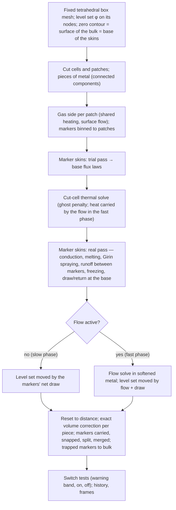

# A level-set deforming body with a flow solve and marker skins (the level-set architecture) — Design

Date: 2026-10-11
Status: draft for Asha's review. Designed with Asha in the brainstorming session of 2026-10-10 to 2026-10-11; every
decision is listed with its date in §19.
Architecture: **level set**, a second model architecture built in parallel to the existing one, which Asha calls
**skyscrapers** (the element model of Step 3 and its successor, the layered skins on columns of a moving mesh,
`docs/superpowers/specs/2026-10-11-layered-skin-moving-mesh-design.md`). The two are selected by a run flag (§4.3).
Relation to other designs: this design neither amends nor supersedes any skyscrapers design. It reuses their physics
(Girin's spraying, the surface flow, Scheil's curve, the slurry viscosity) through shared modules (§4.2), and their
measured facts (§2). **The skins are not shared**: each architecture has its own (decided 2026-10-11). The skyscrapers design of 2026-10-11 records "a level-set method not adopted for
the flight model" (its §16); that decision stands for that architecture, and this one is built alongside it.
Numbers marked *measured* come from runs; *estimated* are calculations made for this design, to be measured in the
build stage named.

## 1. Purpose

The skyscrapers architecture represents the body on a mesh whose topology is fixed: the surface recedes and, in the
2026-10-11 design, moves with the metal, but the body cannot change its connectedness and its shape can change only as
far as the mesh can follow. Asha expects the late-flight remnant to change shape grossly, and wants the model to
capture it:

1. **Pancaking**: the softened remnant flattening under the aerodynamic pressure and the deceleration, as Chen et al.'s
   (2024) tin–bismuth sample flattened on its substrate.
2. **The leeward ring**: melt carried to the rear collecting into a ring or a cap.
3. **Necking and pinch-off** into large droplets (a later step, §3; this design must make it possible).

A level set — a smooth function on a fixed mesh whose zero contour is the metal's surface — represents any shape and
any change of topology without remeshing or surgery. Moved by a computed velocity of the metal, it captures slumping,
spreading and pinching as consequences of the flow rather than as programmed events. This design adds, on a fixed
tetrahedral mesh: the level set (§6), a sharp-surface thermal solve (§7), a flow solve in the softened metal (§8), skins
carried by markers that ride the moving surface (§9), the time stepping that joins them (§10) and the plasma-wind-tunnel
configuration used to verify it against high-speed video (§11).

Deliverables: (1) the flight of the 100 mm sphere (and the 50 mm sphere) with the body's shape free to deform once its
metal softens; (2) the tunnel test reproduced for comparison with its video; (3) exact mass and energy books; (4) a
model that runs alongside skyscrapers from the same command, with no shared file edited for one architecture's sake
(§4).

## 2. Facts this design relies on

| Topic | Fact | Source |
|---|---|---|
| What Chen et al. (2024) do | J. Mater. Res. Technol. 33, 9888–9897: a conservative level set (Olsson and Kreiss) for the metal–gas surface, incompressible Navier–Stokes in metal and gas together, surface tension as a volume force, an enthalpy-porosity model (Carman–Kozeny drag, constant not reported) for solid and liquid metal, Navier slip with a static contact angle; COMSOL, two-dimensional, 14 594–99 896 triangles. Validated on a tin–bismuth cylinder (8 × 10 mm) melting on copper over 200 s (spread 8 → 14.2 mm, final diameter reproduced, spreading too fast before full melting), aluminium injected into a 2.4 mm tube (infiltration about 78 mm), tin–bismuth draining through 6 mm beads (12.6 % retained against 12.2 %). Melting ranges 1 K and 0.1 K; capillary number below 10⁻⁶ in the first case; no gas shear, no mass leaving the surface. | read 2026-10-10 |
| Resolving the windward film with a level set is unaffordable | A film of 0.13–0.34 mm needs about eight cells across it (about four for the smeared surface, four for the flow), so 20–40 µm cells; a 0.5 mm band over the 100 mm sphere is 0.25–2 billion cells in three dimensions with 1.4–3.9 µs steps for about 60 s of melting. The film stays below the grid in this design. | estimated 2026-10-10 |
| Recession speeds | Deepest recession 16.6 mm at 50 s, 29.0 mm at 60 s, 43.0 mm at 80 s on the 100 mm flight: 1.24 mm/s over 50–60 s, 0.70 mm/s over 60–80 s. | measured 2026-10-07 (frames of the fixed-flux 0.5 s run) |
| The remnant late in the flight | 100 mm flight to 120 s (1.4 mm mesh, `--dt-continuum` 0.0125 s, seed 12345): at 90, 100, 110, 120 s the dynamic pressure is 3 804, 3 456, 2 866, 2 259 Pa, the deceleration 9.2, 10.4, 9.2, 7.6 g, the mass 0.55, 0.39, 0.32, 0.30 kg (of 1.47 kg), the equivalent diameter 72, 64, 60, 59 mm, the rear surface 801, 836, 858, 871 K (Scheil liquid fraction 6, 10, 16, 22 %), the mean non-rigid depth 0.50, 0.86, 1.61, 2.94 mm. The metal has not softened in bulk by 120 s; the run ends there. | measured (`prototype/work-2026-10-08-gridgate/runs/hs14_seed12345`), read 2026-10-11 |
| A softened remnant would flatten and break, not settle | With the remnant's diameter and the flight's dynamic pressure at 80–120 s: Weber number q D/σ 166–373 (drops break above about 12, Pilch and Erdman 1987); Ohnesorge number 0.08–0.47 at slurry viscosities of 1–5 Pa·s; characteristic breakup time D/V √(ρ_l/ρ_g) 38–46 ms. | estimated 2026-10-11 from the row above (σ 0.80 N/m, ρ_l 2 400 kg/m³) |
| Strength of the mush | Chen G. et al. (2016) law: the mush above half solid strains less than 1 % in 45 s at 1–40 kPa except within 0.4–1.9 K of the half-liquid temperature (895.1 K on `AA7075_scheil`). Below half solid, Li Yageng et al. (2014): 0.87–5.6 Pa·s. | Step 4 plan, decisions of record (2026-09-27/28) |
| Film and layer speeds | Wall shear 30–32 Pa on the windward patches at 60–80 s; a 10 µm film moves at about 0.25 m/s, a layer sheared over δ_m at about 8 m/s, a 1 mm layer under the pressure gradient at about 10 m/s. | measured 2026-10-05; fact 47 |
| δ_m and the flowing layer | Per patch, median δ_m 228–314 µm, deepest 485 µm at 120 s; mean non-rigid depth over wet windward patches 0.06 mm at 50–60 s rising to 3.38 mm at 120 s. | layered-skin design §2 (measured 2026-10-10) |
| Patch counts and skin cost | 18 830 surface patches on the 2.0 mm mesh, 38 208 on 1.4 mm; about 1.3 ms per skin per macro step at 10 µm cells. | fact 101 (measured); sub-plan 18 (estimated while checking its code) |
| Cut-cell matrices | skfem's speed comes from element matrices computed once (assembly 0.004 s for 87 632 tetrahedra fixed against 0.074 s recomputed). | measured 2026-09-27 (recession design §2) |

## 3. Scope

In scope: the isolation of the architecture and the shared modules (§4); the level set and its mass books (§6); the
cut-cell thermal solve with heat carried by the flow (§7); the flow solve in softened metal (§8); marker skins with
Girin's spraying (§9); the time stepping (§10); the tunnel configuration and the video comparison (§11); settings,
outputs and code (§12); verification (§13); build stages (§14).

Out of scope, recorded in §17: the large-droplet step (necking and pinch-off made into droplet records — the level set
already pinches; the step that turns pinched pieces into fragment records is later); tumbling (the attitude is fixed in
both frames); coupling to a computed gas flow (the gas loads come from the existing angle-based law, with Step 4's CFD
hook as the later remedy); the flow solve on cut cells (diffuse first, §8.6); a FEniCSx port (§7.6).

## 4. Isolation from the skyscrapers architecture (Asha's instruction of 2026-10-11)

### 4.1 The rule

The level-set architecture is built so that it can be developed in parallel with skyscrapers without code or plans
clashing.

- **Existing files are not edited for the level set.** Where the level set needs a changed version of an existing
  module, the module is **copied** into `reentry_model/levelset/` and changed there. The copy's header records the file
  and commit it was copied from.
- **Shared code is factored out once.** Code that both architectures use unchanged moves into a new package,
  `reentry_model/shared/`, which depends on neither architecture; the existing code is changed to import it (§4.2).
  This refactor is the only edit to existing files, and it changes no behaviour (§14, stage 0).
- **One flag selects the architecture** (§4.3).
- **Documents and prototypes live apart**: this design in `docs/superpowers/specs/levelset/`, its sub-plans in
  `docs/superpowers/plans/levelset/`, its prototype code in `prototype/levelset/`, its tests in `tests/levelset/`.
  Nothing in `docs/superpowers/plans/melt-spraying-subplans/` or the skyscrapers prototype work copies is edited; where
  the level-set prototype needs skyscrapers code that is not yet in the package (Step 3's physics lives in prototype
  work copies), it copies it into `prototype/levelset/` and records where from.

### 4.2 The shared package

`reentry_model/shared/` receives the modules that are architecture-independent today:

| Module now | Shared as | Why shared |
|---|---|---|
| `trajectory.py`, `earth.py`, `atmosphere.py`, `fap.py`, `aero.py`, `gas.py`, `constants.py` | `shared/` (same names) | the trajectory and the freestream are identical in both |
| `heating.py` | `shared/heating.py` | per-patch heating from θ and wall temperature; both architectures call it per patch |
| `material.py` | `shared/material.py` | the material laws (and, when promoted, Scheil's curve and the slurry viscosity) |
| `sesam_io.py`, `compare.py` | `shared/` | references and metrics |
| `body.py`: the `Body` protocol and `ConstantBody` | `shared/body.py` | the seam both architectures implement; Step 1 needs no architecture |
| `thermal/__init__.py`: `ThermalSolver`, `StepResult`, `MissingBackend` | `shared/thermal.py` | the backend protocol |
| `cli.py`: `parse_epoch`, `make_atmosphere`, `provenance`, `git_commit`, the common run arguments | `shared/cli_common.py` | both run commands take the same flight arguments |
| `viz.py`: frame reading and the time series plots | `shared/viz.py` | both write VTK series |

The skyscrapers-specific code stays where it is (`mesh.py`, `coupled.py`, `thermal/skfem_backend.py`,
`thermal/fenicsx_backend.py`, the thermal part of `body.py`, the run driver in `cli.py`) and imports from `shared`.
**The old module paths stay importable as one-line re-exports** (for example `reentry_model/atmosphere.py` containing
`from .shared.atmosphere import *`), so the tests, the analysis scripts and the skyscrapers prototype work copies keep
working unchanged; the package's own modules import from `shared` directly.

Step 3's physics — the gas-side surface flow, Girin's dispersion table and spray model, Scheil's material, the slurry
viscosity (`rheology`) — is not yet in the package. **Whichever architecture promotes such a module into the package
first puts it in `shared/`**, in an architecture-independent form; the other imports it. Until then each prototype
holds its own copy. **The skins are the exception: they are separate entities in the two architectures and are never
shared** (decided 2026-10-11). The level set's skins (§9) live only in `reentry_model/levelset/skin.py`; nothing of the
skyscrapers skins (`skin.py`, `columns.py` of the layered-skin design) is imported or copied into it.

### 4.3 The architecture flag

`reentry_model run` gains `--architecture skyscrapers|levelset` (default `skyscrapers`). With `skyscrapers`, the run is
exactly today's: the same arguments, the same run names, bit-identical results. With `levelset`, the command builds the
run through `reentry_model.levelset.cli`, which takes the common flight arguments from `shared/cli_common.py` and the
level-set settings of §12.1. Until the level-set run driver exists (stage 0 ships the flag before stage 1), choosing
`levelset` exits with code 2 and a message, as a missing optional library does. Level-set run names carry the suffix
`_arch-levelset`, so the two architectures share an output directory without overwriting each other and resumable
sweeps stay correct (the repository's run-name rule).

### 4.4 Coordination

- Stage 0 (§14) is one behaviour-preserving change: the shared package, the re-exports, the imports and the flag. It
  is accepted only if the unit tier and the reference tier pass with bit-identical histories. It touches `cli.py` and
  the imports of existing modules, which skyscrapers sub-plans also touch; it is therefore done on its own branch from
  `main`, reviewed and merged before any level-set code, and announced in the skyscrapers shared context so their next
  sub-plan rebases on it.
- Level-set work proceeds on its own branch, `levelset`, from `main` after stage 0.
- Shared modules change only through a change that keeps both architectures' tests passing.

## 5. Architecture

The trajectory sees only mass, area and a temperature through the shared `Body` protocol; `LevelSetBody`
(`reentry_model/levelset/body.py`) implements it. Nothing in the trajectory changes.

## 6. Geometry: the level set

### 6.1 The mesh

A fixed tetrahedral mesh of a box around the body (generated once with gmsh, cached by geometry like today's meshes).
The box encloses the original sphere with a margin for spreading (laterally 1.5 times the diameter, setting); its
cells are uniform at the cell size (`--cell`, 2 mm default, 1 mm for convergence). Cells holding no metal are inactive
and cost nothing in the solves. Stage 1 measures generation time and memory: a 150 mm box is about 3.6 million
tetrahedra at 2 mm (estimated), of which at most about 0.55 million hold metal at the start and fewer later. If 1 mm
proves too large to store on the laptop, the 1 mm runs are made on the MIT cluster, or the fast phase's mesh is
generated afresh around the remnant at its switch-on (recorded in §17 as the fallback).

### 6.2 The level set

φ is a P1 nodal field: negative inside the metal, positive outside, its zero contour the surface of the bulk metal. It
is kept close to a signed distance by a reset (reinitialisation) after every move. Where a skin exists, the zero
contour is the **skin's base** (§9.3); the metal's true outer surface is the zero contour moved out by the local skin
thickness. Each cut tetrahedron holds one flat piece of the zero contour: its **patch**, with an area, a centroid and the
normal ∇φ/|∇φ|. Patches replace the facets of today's mesh for every consumer: the heating (θ from the smooth normal,
not a staircase), the surface flow, the runoff graph (neighbouring patches share a face of the mesh), the radiation.

### 6.3 Pieces

The metal's connected components are found every step from the active cells. A piece that separates (pinch-off) gets its
own mass account (§6.4) and keeps its markers (§9.6). **Proposed in this document, not yet agreed:** in the flight,
every piece other than the largest is recorded and removed from the run (its fate, and turning it into a droplet record,
is the later step), so that the fast phase does not follow detached pieces out of the box; in the tunnel, pieces that
stay on the holder remain.

### 6.4 The mass books (decided 2026-10-11: option 1)

The level set is authoritative for volume, with an **exact correction per piece**. Each piece keeps an account: its
previous mass, minus what its skins drew, plus what they returned, plus or minus what pinch-off or merging moved
between pieces. After every move of φ, a uniform shift of φ over each piece moves its zero contour in or out until the
piece's cut-cell volume times the density equals its account, to round-off. The enthalpy of the metal the shift adds or
removes is booked to the nearest nodes as a deferred load, the rule every transfer in the model follows. The correction
is exact per piece, not per cell: the leak of the level-set advection is spread over the piece rather than kept where it
occurred. The largest relative correction per step is recorded (`volume_correction_max`) so that a leak concentrating
somewhere that matters (a thinning neck) is visible.

Alternatives considered (§18): a fill fraction per cell transported by the flow (coupled level set and volume of fluid,
exact per cell, but geometric fluxes on tetrahedra are a project of their own); Chen et al.'s conservative level set
(approximately conserving only).

## 7. The thermal solve on the moving body (decided 2026-10-11)

### 7.1 Why sharp

The skins' base law has a conductance of about 3.2 × 10⁵ W m⁻² K⁻¹ and needs the 3D temperature at the base itself; a
diffuse surface would smear it over 2–4 mm and break the exact energy books by letting heat leak into empty cells. The
thermal solve therefore integrates over the metal only and applies its boundary conditions on the zero contour.

### 7.2 Cut cells

A tetrahedron cut by the zero contour has as its metal part a tetrahedron or a wedge (three tetrahedra); the capacity
and conduction terms are integrated over those pieces, and the boundary terms over the patch. This is written and tested
in the repository (`levelset/cutcell.py`); no library is needed. Temperature stays P1 at the nodes. A node outside the
metal keeps a value while any of its cells holds metal; nodes whose cells hold none leave the system.

### 7.3 Small cut cells: the ghost penalty (decided 2026-10-11)

A cell holding a sliver of metal makes the system ill-conditioned. A ghost penalty (Burman 2010) — a term on the faces
of cut cells penalising jumps of the temperature gradient, scaled to vanish under refinement — keeps it well
conditioned without changing which nodes are unknowns from step to step. skfem integrates over interior faces.

### 7.4 Heat carried by the flow

In the fast phase the energy equation gains advection, in conservative form so that what leaves a cell enters its
neighbour exactly. The Péclet number is about 30 at 1 m/s and 1 mm cells (estimated), so the advection is stabilised
(streamline-upwind Petrov–Galerkin). Every other change of the metal — draws and returns at skin bases, the per-piece
volume correction, the metal of trapped markers — is booked to the nodes as a deferred load.

### 7.5 Boundary conditions on the zero contour

Patches carrying skins: the skins' base flux law q_b(T_b) = a + b T_b, applied implicitly as in the skin designs, with
no radiation. Patches without skins: the convective heat flux and εσ(T⁴ − T_amb⁴), implicit as today. In the tunnel,
the holder is a separate solid region of the same mesh with its own conductivity, exchanging heat with the metal where
they touch.

### 7.6 Backend (decided 2026-10-11: scikit-fem first)

A new backend, `levelset/thermal/skfem_cut.py`, a copy of `thermal/skfem_backend.py` changed for cut cells. Uncut
interior cells keep their precomputed element matrices; only the cut layer, about one cell thick, is recomputed each
step. A FEniCSx port is made only if MPI scaling is needed.

## 8. The flow solve

### 8.1 Equations

Incompressible Navier–Stokes in the metal only: ∇·u = 0 and ρ(∂u/∂t + u·∇u) = −∇p + ∇·(2η D(u)) + ρ f, with u the
velocity, p the pressure, η the viscosity, D(u) the strain-rate tensor and f the body force per unit mass of §8.2. The
gas is not solved: hypersonic flow is outside an incompressible solver, and its effects enter as forces on the surface
(§8.4). The few-per-cent shrinkage on solidification is neglected (assumption, §16).

### 8.2 Frame of reference

The flight frame translates with the body without rotating (fixed attitude). While a rigid core remains, the frame is
fixed to it; the flowing metal moves relative to it, and the frame's acceleration is the net external force on the body,
less the rate of change of the flowing metal's momentum in the frame, divided by the total mass. Gravity acts equally on
metal and frame and drops out; the body force is f = −a_frame, which pushes every kilogram toward the windward face with
the deceleration (8–10 g at 90–120 s, §2). If no rigid core remains, the frame moves with the centre of mass and the
mean velocity of the metal is held at zero. In the tunnel the frame is the laboratory and f is gravity.

### 8.3 Viscosity and the rigid region

η depends on the Scheil liquid fraction and on the shear rate: liquid aluminium's 1.3 mPa·s above the liquidus (908 K);
Li et al.'s law, η = [0.871 − 0.00849 γ̇^0.74924] exp(3.7311 f_s) Pa·s, between half and fully liquid, with the shear
rate held at no more than 367 1/s and the labelled log-linear bridge to the liquid below 10 % solid (as in the Step 4
plan, `shared/rheology.py` when promoted). **Metal less than half liquid is rigid**: the surface where the metal is half
liquid (895.1 K) is a no-slip wall of the flow solve. This follows the Step 4 finding (§2) and replaces Chen et al.'s
drag term, whose constant is unreported and whose "solid" is only about ten times stiffer than the slurry. Step 4's strain
check can be run on the rigid region to report whether that holds.

### 8.4 Forces on the surface

On each patch: the gas pressure from the existing angle-based law with its shelter test (any shape); the gas shear from
the surface flow; surface tension σκ (σ = 0.80 N/m for liquid and slurry, the Step 4 value, labelled for slurry),
applied through the weak form's surface integral so that curvature is not differentiated twice; and **the skin's own
mass** as a surface load (its weight and inertia in the frame), since the skin sits outside the flow domain and holds
about 4 % of a 60 mm remnant's metal at 0.4 mm (estimated). All act on the zero contour, which lies the skin's thickness
below the true surface — less than half a cell at 1 mm (approximation, §15).

### 8.5 When the flow solve runs

At the end of each macro step, the solve is switched on if metal more than half liquid, connected to the surface, forms
a region at least `--flow-switch-cells` (default 3) cells thick. Before that, thin soft metal under the skins is held in
place (approximation, §15).

### 8.6 Discretisation (decided 2026-10-11: diffuse first)

The flow is solved on the active cells plus a margin of a few cells (P1–P1 with pressure stabilisation, implicit, the
viscosity iterated to agreement), with Chen et al.'s diffuse treatment of the surface: cells outside the metal take a
density and viscosity a thousand times smaller (a numerical device, labelled), and the surface forces are spread over
about two cells either side of the zero contour. A cut-cell flow solve using the thermal solve's cut-cell integration is
the upgrade if verification shows the smearing matters.

### 8.7 Surface tension semi-implicit (decided 2026-10-11)

With surface tension evaluated explicitly, the step is held near 0.5 ms at 1 mm cells however slowly the metal moves;
a slow slump in the tunnel lasting about 100 s (Chen et al.'s timescale) would take about 200 000 steps. Surface tension
is therefore treated semi-implicitly (the surface's position advanced with the step's velocity inside the curvature
term, Bänsch 2001; Hysing 2006), so that slow flows take steps limited by how far the metal moves and by the skins'
sub-step.

### 8.8 Velocity of the surface

φ is advected by u plus the skins' recession speed along the normal, V_n = (net mass drawn by the patch's markers) /
(ρ A Δt), positive inward; then reset to a distance and corrected per piece (§6.4).

## 9. Skins on markers

### 9.1 What a marker is (decided 2026-10-11)

A **marker** is a point on the zero contour carrying one skin and an area. Markers exist on every free surface;
a marker carries a skin once its patch first reaches the solidus or liquid first runs onto it. Each step a marker is
**carried** by the flow velocity at its position and then **snapped** back onto the zero contour along the normal
(by −φ ∇φ/|∇φ|, iterated once). While the flow solve is off, the only motion is the surface's recession, and markers
follow it with no hand-overs.

### 9.2 Area, stretching and gathering

A marker's area changes with the surface's stretching (A grows by A ∇_s·u Δt, ∇_s the surface divergence); its skin's
mass does not, so a stretched skin thins and draws metal from the bulk to its thickness (§9.3), and a gathered skin
thickens and returns metal at its base. **Split**: a marker whose area exceeds twice the target (the patch area at the
cell size) splits in two along the surface, each with the same profile and half the mass and area. **Merge**: two markers
closer than a third of the target spacing merge, their columns mixed layer by layer by mass and enthalpy (the hand-over
rule of the skin designs). Splits and merges conserve mass and enthalpy exactly and are counted.

### 9.3 The skin and its base (decided 2026-10-11)

The skin's **base lies on the zero contour**; the skin stands outward from it. The skin has two zones (decided
2026-10-11, Asha's proposal that the skin replaces the film and the deep account):

- a **metal zone** of solid, mush and slurry, kept at `s = 0.4 mm` by drawing metal from the bulk across the base (the
  zero contour moves inward) and returning metal above 2s (the zero contour moves outward); 10 µm cells (20 µm in
  development);
- a **liquid zone** on top, of continuously variable thickness with its own cells, holding the free liquid. A metal-zone
  cell that becomes fully liquid (at or above the feed temperature, the top of the melting ramp) is relabelled into the
  liquid zone; a liquid-zone cell that cools into the melting range is relabelled back. Freezing therefore comes from
  the skin's own conduction; the energy-limited freeze-back rule and the dead band of the 2026-10-07 design are not
  used.

At creation the skin takes a slab of thickness s from the bulk under its patch (the zero contour steps inward by s there)
with its cells filled from the 3D field along the normal. The base is a bookkeeping boundary, not a physical front: the
melting front lies inside the skin, and the half-liquid surface lies in the skin or in the bulk.

### 9.4 Coupling to the patches and the 3D solve

Each step every marker is assigned to the patch whose cut cell contains it. The patch's heating, wall shear, pressure
gradient and Girin closure are passed to its markers; the patch's boundary law in the thermal solve is the
area-weighted sum of its markers' base flux laws; each marker reads its base temperature from the 3D field at its own
position; the mismatch between what the skins passed and what the 3D solve received is booked per patch as a deferred
load (the skin designs' interface, with its tolerance and repeat).

### 9.5 Spraying and runoff

Girin's spraying acts on each marker's liquid zone with the film thickness b read as the liquid zone's depth and the
thick or thin branch decided from it and δ_m (the shared spray model). The release is capped by the **renewal limit**:
liquid deeper than δ_m below the top becomes sprayable at most at ρ_l δ_m A per renewal time δ_m²/ν_l (about
0.1–0.16 s), which keeps the momentum-diffusion physics of the 2026-10-07 deep account without the account.
Runoff relative to the surface moves liquid between neighbouring markers (a neighbour graph rebuilt each step from the
patch graph) with the lubrication fluxes of the melt film model, with b the liquid zone's depth, carrying the donor's
liquid enthalpy. Droplet records are combined per marker-patch, per mode, per macro step, as in the skin designs.

### 9.6 Topology

At pinch-off each marker belongs to the piece whose zero contour it snaps onto. Where two surfaces meet (the ring
closing, the pancake folding), markers left with no surface within half a cell are **trapped**: their skin's metal and
liquid return to the bulk cell containing them, with their enthalpy, as a deferred load.

## 10. Time stepping (decided 2026-10-11)

### 10.1 Slow phase (flow off; most of the flight)

The macro step is `--dt` (0.5 s), or the short continuum step where the existing `--dt-continuum` rule applies. Each
macro step: (1) trajectory, with mass, frontal area and shape factor from the level set; (2) gas side once per patch;
(3) skins' trial pass, implicit cut-cell 3D solve, skins' real pass on 10 ms sub-steps (conduction, relabelling,
spraying, runoff, freezing, draw and return); (4) φ moved by the net draw, reset, corrected per piece; (5) markers
snapped, split, merged; (6) the warning-band and switch tests; (7) history and frames. Until the switch first fires, a
level-set run is unchanged by the flow solve's existence.

### 10.2 Warning band

When metal within `--warning-band` kelvin (default 3 K) of the half-liquid temperature forms a region near the switch
size, the macro step shortens to 10 ms until the switch fires or the region cools away, so that softened metal is not
held rigid for up to half a second (the collapse itself takes tens of milliseconds, §2).

### 10.3 Fast phase (flow on)

The flow step is the smallest of: the metal crossing half a cell, the stability limit of the semi-implicit surface
tension, and the skins' 10 ms sub-step. Each flow step: (1) trajectory; (2) gas loads re-evaluated when the surface has
moved more than a tenth of a cell since their last evaluation; (3) flow solve with surface forces and the skins' mass
load, rigid metal held; (4) thermal solve with advection, the skins' trial and real pass over the one step; (5) φ moved
by u and the draw, reset, corrected per piece; (6) markers carried, snapped, split, merged, trapped markers returned;
(7) pieces found, new pieces given accounts; (8) switch-off test: off once no region qualifying under §8.5 has existed for
20 ms in a row; (9) history rows and frames every 10 ms.

### 10.4 Rejoining the macro grid

When the fast phase ends inside a macro interval, one shortened slow-phase step brings the clock to the next macro
boundary (for example 101.37 → 101.5 s), so that histories and frames of different runs and seeds share their times.
Fast phases may recur; each starts and ends the same way and is recorded.

### 10.5 Cost (estimated; measured in stages 3 and 4)

Fast phase at 1 mm: the remnant's metal (about 0.3 kg, §2) is about 0.9 million active tetrahedra, about 1.2 million
with the margin; with the semi-implicit surface tension and flow speeds of 1–2 m/s, a flight window of 0.1–0.3 s takes a
few hundred to a thousand steps — tens of minutes to a few hours on the laptop. At 2 mm about eight times fewer cells.
Skins: about 30 000 markers at about 26 µs per skin per sub-step (from the 1.3 ms per macro step of 50 sub-steps,
estimated) is about 0.8 s per flow step. The slow phase costs the cut-cell thermal solve on at most 0.55 million active
tetrahedra at 2 mm (about three times today's 177 363), plus the skins.

## 11. The tunnel configuration (verification)

The plasma wind tunnel test is the architecture's validation against high-speed video (decided 2026-10-11: the flight
is the result, the tunnel the verification). `levelset/tunnel.py` configures: the laboratory frame and gravity; the
sample on its holder, the holder a solid region conducting heat and a boundary of the flow solve with Navier slip and a
static contact angle (Chen et al.'s wetting condition); the tunnel's heat flux, pressure and gas from the test record
(`--tunnel <record.json>`); no trajectory. Markers exist only on free surfaces; the melt–holder contact carries the
contact condition, not a skin.

**The comparison**: the outline of the metal seen from the camera's direction (the zero contour moved out by the skin
thickness, projected), frame by frame against the video — the frontal outline, the recession of the front, the
flattening, the ring's position and size, the times of key events. The metrics (for example the mean distance between
outlines in millimetres, and event times) are written down, with their acceptance values, **before** any comparison is
made, so that nothing is tuned to the video.

The record is not yet available (sample size, holder, gas, heat flux, pressure, speed, duration, frame rate); stage 5
waits for it (§17).

## 12. Settings, outputs and code

### 12.1 Settings (level-set run command; common flight arguments shared)

| Setting | Default | Run-name suffix when not default |
|---|---|---|
| `--architecture skyscrapers\|levelset` | `skyscrapers` | `_arch-levelset` |
| `--cell` (mm) | 2.0 | `_cell<value>mm` |
| `--box-margin` (diameters) | 1.5 | `_box<value>` |
| `--flow on\|off` | `on` | `_flow-off` |
| `--flow-switch-cells` | 3 | `_switch<value>` |
| `--warning-band` (K) | 3 | `_warn<value>K` |
| `--skin-thickness` (mm), `--skin-cell` (µm), `--skin-substep` (ms) | 0.4, 10, 10 | as in the skin designs |
| `--tunnel <record.json>` | none (flight) | `_tunnel-<record stem>` |

A malformed value exits with code 2, as every setting does.

### 12.2 Outputs

History columns added for level-set runs: `n_pieces`, `softened_mass_kg` (metal more than half liquid), `flowing_mass_kg`,
`flow_active`, `flow_steps` (cumulative), `volume_correction_max`, `n_markers`, `marker_splits`, `marker_merges`,
`markers_trapped` (cumulative), `frontal_area_m2`, `interface_mismatch_J`, and the skin columns of the skin designs. Frames:
the level set, the markers with their skin depths, and the projected outline, every `--frames-every` macro steps and
every 10 ms in fast phases. Pieces removed in flight are written to `pieces.csv` (time, mass, enthalpy, position,
velocity) for the later droplet step.

### 12.3 Code

- `reentry_model/shared/` — §4.2.
- `reentry_model/levelset/`: `cli.py` (run driver), `body.py` (`LevelSetBody`), `coupled.py` (copy of `coupled.py`
  with the two phases), `boxmesh.py` (copy of the gmsh parts of `mesh.py` for the box), `levelset.py` (φ, reset,
  advection, pieces, per-piece correction), `cutcell.py` (cutting, quadrature, patches, ghost-penalty faces),
  `thermal/skfem_cut.py`, `flow.py` (Navier–Stokes, frame, semi-implicit surface tension), `markers.py` (carry, snap,
  split, merge, trapped, binning, neighbour graph), `skin.py` (two-zone skins on markers, the level set's
  own, never shared with skyscrapers), `tunnel.py`.
- `tests/levelset/` with its own fixtures; the normal loop runs it with the rest of the unit tier.

## 13. Verification and acceptance (decided 2026-10-11)

Each stage is verified before the next is built; exact or published answers first, then agreement with skyscrapers
where their scopes overlap.

1. **Level set geometry**: a level set on the sphere reproduces its volume and area; a prescribed recession field gives
   its analytic shape; the per-piece correction is exact to round-off; a dumbbell with a shrinking neck pinches into two
   pieces with exact volumes.
2. **Thermal**: with the zero contour on today's sphere, Step 2's verification against SESAM within its thresholds; a
   receding slab against the Stefan solution; energy closed to round-off across recession, a prescribed flow and the
   per-piece correction; a surface swept slowly through cells shows no temperature jumps as cells pass through slivers.
3. **Flow**: a resting drop with negligible spurious currents; Chen et al.'s tin–bismuth case (spread 8 → about
   14.2 mm against their measurements); a drop under a prescribed gas stream flattening without breakup below a Weber
   number of about 12 and breaking above; a slow viscous slump against Huppert's (1982) axisymmetric spreading law
   (radius growing as time to the one-eighth); mass and energy exact across switch-on and switch-off.
4. **Marker skins**: rigid translation and rotation leave skins unchanged; uniform stretching thins skins and draws
   exactly the implied metal; merges conserve mass and enthalpy; the layered-skin design's level 1 skin checks (steady
   ablation, receding top) and its level 2 box (q6p, 8 × 10 × 10 mm, 6 MW/m², 2 s) with the level set's surface on the
   box; on the 100 mm flight while the body is rigid, agreement with the skyscrapers model within the scatter between
   seeds (sanity check, not a reference).
5. **Tunnel**: the comparison of §11 against the pre-registered metrics.
- **Flight, throughout**: before the metal first softens, the level-set body reproduces Step 1 and Step 2 against SESAM
  within their thresholds, so everything verified so far stays verified. The flight result is then reported with the
  convergence checks of the layered-skin design's level 3 (halving the macro step, 10 against 20 µm cells) plus 2 against
  1 mm cells for the level set.

## 14. Build stages and documents

0. **Isolation**: the shared package, the re-exports, the imports, the `--architecture` flag (levelset exits 2 until
   stage 1's driver exists). Accepted on bit-identical unit and reference tiers. Own branch, merged first (§4.4).
1. **Level set geometry** (§6) with a prescribed surface motion; the box mesh's cost and memory measured.
2. **Thermal solve** (§7) on the moving body, with prescribed motion and prescribed flow.
3. **Flow solve** (§8) and the fast phase (§10.3–10.4).
4. **Marker skins** (§9) and the flight.
5. **Tunnel configuration** (§11) and the video comparison.

Each stage gets its own sub-plan in `docs/superpowers/plans/levelset/` (`01-…`, `02-…`), written after the previous
stage is verified; each is prototyped in `prototype/levelset/` with its code blocks tested before they are written into
the plan, the repository's prototype-then-plan practice. `README.md` and `docs/model_assumptions.md` gain a level-set
section, kept true as each stage lands.

## 15. Risks and approximations

- **The thermal core.** Every recorded failure in this project lives there (Newton cycling across the latent ramp,
  nodes driven to 5 000 K, limit cycles). Cut cells add slivers; the ghost penalty and the sliver sweep test (§13.2)
  address them; the stage is not passed until the test is clean.
- **Diffuse flow surface**: forces smeared over about four cells; gas cells a thousand times lighter (numerical device).
- **Forces at the zero contour**, a skin thickness below the true surface (less than half a cell at 1 mm).
- **Thin soft metal under the skins is held in place before the switch** (the metal zone's slurry does not flow, and soft
  metal below the skin is rigid until it forms a region three cells thick). The skyscrapers design resolves this layer's
  flow in its columns; the level set's skins are kept separate from those by decision (§19), so this approximation is
  measured in stage 4 (the soft depth held in place, per step) and revisited in a level-set design of its own if it
  matters.
- **Gas loads from the angle-based law** on shapes far from a sphere (a disc, a bag): rough; the CFD hook is the remedy.
- **Grid-scale breakup**: sheets thinner than a cell tear at the cell size, so fragment sizes from breakup depend on the
  mesh; fragments are not used as results until the later droplet step addresses it.
- **Per-piece, not per-cell, volume correction** (§6.4), monitored.
- **Mixing at merges** of markers smears skin profiles where the surface gathers (the ring).
- **Mesh memory at 1 mm** (§6.1).

## 16. Assumptions to state in the thesis

Fixed attitude; incompressible metal (shrinkage neglected); metal less than half liquid rigid; Li et al.'s slurry law
used beyond its measured shear rates (held at 367 1/s) with a labelled bridge to the liquid; σ = 0.80 N/m for slurry;
gas loads from the angle-based law; surface forces applied at the skin base; the diffuse flow surface; the per-piece
volume correction; pieces other than the largest removed in flight (to the later droplet step).

## 17. Open items, for later decisions

1. **Resolved 2026-10-11: the skins are not shared.** The skyscrapers layered skin (whole flowing layer, a velocity in
   every cell) was considered as a shared skin; Asha decided the skins stay separate entities in the two architectures.
2. **The tunnel record** (§11): needed for stage 5.
3. **Gas loads on deformed shapes**: the CFD hook (Step 4) when the angle-based law is shown inadequate.
4. **A FEniCSx port** of the cut-cell thermal solve, if MPI scaling is needed.
5. **The large-droplet step**: turning pinched pieces into fragment records, and the boundary with the Spheral
   large-fragment design's loss-of-strength route (a level-set flow solve has the viscosity and surface tension that
   Spheral lacks, so the slurry route may move here; Spheral keeps the tearing of the mush).
6. **Fallback mesh strategy** at 1 mm (§6.1).
7. **A cut-cell flow solve** if diffuse smearing matters (§8.6).

## 18. Alternatives considered

- **Resolving the film with the level set** (cells of 20–40 µm): unaffordable (§2).
- **A level set only for thick liquid** (0.1–0.2 mm cells, liquid thicker than about 1 mm resolved): affordable in two
  dimensions, rejected as the flight model because the deformation of interest is of the whole remnant.
- **A level set for shape only, without a flow solve** (the first "version C"): cannot pancake, since the surface moves
  only as metal melts and sprays; superseded by adding the flow solve (2026-10-11).
- **Skins owned by cut cells**, handed over as the surface leaves a cell (approach A), or carried sideways between cells
  (cell transport): smear the skins' profiles over large motions; **skins as band fields** around the surface (approach
  C): many fields, conservation only approximate. Markers chosen (2026-10-11).
- **The level set marking the true outer surface**, with the bulk boundary inside it: the variable skin thickness would
  make the bulk boundary a second irregular surface; the base on the zero contour chosen (2026-10-11).
- **Mass books** by fill fraction per cell or by a conservative level set (§6.4).
- **Chen et al.'s enthalpy-porosity drag** for the solid: replaced by the rigid half-liquid wall (§8.3).
- **A diffuse thermal surface**: rejected for the skins' stiff base law (§7.1).
- **Smoothed particle hydrodynamics** (Spheral) for the deformation: no physical viscosity or surface tension, and an
  explicit step of about 0.1 µs at 2 mm; kept for tearing of the mush (the Spheral design).

## 19. Decisions of record

- 2026-10-10: Chen et al. (2024) assessed: their method is not a replacement for resolving the windward film; useful
  for thick liquid, the ring and the tunnel (Asha's question).
- 2026-10-11: shape tracked by a level set on a fixed mesh with the film below the grid (version C), then a flow solve in
  the body added so that the shape can pancake, ring and pinch (Asha: "add a flow solve in the body").
- 2026-10-11: the skin replaces the film and the deep account (Asha's proposal): two zones, the renewal limit kept as a
  cap on spraying.
- 2026-10-11: purpose — the flight is the result, the plasma wind tunnel test the verification against high-speed video;
  the level set to capture pancaking, the leeward ring, and later necking and pinch-off.
- 2026-10-11: skins on markers riding the moving surface; the skin's base on the zero contour.
- 2026-10-11: mass books by option 1, the level set authoritative with an exact correction per piece.
- 2026-10-11: time stepping with a warning band, a closing step back to the macro grid, and semi-implicit surface tension.
- 2026-10-11: the thermal solve on cut cells with a ghost penalty, on scikit-fem first.
- 2026-10-11: the verification of §13 and the settings, outputs and code of §12.
- 2026-10-11: the skins are separate entities in the two architectures and are never shared (Asha).
- 2026-10-11: isolation (Asha's instruction): copies of changed files in `reentry_model/levelset/`, shared code in
  `reentry_model/shared/` imported by the existing code, `--architecture skyscrapers|levelset`, documents and prototypes
  in their own `levelset` folders.
