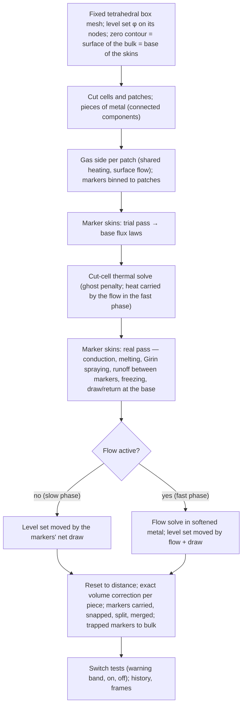

# A level-set deforming body with a flow solve and marker skins (the level-set architecture) — Design

Date: 2026-10-11
Status: draft for Asha's review. Designed with Asha in the brainstorming session of 2026-10-10 to 2026-10-11; every
decision is listed with its date in §19. Revised 2026-10-12: the shared-package refactor waits for the skyscrapers
port of the prototyped Step 3 code to land on `main` (§4.2, §4.4, §13, §14). **Amended 2026-11-10 (§20, approved by
Asha 2026-11-10): two tracked interfaces — the outer surface φ (derived from the skin base β) and the molten-rigid surface ψ, the half-liquid
isotherm rebuilt each step — with an adaptively refined volume mesh for rigid metal and thick melt, skins on markers in
two modes, a ray-cast shadow test, and build steps reordered to parity with the skyscrapers first, then the first
leeward mass-loss mechanisms. §20.12 lists the sections it supersedes.**
Architecture: **level set**, a second model architecture built in parallel to the existing one, which Asha calls
**skyscrapers** (the element model of Step 3 and its successor, the layered skins on columns of a moving mesh,
`docs/superpowers/specs/2026-10-11-layered-skin-moving-mesh-design.md`). The two are selected by a run flag (§4.3).
Relation to other designs: this design neither amends nor supersedes any skyscrapers design. It reuses their physics
(Girin's spraying, the surface flow, Scheil's curve, the slurry viscosity) through shared modules (§4.2), and their
measured facts (§2). **The skins are not shared**: each architecture has its own (decided 2026-10-11). The skyscrapers design of 2026-10-11 records "a level-set method not adopted for
the flight model" (its §16); that decision stands for that architecture, and this one is built alongside it.
Numbers marked *measured* come from runs; *estimated* are calculations made for this design, to be measured in the
build stage named.

## 1. Purpose

The skyscrapers architecture represents the body on a mesh whose topology is fixed: the surface recedes and, in the
2026-10-11 design, moves with the metal, but the body cannot change its connectedness and its shape can change only as
far as the mesh can follow. Asha expects the late-flight remnant to change shape grossly, and wants the model to
capture it:

1. **Pancaking**: the softened remnant flattening under the aerodynamic pressure and the deceleration, as Chen et al.'s
   (2024) tin–bismuth sample flattened on its substrate.
2. **The leeward ring**: melt carried to the rear collecting into a ring or a cap.
3. **Necking and pinch-off** into large droplets (a later step, §3; this design must make it possible).

A level set — a smooth function on a fixed mesh whose zero contour is the metal's surface — represents any shape and
any change of topology without remeshing or surgery. Moved by a computed velocity of the metal, it captures slumping,
spreading and pinching as consequences of the flow rather than as programmed events. This design adds, on a fixed
tetrahedral mesh: the level set (§6), a sharp-surface thermal solve (§7), a flow solve in the softened metal (§8), skins
carried by markers that ride the moving surface (§9), the time stepping that joins them (§10) and the plasma-wind-tunnel
configuration used to verify it against high-speed video (§11).

Deliverables: (1) the flight of the 100 mm sphere (and the 50 mm sphere) with the body's shape free to deform once its
metal softens; (2) the tunnel test reproduced for comparison with its video; (3) exact mass and energy books; (4) a
model that runs alongside skyscrapers from the same command, with no shared file edited for one architecture's sake
(§4).

## 2. Facts this design relies on

| Topic | Fact | Source |
|---|---|---|
| What Chen et al. (2024) do | J. Mater. Res. Technol. 33, 9888–9897: a conservative level set (Olsson and Kreiss) for the metal–gas surface, incompressible Navier–Stokes in metal and gas together, surface tension as a volume force, an enthalpy-porosity model (Carman–Kozeny drag, constant not reported) for solid and liquid metal, Navier slip with a static contact angle; COMSOL, two-dimensional, 14 594–99 896 triangles. Validated on a tin–bismuth cylinder (8 × 10 mm) melting on copper over 200 s (spread 8 → 14.2 mm, final diameter reproduced, spreading too fast before full melting), aluminium injected into a 2.4 mm tube (infiltration about 78 mm), tin–bismuth draining through 6 mm beads (12.6 % retained against 12.2 %). Melting ranges 1 K and 0.1 K; capillary number below 10⁻⁶ in the first case; no gas shear, no mass leaving the surface. | read 2026-10-10 |
| Resolving the windward film with a level set is unaffordable | A film of 0.13–0.34 mm needs about eight cells across it (about four for the smeared surface, four for the flow), so 20–40 µm cells; a 0.5 mm band over the 100 mm sphere is 0.25–2 billion cells in three dimensions with 1.4–3.9 µs steps for about 60 s of melting. The film stays below the grid in this design. | estimated 2026-10-10 |
| Recession speeds | Deepest recession 16.6 mm at 50 s, 29.0 mm at 60 s, 43.0 mm at 80 s on the 100 mm flight: 1.24 mm/s over 50–60 s, 0.70 mm/s over 60–80 s. | measured 2026-10-07 (frames of the fixed-flux 0.5 s run) |
| The remnant late in the flight | 100 mm flight to 120 s (1.4 mm mesh, `--dt-continuum` 0.0125 s, seed 12345): at 90, 100, 110, 120 s the dynamic pressure is 3 804, 3 456, 2 866, 2 259 Pa, the deceleration 9.2, 10.4, 9.2, 7.6 g, the mass 0.55, 0.39, 0.32, 0.30 kg (of 1.47 kg), the equivalent diameter 72, 64, 60, 59 mm, the rear surface 801, 836, 858, 871 K (Scheil liquid fraction 6, 10, 16, 22 %), the mean non-rigid depth 0.50, 0.86, 1.61, 2.94 mm. The metal has not softened in bulk by 120 s; the run ends there. | measured (`prototype/work-2026-10-08-gridgate/runs/hs14_seed12345`), read 2026-10-11 |
| A softened remnant would flatten and break, not settle | With the remnant's diameter and the flight's dynamic pressure at 80–120 s: Weber number q D/σ 166–373 (drops break above about 12, Pilch and Erdman 1987); Ohnesorge number 0.08–0.47 at slurry viscosities of 1–5 Pa·s; characteristic breakup time D/V √(ρ_l/ρ_g) 38–46 ms. | estimated 2026-10-11 from the row above (σ 0.80 N/m, ρ_l 2 400 kg/m³) |
| Strength of the mush | Chen G. et al. (2016) law: the mush above half solid strains less than 1 % in 45 s at 1–40 kPa except within 0.4–1.9 K of the half-liquid temperature (895.1 K on `AA7075_scheil`). Below half solid, Li Yageng et al. (2014): 0.87–5.6 Pa·s. | Step 4 plan, decisions of record (2026-09-27/28) |
| Film and layer speeds | Wall shear 30–32 Pa on the windward patches at 60–80 s; a 10 µm film moves at about 0.25 m/s, a layer sheared over δ_m at about 8 m/s, a 1 mm layer under the pressure gradient at about 10 m/s. | measured 2026-10-05; fact 47 |
| δ_m and the flowing layer | Per patch, median δ_m 228–314 µm, deepest 485 µm at 120 s; mean non-rigid depth over wet windward patches 0.06 mm at 50–60 s rising to 3.38 mm at 120 s. | layered-skin design §2 (measured 2026-10-10) |
| Patch counts and skin cost | 18 830 surface patches on the 2.0 mm mesh, 38 208 on 1.4 mm; about 1.3 ms per skin per macro step at 10 µm cells. | fact 101 (measured); sub-plan 18 (estimated while checking its code) |
| Cut-cell matrices | skfem's speed comes from element matrices computed once (assembly 0.004 s for 87 632 tetrahedra fixed against 0.074 s recomputed). | measured 2026-09-27 (recession design §2) |

## 3. Scope

In scope: the isolation of the architecture and the shared modules (§4); the level set and its mass books (§6); the
cut-cell thermal solve with heat carried by the flow (§7); the flow solve in softened metal (§8); marker skins with
Girin's spraying (§9); the time stepping (§10); the tunnel configuration and the video comparison (§11); settings,
outputs and code (§12); verification (§13); build stages (§14).

Out of scope, recorded in §17: the large-droplet step (necking and pinch-off made into droplet records — the level set
already pinches; the step that turns pinched pieces into fragment records is later); tumbling (the attitude is fixed in
both frames); coupling to a computed gas flow (the gas loads come from the existing angle-based law, with Step 4's CFD
hook as the later remedy); the flow solve on cut cells (diffuse first, §8.6); a FEniCSx port (§7.6).

## 4. Isolation from the skyscrapers architecture (Asha's instruction of 2026-10-11)

### 4.1 The rule

The level-set architecture is built so that it can be developed in parallel with skyscrapers without code or plans
clashing.

- **Existing files are not edited for the level set.** Where the level set needs a changed version of an existing
  module, the module is **copied** into `reentry_model/levelset/` and changed there. The copy's header records the file
  and commit it was copied from.
- **Shared code is factored out once.** Code that both architectures use unchanged moves into a new package,
  `reentry_model/shared/`, which depends on neither architecture; the existing code is changed to import it (§4.2).
  This refactor is the only edit to existing files, and it changes no behaviour (§14, stage 0 + S).
- **One flag selects the architecture** (§4.3).
- **Documents and prototypes live apart**: this design in `docs/superpowers/specs/levelset/`, its sub-plans in
  `docs/superpowers/plans/levelset/`, the index of the shared physics (superseded as separate sub-plans on 2026-10-12, §14) in the neutral folder
  `docs/superpowers/plans/shared/`, its prototype code in `prototype/levelset/`, its tests in `tests/levelset/`.
  Nothing in `docs/superpowers/plans/melt-spraying-subplans/` or the skyscrapers prototype work copies is edited; where
  the level-set prototype needs skyscrapers code that is not yet in the package (Step 3's physics lives in prototype
  work copies), it copies it into `prototype/levelset/` and records where from.

### 4.2 The shared package

`reentry_model/shared/` receives the modules that are architecture-independent today:

| Module now | Shared as | Why shared |
|---|---|---|
| `trajectory.py`, `earth.py`, `atmosphere.py`, `fap.py`, `aero.py`, `gas.py`, `constants.py` | `shared/` (same names) | the trajectory and the freestream are identical in both |
| `heating.py` | `shared/heating.py` | per-patch heating from θ and wall temperature; both architectures call it per patch |
| `material.py` | `shared/material.py` | the material laws (and, when promoted, Scheil's curve and the slurry viscosity) |
| `sesam_io.py`, `compare.py` | `shared/` | references and metrics |
| `body.py`: the `Body` protocol and `ConstantBody` | `shared/body.py` | the seam both architectures implement; Step 1 needs no architecture |
| `thermal/__init__.py`: `ThermalSolver`, `StepResult`, `MissingBackend` | `shared/thermal.py` | the backend protocol |
| `cli.py`: `parse_epoch`, `make_atmosphere`, `provenance`, `git_commit`, the common run arguments | `shared/cli_common.py` | both run commands take the same flight arguments |
| `viz.py`: frame reading and the time series plots | `shared/viz.py` | both write VTK series |

The skyscrapers-specific code stays where it is (`mesh.py`, `coupled.py`, `thermal/skfem_backend.py`,
`thermal/fenicsx_backend.py`, the thermal part of `body.py`, the run driver in `cli.py`) and imports from `shared`.
**The old module paths stay importable as one-line re-exports** (for example `reentry_model/atmosphere.py` containing
`from .shared.atmosphere import *`), so the tests, the analysis scripts and the skyscrapers prototype work copies keep
working unchanged; the package's own modules import from `shared` directly.

Step 3's physics — the gas-side surface flow, Girin's dispersion table and spray model, Scheil's material, the slurry
viscosity — is not yet in the package; it lives in prototype work copies. **It is ported into the package by the
skyscrapers work first, at the module paths the prototype uses, and then moved into `reentry_model/shared/` together
with the Steps 1–2 modules by one combined refactor (stage 0 + S, §14)** (decided 2026-10-12, superseding the
2026-10-11 order, in which a separate stage S promoted the physics from the prototype before either architecture's
melting code landed). Once ported, the physics exists in one tested place on `main`, so the refactor is mostly a move.
The modules it will move, grouped as the 2026-10-11 decision grouped them:

| Group | Shared module(s) | From (skyscrapers sub-plan, prototype module) |
|---|---|---|
| S1 material and rheology | `shared/material.py`, `shared/rheology.py` | 02; the Step 4 plan's slurry law |
| S2 dispersion table | `shared/dispersion.py` (table data in `reentry_model/data/`) | 04 |
| S3 surface flow | `shared/surface_flow.py`, additions to `shared/gas.py` | 05 |
| S4 spray physics | `shared/spray.py`: the modes, `SprayModel`, droplet radius and release rate, `SOURCE_COLUMNS`, `source_rows`, `histogram` | 07 (core only) |
| S5 Girin's published cases | `shared/girin_case.py`, `analysis/girin_reference.py` | 08 |
| S6 droplet outputs | `shared/droplets.py`: the particle files, the size distributions and their plots | parts of 10 (`write_particles`) and 12 |

`SprayModel.evaluate` already takes the film depth and mass per patch as arrays, so the shared module holds the physics
and each architecture keeps the bookkeeping that decides those depths and masses (skyscrapers: its columns' top cells;
the level set: its markers' liquid zones). The skyscrapers sub-plans 00, 02, 03, 04, 05, 07, 08, 10, 12, 13, 14, 15,
19, 20, 21 and 22 carry an amendment of 2026-10-11 naming what will be shared, and one of 2026-10-12 telling the port
to use the prototype's paths until the combined refactor moves them.
**The skins are the exception: they are separate entities in the two architectures and are never shared** (decided
2026-10-11). The level set's skins (§9) live only in `reentry_model/levelset/skin.py`; nothing of the skyscrapers skins
(`skin.py`, `columns.py` of the layered-skin design) is imported or copied into it.

### 4.3 The architecture flag

`reentry_model run` gains `--architecture skyscrapers|levelset` (default `skyscrapers`). With `skyscrapers`, the run is
exactly today's: the same arguments, the same run names, bit-identical results. With `levelset`, the command builds the
run through `reentry_model.levelset.cli`, which takes the common flight arguments from `shared/cli_common.py` and the
level-set settings of §12.1. Until the level-set run driver exists (stage 0 + S ships the flag before stage 1), choosing
`levelset` exits with code 2 and a message, as a missing optional library does. Level-set run names carry the suffix
`_arch-levelset`, so the two architectures share an output directory without overwriting each other and resumable
sweeps stay correct (the repository's run-name rule).

### 4.4 Coordination (revised 2026-10-12)

- The skyscrapers port of the prototyped Step 3 code lands on `main` first, at the prototype's module paths.
- Stage 0 + S (§14) then runs on its own branch from that `main`: the shared package, the moves, the aliases, the
  spray split, the imports and the flag, as one behaviour-preserving change. It is accepted only if the histories of a
  Step 1, a Step 2 and a melting flight are identical before and after, and the unit and reference tiers pass. It is
  merged before any level-set code, and the skyscrapers branch merges `main` before its next code task.
- Branch `levelset-stage0` (head da4c549), built and verified on 2026-10-11/12 from the earlier `main`, is not merged:
  the port edits several of the files it moved (`material.py`, `gas.py`, `cli.py`, `body.py`, `coupled.py`), and
  repeating the mechanical move on the new `main` is safer than resolving those conflicts. Its alias mechanism, guard
  tests, bit-identity script and `--architecture` flag are reused.
- Level-set work proceeds on its own branch, `levelset`, from `main` after stage 0 + S.
- Shared modules change only through a change that keeps both architectures' tests passing.

## 5. Architecture

The trajectory sees only mass, area and a temperature through the shared `Body` protocol; `LevelSetBody`
(`reentry_model/levelset/body.py`) implements it. Nothing in the trajectory changes.

## 6. Geometry: the level set

### 6.1 The mesh (superseded in part by §20.5, 2026-11-10)

A fixed tetrahedral mesh of a box around the body (generated once with gmsh, cached by geometry like today's meshes).
The box encloses the original sphere with a margin for spreading (laterally 1.5 times the diameter, setting); its
cells are uniform at the cell size (`--cell`, 2 mm default, 1 mm for convergence). Cells holding no metal are inactive
and cost nothing in the solves. Stage 1 measures generation time and memory: a 150 mm box is about 3.6 million
tetrahedra at 2 mm (estimated), of which at most about 0.55 million hold metal at the start and fewer later. If 1 mm
proves too large to store on the laptop, the 1 mm runs are made on the MIT cluster, or the fast phase's mesh is
generated afresh around the remnant at its switch-on (recorded in §17 as the fallback).

### 6.2 The level set

φ is a P1 nodal field: negative inside the metal, positive outside, its zero contour the surface of the bulk metal. It
is kept close to a signed distance by a reset (reinitialisation) after every move. Where a skin exists, the zero
contour is the **skin's base** (§9.3); the metal's true outer surface is the zero contour moved out by the local skin
thickness. Each cut tetrahedron holds one flat piece of the zero contour: its **patch**, with an area, a centroid and the
normal ∇φ/|∇φ|. Patches replace the facets of today's mesh for every consumer: the heating (θ from the smooth normal,
not a staircase), the surface flow, the runoff graph (neighbouring patches share a face of the mesh), the radiation.

### 6.3 Pieces

The metal's connected components are found every step from the active cells. A piece that separates (pinch-off) gets its
own mass account (§6.4) and keeps its markers (§9.6). **Proposed in this document, not yet agreed:** in the flight,
every piece other than the largest is recorded and removed from the run (its fate, and turning it into a droplet record,
is the later step), so that the fast phase does not follow detached pieces out of the box; in the tunnel, pieces that
stay on the holder remain.

### 6.4 The mass books (decided 2026-10-11: option 1)

The level set is authoritative for volume, with an **exact correction per piece**. Each piece keeps an account: its
previous mass, minus what its skins drew, plus what they returned, plus or minus what pinch-off or merging moved
between pieces. After every move of φ, a uniform shift of φ over each piece moves its zero contour in or out until the
piece's cut-cell volume times the density equals its account, to round-off. The enthalpy of the metal the shift adds or
removes is booked to the nearest nodes as a deferred load, the rule every transfer in the model follows. The correction
is exact per piece, not per cell: the leak of the level-set advection is spread over the piece rather than kept where it
occurred. The largest relative correction per step is recorded (`volume_correction_max`) so that a leak concentrating
somewhere that matters (a thinning neck) is visible.

Alternatives considered (§18): a fill fraction per cell transported by the flow (coupled level set and volume of fluid,
exact per cell, but geometric fluxes on tetrahedra are a project of their own); Chen et al.'s conservative level set
(approximately conserving only).

## 7. The thermal solve on the moving body (decided 2026-10-11)

### 7.1 Why sharp

The skins' base law has a conductance of about 3.2 × 10⁵ W m⁻² K⁻¹ and needs the 3D temperature at the base itself; a
diffuse surface would smear it over 2–4 mm and break the exact energy books by letting heat leak into empty cells. The
thermal solve therefore integrates over the metal only and applies its boundary conditions on the zero contour.

### 7.2 Cut cells

A tetrahedron cut by the zero contour has as its metal part a tetrahedron or a wedge (three tetrahedra); the capacity
and conduction terms are integrated over those pieces, and the boundary terms over the patch. This is written and tested
in the repository (`levelset/cutcell.py`); no library is needed. Temperature stays P1 at the nodes. A node outside the
metal keeps a value while any of its cells holds metal; nodes whose cells hold none leave the system.

### 7.3 Small cut cells: the ghost penalty (decided 2026-10-11)

A cell holding a sliver of metal makes the system ill-conditioned. A ghost penalty (Burman 2010) — a term on the faces
of cut cells penalising jumps of the temperature gradient, scaled to vanish under refinement — keeps it well
conditioned without changing which nodes are unknowns from step to step. skfem integrates over interior faces.

### 7.4 Heat carried by the flow

In the fast phase the energy equation gains advection, in conservative form so that what leaves a cell enters its
neighbour exactly. The Péclet number is about 30 at 1 m/s and 1 mm cells (estimated), so the advection is stabilised
(streamline-upwind Petrov–Galerkin). Every other change of the metal — draws and returns at skin bases, the per-piece
volume correction, the metal of trapped markers — is booked to the nodes as a deferred load.

*Amended 2026-11-11 (stage 2 plan, Decision C):* the advection term moves to stage 4, where the flow solve supplies the
velocity it needs (§20.11 already moved the flow there). Stage 2's solve (`CutThermal`) has conduction, capacity and
boundary heat only; heat carried by a flow is not built.

### 7.5 Boundary conditions on the zero contour

Patches carrying skins: the skins' base flux law q_b(T_b) = a + b T_b, applied implicitly as in the skin designs, with
no radiation. Patches without skins: the convective heat flux and εσ(T⁴ − T_amb⁴), implicit as today. In the tunnel,
the holder is a separate solid region of the same mesh with its own conductivity, exchanging heat with the metal where
they touch.

### 7.6 Backend (decided 2026-10-11: scikit-fem first)

A new backend, `levelset/thermal/skfem_cut.py`, a copy of `thermal/skfem_backend.py` changed for cut cells. Uncut
interior cells keep their precomputed element matrices; only the cut layer, about one cell thick, is recomputed each
step. A FEniCSx port is made only if MPI scaling is needed.

*Amended 2026-11-11 (stage 2 plan, Decision D):* the backend was built as `reentry_model/levelset/cutthermal.py`
(class `CutThermal`) rather than `levelset/thermal/skfem_cut.py`, because stage 1's package is flat and the solve uses
no scikit-fem assembly: it assembles its own sparse matrices. Each `setup` (after every move or rebuild) forms the
unit element matrices of all active cells, in closed form for uncut cells and by quadrature over the sub-tetrahedra of
the metal part for cut ones, and every Newton iteration scales them by the cells' coefficients. The ghost penalty of
§7.3 is assembled the same way, with weight γ = 0.01 (its choice is in §20.11 item 2).

## 8. The flow solve

### 8.1 Equations

Incompressible Navier–Stokes in the metal only: ∇·u = 0 and ρ(∂u/∂t + u·∇u) = −∇p + ∇·(2η D(u)) + ρ f, with u the
velocity, p the pressure, η the viscosity, D(u) the strain-rate tensor and f the body force per unit mass of §8.2. The
gas is not solved: hypersonic flow is outside an incompressible solver, and its effects enter as forces on the surface
(§8.4). The few-per-cent shrinkage on solidification is neglected (assumption, §16).

### 8.2 Frame of reference

The flight frame translates with the body without rotating (fixed attitude). While a rigid core remains, the frame is
fixed to it; the flowing metal moves relative to it, and the frame's acceleration is the net external force on the body,
less the rate of change of the flowing metal's momentum in the frame, divided by the total mass. Gravity acts equally on
metal and frame and drops out; the body force is f = −a_frame, which pushes every kilogram toward the windward face with
the deceleration (8–10 g at 90–120 s, §2). If no rigid core remains, the frame moves with the centre of mass and the
mean velocity of the metal is held at zero. In the tunnel the frame is the laboratory and f is gravity.

### 8.3 Viscosity and the rigid region

η depends on the Scheil liquid fraction and on the shear rate: liquid aluminium's 1.3 mPa·s above the liquidus (908 K);
Li et al.'s law, η = [0.871 − 0.00849 γ̇^0.74924] exp(3.7311 f_s) Pa·s, between half and fully liquid, with the shear
rate held at no more than 367 1/s and the labelled log-linear bridge to the liquid below 10 % solid (as in the Step 4
plan, `shared/rheology.py` when promoted). **Metal less than half liquid is rigid**: the surface where the metal is half
liquid (895.1 K) is a no-slip wall of the flow solve. This follows the Step 4 finding (§2) and replaces Chen et al.'s
drag term, whose constant is unreported and whose "solid" is only about ten times stiffer than the slurry. Step 4's strain
check can be run on the rigid region to report whether that holds.

### 8.4 Forces on the surface

On each patch: the gas pressure from the existing angle-based law with its shelter test (any shape); the gas shear from
the surface flow; surface tension σκ (σ = 0.80 N/m for liquid and slurry, the Step 4 value, labelled for slurry),
applied through the weak form's surface integral so that curvature is not differentiated twice; and **the skin's own
mass** as a surface load (its weight and inertia in the frame), since the skin sits outside the flow domain and holds
about 4 % of a 60 mm remnant's metal at 0.4 mm (estimated). All act on the zero contour, which lies the skin's thickness
below the true surface — less than half a cell at 1 mm (approximation, §15).

### 8.5 When the flow solve runs (superseded by §20.5 and §20.7, 2026-11-10)

At the end of each macro step, the solve is switched on if metal more than half liquid, connected to the surface, forms
a region at least `--flow-switch-cells` (default 3) cells thick. Before that, thin soft metal under the skins is held in
place (approximation, §15).

### 8.6 Discretisation (decided 2026-10-11: diffuse first)

The flow is solved on the active cells plus a margin of a few cells (P1–P1 with pressure stabilisation, implicit, the
viscosity iterated to agreement), with Chen et al.'s diffuse treatment of the surface: cells outside the metal take a
density and viscosity a thousand times smaller (a numerical device, labelled), and the surface forces are spread over
about two cells either side of the zero contour. A cut-cell flow solve using the thermal solve's cut-cell integration is
the upgrade if verification shows the smearing matters.

### 8.7 Surface tension semi-implicit (decided 2026-10-11)

With surface tension evaluated explicitly, the step is held near 0.5 ms at 1 mm cells however slowly the metal moves;
a slow slump in the tunnel lasting about 100 s (Chen et al.'s timescale) would take about 200 000 steps. Surface tension
is therefore treated semi-implicitly (the surface's position advanced with the step's velocity inside the curvature
term, Bänsch 2001; Hysing 2006), so that slow flows take steps limited by how far the metal moves and by the skins'
sub-step.

### 8.8 Velocity of the surface

φ is advected by u plus the skins' recession speed along the normal, V_n = (net mass drawn by the patch's markers) /
(ρ A Δt), positive inward; then reset to a distance and corrected per piece (§6.4).

## 9. Skins on markers

### 9.1 What a marker is (decided 2026-10-11)

A **marker** is a point on the zero contour carrying one skin and an area. Markers exist on every free surface;
a marker carries a skin once its patch first reaches the solidus or liquid first runs onto it. Each step a marker is
**carried** by the flow velocity at its position and then **snapped** back onto the zero contour along the normal
(by −φ ∇φ/|∇φ|, iterated once). While the flow solve is off, the only motion is the surface's recession, and markers
follow it with no hand-overs.

### 9.2 Area, stretching and gathering

A marker's area changes with the surface's stretching (A grows by A ∇_s·u Δt, ∇_s the surface divergence); its skin's
mass does not, so a stretched skin thins and draws metal from the bulk to its thickness (§9.3), and a gathered skin
thickens and returns metal at its base. **Split**: a marker whose area exceeds twice the target (the patch area at the
cell size) splits in two along the surface, each with the same profile and half the mass and area. **Merge**: two markers
closer than a third of the target spacing merge, their columns mixed layer by layer by mass and enthalpy (the hand-over
rule of the skin designs). Splits and merges conserve mass and enthalpy exactly and are counted.

### 9.3 The skin and its base (decided 2026-10-11; superseded by §20.6, 2026-11-10)

The skin's **base lies on the zero contour**; the skin stands outward from it. The skin has two zones (decided
2026-10-11, Asha's proposal that the skin replaces the film and the deep account):

- a **metal zone** of solid, mush and slurry, kept at `s = 0.4 mm` by drawing metal from the bulk across the base (the
  zero contour moves inward) and returning metal above 2s (the zero contour moves outward); 10 µm cells (20 µm in
  development);
- a **liquid zone** on top, of continuously variable thickness with its own cells, holding the free liquid. A metal-zone
  cell that becomes fully liquid (at or above the feed temperature, the top of the melting ramp) is relabelled into the
  liquid zone; a liquid-zone cell that cools into the melting range is relabelled back. Freezing therefore comes from
  the skin's own conduction; the energy-limited freeze-back rule and the dead band of the 2026-10-07 design are not
  used.

At creation the skin takes a slab of thickness s from the bulk under its patch (the zero contour steps inward by s there)
with its cells filled from the 3D field along the normal. The base is a bookkeeping boundary, not a physical front: the
melting front lies inside the skin, and the half-liquid surface lies in the skin or in the bulk.

### 9.4 Coupling to the patches and the 3D solve

Each step every marker is assigned to the patch whose cut cell contains it. The patch's heating, wall shear, pressure
gradient and Girin closure are passed to its markers; the patch's boundary law in the thermal solve is the
area-weighted sum of its markers' base flux laws; each marker reads its base temperature from the 3D field at its own
position; the mismatch between what the skins passed and what the 3D solve received is booked per patch as a deferred
load (the skin designs' interface, with its tolerance and repeat).

### 9.5 Spraying and runoff

Girin's spraying acts on each marker's liquid zone with the film thickness b read as the liquid zone's depth and the
thick or thin branch decided from it and δ_m (the shared spray model). The release is capped by the **renewal limit**:
liquid deeper than δ_m below the top becomes sprayable at most at ρ_l δ_m A per renewal time δ_m²/ν_l (about
0.1–0.16 s), which keeps the momentum-diffusion physics of the 2026-10-07 deep account without the account.
Runoff relative to the surface moves liquid between neighbouring markers (a neighbour graph rebuilt each step from the
patch graph) with the lubrication fluxes of the melt film model, with b the liquid zone's depth, carrying the donor's
liquid enthalpy. Droplet records are combined per marker-patch, per mode, per macro step, as in the skin designs.

### 9.6 Topology

At pinch-off each marker belongs to the piece whose zero contour it snaps onto. Where two surfaces meet (the ring
closing, the pancake folding), markers left with no surface within half a cell are **trapped**: their skin's metal and
liquid return to the bulk cell containing them, with their enthalpy, as a deferred load.

## 10. Time stepping (decided 2026-10-11)

### 10.1 Slow phase (flow off; most of the flight)

The macro step is `--dt` (0.5 s), or the short continuum step where the existing `--dt-continuum` rule applies. Each
macro step: (1) trajectory, with mass, frontal area and shape factor from the level set; (2) gas side once per patch;
(3) skins' trial pass, implicit cut-cell 3D solve, skins' real pass on 10 ms sub-steps (conduction, relabelling,
spraying, runoff, freezing, draw and return); (4) φ moved by the net draw, reset, corrected per piece; (5) markers
snapped, split, merged; (6) the warning-band and switch tests; (7) history and frames. Until the switch first fires, a
level-set run is unchanged by the flow solve's existence.

### 10.2 Warning band

When metal within `--warning-band` kelvin (default 3 K) of the half-liquid temperature forms a region near the switch
size, the macro step shortens to 10 ms until the switch fires or the region cools away, so that softened metal is not
held rigid for up to half a second (the collapse itself takes tens of milliseconds, §2).

### 10.3 Fast phase (flow on)

The flow step is the smallest of: the metal crossing half a cell, the stability limit of the semi-implicit surface
tension, and the skins' 10 ms sub-step. Each flow step: (1) trajectory; (2) gas loads re-evaluated when the surface has
moved more than a tenth of a cell since their last evaluation; (3) flow solve with surface forces and the skins' mass
load, rigid metal held; (4) thermal solve with advection, the skins' trial and real pass over the one step; (5) φ moved
by u and the draw, reset, corrected per piece; (6) markers carried, snapped, split, merged, trapped markers returned;
(7) pieces found, new pieces given accounts; (8) switch-off test: off once no region qualifying under §8.5 has existed for
20 ms in a row; (9) history rows and frames every 10 ms.

### 10.4 Rejoining the macro grid

When the fast phase ends inside a macro interval, one shortened slow-phase step brings the clock to the next macro
boundary (for example 101.37 → 101.5 s), so that histories and frames of different runs and seeds share their times.
Fast phases may recur; each starts and ends the same way and is recorded.

### 10.5 Cost (estimated; measured in stages 3 and 5)

Fast phase at 1 mm: the remnant's metal (about 0.3 kg, §2) is about 0.9 million active tetrahedra, about 1.2 million
with the margin; with the semi-implicit surface tension and flow speeds of 1–2 m/s, a flight window of 0.1–0.3 s takes a
few hundred to a thousand steps — tens of minutes to a few hours on the laptop. At 2 mm about eight times fewer cells.
Skins: about 30 000 markers at about 26 µs per skin per sub-step (from the 1.3 ms per macro step of 50 sub-steps,
estimated) is about 0.8 s per flow step. The slow phase costs the cut-cell thermal solve on at most 0.55 million active
tetrahedra at 2 mm (about three times today's 177 363), plus the skins.

## 11. The tunnel configuration (verification)

The plasma wind tunnel test is the architecture's validation against high-speed video (decided 2026-10-11: the flight
is the result, the tunnel the verification). `levelset/tunnel.py` configures: the laboratory frame and gravity; the
sample on its holder, the holder a solid region conducting heat and a boundary of the flow solve with Navier slip and a
static contact angle (Chen et al.'s wetting condition); the tunnel's heat flux, pressure and gas from the test record
(`--tunnel <record.json>`); no trajectory. Markers exist only on free surfaces; the melt–holder contact carries the
contact condition, not a skin.

**The comparison**: the outline of the metal seen from the camera's direction (the zero contour moved out by the skin
thickness, projected), frame by frame against the video — the frontal outline, the recession of the front, the
flattening, the ring's position and size, the times of key events. The metrics (for example the mean distance between
outlines in millimetres, and event times) are written down, with their acceptance values, **before** any comparison is
made, so that nothing is tuned to the video.

The record is not yet available (sample size, holder, gas, heat flux, pressure, speed, duration, frame rate); stage 6
waits for it (§17).

## 12. Settings, outputs and code

### 12.1 Settings (level-set run command; common flight arguments shared)

| Setting | Default | Run-name suffix when not default |
|---|---|---|
| `--architecture skyscrapers\|levelset` | `skyscrapers` | `_arch-levelset` |
| `--cell` (mm) | 2.0 | `_cell<value>mm` |
| `--box-margin` (diameters) | 1.5 | `_box<value>` |
| `--flow on\|off` | `on` | `_flow-off` |
| `--flow-switch-cells` | 3 | `_switch<value>` |
| `--warning-band` (K) | 3 | `_warn<value>K` |
| `--skin-thickness` (mm), `--skin-cell` (µm), `--skin-substep` (ms) | 0.4, 10, 10 | as in the skin designs |
| `--tunnel <record.json>` | none (flight) | `_tunnel-<record stem>` |

A malformed value exits with code 2, as every setting does.

### 12.2 Outputs

History columns added for level-set runs: `n_pieces`, `softened_mass_kg` (metal more than half liquid), `flowing_mass_kg`,
`flow_active`, `flow_steps` (cumulative), `volume_correction_max`, `n_markers`, `marker_splits`, `marker_merges`,
`markers_trapped` (cumulative), `frontal_area_m2`, `interface_mismatch_J`, and the skin columns of the skin designs. Frames:
the level set, the markers with their skin depths, and the projected outline, every `--frames-every` macro steps and
every 10 ms in fast phases. Pieces removed in flight are written to `pieces.csv` (time, mass, enthalpy, position,
velocity) for the later droplet step.

### 12.3 Code

- `reentry_model/shared/` — §4.2.
- `reentry_model/levelset/`: `cli.py` (run driver), `body.py` (`LevelSetBody`), `coupled.py` (copy of `coupled.py`
  with the two phases), `boxmesh.py` (copy of the gmsh parts of `mesh.py` for the box), `levelset.py` (φ, reset,
  advection, pieces, per-piece correction), `cutcell.py` (cutting, quadrature, patches, ghost-penalty faces),
  `thermal/skfem_cut.py`, `flow.py` (Navier–Stokes, frame, semi-implicit surface tension), `markers.py` (carry, snap,
  split, merge, trapped, binning, neighbour graph), `skin.py` (two-zone skins on markers, the level set's
  own, never shared with skyscrapers), `tunnel.py`.
- `tests/levelset/` with its own fixtures; the normal loop runs it with the rest of the unit tier.

## 13. Verification and acceptance (decided 2026-10-11; reordered the same day; items 1–5 superseded by §20.11, 2026-11-10)

Each stage is verified before the next is built; exact or published answers first, then agreement with skyscrapers
where their scopes overlap. The numbers follow the build stages of §14.

0+S. **The combined refactor**: the histories of a Step 1, a Step 2 and a melting flight of the ported model are
   identical before and after; the unit and reference tiers pass; Girin's published cases are reproduced as in
   sub-plan 08; the shared package imports neither architecture (by running it and by reading its source); every old
   import path is the same module object as its shared one.
1. **Level set geometry**: a level set on the sphere reproduces its volume and area; a prescribed recession field gives
   its analytic shape; the per-piece correction is exact to round-off; a dumbbell with a shrinking neck pinches into two
   pieces with exact volumes.
2. **Thermal**: with the zero contour on today's sphere, Step 2's verification against SESAM within its thresholds; a
   receding slab against the Stefan solution; energy closed to round-off across recession, a prescribed flow and the
   per-piece correction; a surface swept slowly through cells shows no temperature jumps as cells pass through slivers.
3. **Marker skins with Girin's spraying** (flow solve off; marker motion under prescribed velocity fields): rigid
   translation and rotation leave skins unchanged; uniform stretching thins skins and draws exactly the implied metal;
   merges conserve mass and enthalpy; a skin with a receding top against steady ablation (recession speed
   q/(ρ(L + c_p ΔT)) and an exponential profile); the q6p box (8 × 10 × 10 mm, 6 MW/m², 2 s) with the level set's
   surface on the box; the spray's release from a marker equals the shared model's for the same depth and gas state;
   droplet records and size distributions written by the shared `droplets` module.
4. **The spraying flight**: before the metal first softens, Step 1 and Step 2 against SESAM within their thresholds;
   the 100 mm and 50 mm flights with the droplet population converged — droplet count, thick share of the sprayed mass,
   medians by number and mass, sprayed mass and mass at 120 s within the scatter between seeds under halving the macro
   step, 10 against 20 µm skin cells and 2 against 1 mm level-set cells; the skyscrapers flight as a sanity check, not
   a reference; the melting SESAM references of sub-plan 11, if committed by then, for the mass history. **Girin's
   spraying is complete in this architecture when this stage passes.**
5. **Flow**: a resting drop with negligible spurious currents; Chen et al.'s tin–bismuth case (spread 8 → about
   14.2 mm against their measurements); a drop under a prescribed gas stream flattening without breakup below a Weber
   number of about 12 and breaking above; a slow viscous slump against Huppert's (1982) axisymmetric spreading law
   (radius growing as time to the one-eighth); mass and energy exact across switch-on and switch-off; the flight re-run
   with the flow on, stage 4's results unchanged before the first switch.
6. **Tunnel**: the comparison of §11 against the pre-registered metrics.

## 14. Build stages and documents (reordered 2026-10-11; revised 2026-10-12; stages 1–5 superseded by §20.11, 2026-11-10)

0+S. **The combined refactor**, after the skyscrapers port of the prototyped Step 3 code has landed on `main`
   (decided 2026-10-12): the Steps 1–2 modules and Step 3's architecture-independent physics move into
   `reentry_model/shared/` with aliases at the old paths; the spray physics is split from the skyscrapers bookkeeping;
   `run --architecture skyscrapers|levelset` is added. On its own branch from that `main`, merged before any level-set
   code (§4.4). Its plan is written once the port has landed, in `docs/superpowers/plans/levelset/`, reusing the tested
   pieces of `00-stage0-isolation-and-shared-package.md`; that plan, the six separate stage S sub-plans indexed in
   `docs/superpowers/plans/shared/README.md`, and branch `levelset-stage0` are superseded.
1. **Level set geometry** (§6) with a prescribed surface motion; the box mesh's cost and memory measured.
2. **Thermal solve** (§7) on the moving body, with prescribed motion and prescribed flow.
3. **Marker skins with Girin's spraying** (§9) on a rigid, receding body (flow solve off).
4. **The spraying flight** (§13, item 4): the convergence campaign. Girin's spraying is complete here.
   (Stage numbers 1–6 are unchanged by the 2026-10-12 revision.)
5. **Flow solve** (§8) and the fast phase (§10.3–10.4): the deformation.
6. **Tunnel configuration** (§11) and the video comparison.

Each level-set stage gets its own sub-plan in `docs/superpowers/plans/levelset/` (`01-…`, `02-…`), written after the
previous stage is verified; each is prototyped in `prototype/levelset/` with its code blocks tested before they are
written into the plan, the repository's prototype-then-plan practice. The combined refactor is prototyped in a scratch
worktree of the post-port `main`, as stage 0 was (`prototype/levelset/stage0/`). `README.md` and `docs/model_assumptions.md` gain a section on the two architectures and the shared physics,
and a level-set section kept true as each stage lands.

## 15. Risks and approximations

- **The thermal core.** Every recorded failure in this project lives there (Newton cycling across the latent ramp,
  nodes driven to 5 000 K, limit cycles). Cut cells add slivers; the ghost penalty and the sliver sweep test (§13.2)
  address them; the stage is not passed until the test is clean.
- **Diffuse flow surface**: forces smeared over about four cells; gas cells a thousand times lighter (numerical device).
- **Forces at the zero contour**, a skin thickness below the true surface (less than half a cell at 1 mm).
- **Thin soft metal under the skins is held in place before the switch** (the metal zone's slurry does not flow, and soft
  metal below the skin is rigid until it forms a region three cells thick). The skyscrapers design resolves this layer's
  flow in its columns; the level set's skins are kept separate from those by decision (§19), so this approximation is
  measured in stage 3 (the soft depth held in place, per step) and revisited in a level-set design of its own if it
  matters.
- **Gas loads from the angle-based law** on shapes far from a sphere (a disc, a bag): rough; the CFD hook is the remedy.
- **Grid-scale breakup**: sheets thinner than a cell tear at the cell size, so fragment sizes from breakup depend on the
  mesh; fragments are not used as results until the later droplet step addresses it.
- **Per-piece, not per-cell, volume correction** (§6.4), monitored.
- **Mixing at merges** of markers smears skin profiles where the surface gathers (the ring).
- **Mesh memory at 1 mm** (§6.1).

## 16. Assumptions to state in the thesis

Fixed attitude; incompressible metal (shrinkage neglected); metal less than half liquid rigid; Li et al.'s slurry law
used beyond its measured shear rates (held at 367 1/s) with a labelled bridge to the liquid; σ = 0.80 N/m for slurry;
gas loads from the angle-based law; surface forces applied at the skin base; the diffuse flow surface; the per-piece
volume correction; pieces other than the largest removed in flight (to the later droplet step).

## 17. Open items, for later decisions

1. **Resolved 2026-10-11: the skins are not shared.** The skyscrapers layered skin (whole flowing layer, a velocity in
   every cell) was considered as a shared skin; Asha decided the skins stay separate entities in the two architectures.
2. **The tunnel record** (§11): needed for stage 6.
3. **Gas loads on deformed shapes**: the CFD hook (Step 4) when the angle-based law is shown inadequate.
4. **A FEniCSx port** of the cut-cell thermal solve, if MPI scaling is needed.
5. **The large-droplet step**: turning pinched pieces into fragment records, and the boundary with the Spheral
   large-fragment design's loss-of-strength route (a level-set flow solve has the viscosity and surface tension that
   Spheral lacks, so the slurry route may move here; Spheral keeps the tearing of the mush).
6. **Fallback mesh strategy** at 1 mm (§6.1).
7. **A cut-cell flow solve** if diffuse smearing matters (§8.6).
8. **The capillary curvature: take it from the level set** (Asha, 2026-11-10). The skyscrapers' skin flow takes the
   curvature in its surface-tension term in a thin-film form, the base surface's curvature plus the linear response of
   the thicknesses (the cotangent Laplacian of the column heights over each column's area; sub-plan 21 Task 6b, Asha,
   2026-10-21, option A, chosen over the top surface's own mesh curvature because at corners touching an obtuse
   triangle that curvature took its neighbours' mean, could not see its own height, and drew metal onto pile-ups). The
   thin-film form holds only while the layer is much thinner than the base's radius of curvature and its top slopes
   gently. The comparison flights of 2026-11-08 to 2026-11-10 broke both conditions: by 187.0 s the 50 mm sphere's
   rear pool stood 51.5-66.5 mm deep in its columns on a base about 19-21 mm from the sphere's centre, one to three base
   radii (`prototype/work-2026-10-28-skin-spraying/measure/task5_compare/`). This architecture's surface tension, in the
   flow solve's weak form (§8.4) and in any capillary term of the marker skins' runoff (§9.5), takes the curvature of
   the true outer surface from the level set itself, κ = ∇·(∇φ/|∇φ|), evaluated on the zero contour moved out by the
   skin thickness, and not the skyscrapers' thin-film rule. Asha's decision of 2026-11-10: the skyscrapers keep the
   thin-film rule until this is built, and adopt the level set's curvature then.

9. **A banded ψ caps the molten depth the thin test reads** (found by the stage 1 final review, 2026-11-11). With a
   band b on the distance reset, ψ is clipped to ±b away from its contour, so a molten layer deeper than b reads as
   depth b and slope 0, and on a surface whose radius of curvature exceeds about 10 b it would be judged thin. Stage 3
   must either reset ψ without a band for the thin test or use a band at least ten times the largest radius it
   judges. The library's default is no band.

## 18. Alternatives considered

- **Resolving the film with the level set** (cells of 20–40 µm): unaffordable (§2).
- **A level set only for thick liquid** (0.1–0.2 mm cells, liquid thicker than about 1 mm resolved): affordable in two
  dimensions, rejected as the flight model because the deformation of interest is of the whole remnant.
- **A level set for shape only, without a flow solve** (the first "version C"): cannot pancake, since the surface moves
  only as metal melts and sprays; superseded by adding the flow solve (2026-10-11).
- **Skins owned by cut cells**, handed over as the surface leaves a cell (approach A), or carried sideways between cells
  (cell transport): smear the skins' profiles over large motions; **skins as band fields** around the surface (approach
  C): many fields, conservation only approximate. Markers chosen (2026-10-11).
- **The level set marking the true outer surface**, with the bulk boundary inside it: the variable skin thickness would
  make the bulk boundary a second irregular surface; the base on the zero contour chosen (2026-10-11).
- **Mass books** by fill fraction per cell or by a conservative level set (§6.4).
- **Chen et al.'s enthalpy-porosity drag** for the solid: replaced by the rigid half-liquid wall (§8.3).
- **A diffuse thermal surface**: rejected for the skins' stiff base law (§7.1).
- **Smoothed particle hydrodynamics** (Spheral) for the deformation: no physical viscosity or surface tension, and an
  explicit step of about 0.1 µs at 2 mm; kept for tearing of the mush (the Spheral design).

## 19. Decisions of record

- 2026-10-10: Chen et al. (2024) assessed: their method is not a replacement for resolving the windward film; useful
  for thick liquid, the ring and the tunnel (Asha's question).
- 2026-10-11: shape tracked by a level set on a fixed mesh with the film below the grid (version C), then a flow solve in
  the body added so that the shape can pancake, ring and pinch (Asha: "add a flow solve in the body").
- 2026-10-11: the skin replaces the film and the deep account (Asha's proposal): two zones, the renewal limit kept as a
  cap on spraying.
- 2026-10-11: purpose — the flight is the result, the plasma wind tunnel test the verification against high-speed video;
  the level set to capture pancaking, the leeward ring, and later necking and pinch-off.
- 2026-10-11: skins on markers riding the moving surface; the skin's base on the zero contour.
- 2026-10-11: mass books by option 1, the level set authoritative with an exact correction per piece.
- 2026-10-11: time stepping with a warning band, a closing step back to the macro grid, and semi-implicit surface tension.
- 2026-10-11: the thermal solve on cut cells with a ghost penalty, on scikit-fem first.
- 2026-10-11: the verification of §13 and the settings, outputs and code of §12.
- 2026-10-11: the skins are separate entities in the two architectures and are never shared (Asha).
- 2026-10-11: the shared physics promoted by six sub-plans in `docs/superpowers/plans/shared/` (stage S), and the
  skyscrapers sub-plans amended to point at `reentry_model/shared/` (Asha).
- 2026-10-12: the shared-package refactor waits for the skyscrapers port of the prototyped Step 3 code to land on
  `main`, then moves the Steps 1–2 modules and the ported shared physics in one combined refactor (stage 0 + S); the
  separate stage S sub-plans, the stage 0 plan and branch `levelset-stage0` are superseded, the branch kept as a
  tested reference; the skyscrapers sub-plans amended to port at the prototype's paths (Asha).
- 2026-10-11: build order changed so that marker skins and Girin's spraying (stages 3–4) come before the flow solve
  (stage 5); the spraying flight made its own stage (Asha).
- 2026-10-11: isolation (Asha's instruction): copies of changed files in `reentry_model/levelset/`, shared code in
  `reentry_model/shared/` imported by the existing code, `--architecture skyscrapers|levelset`, documents and prototypes
  in their own `levelset` folders.
- 2026-11-10: the capillary curvature from the level set, §17 item 8 (Asha).
- 2026-11-10: two tracked interfaces; the molten-rigid surface is the half-liquid isotherm, rebuilt as a level set ψ
  each step, not advected (Asha, "way 1"; §20.3).
- 2026-11-10: the fine region reaches a fixed margin d into rigid metal everywhere, even under thick melt (Asha, §20.4).
- 2026-11-10: the amended hybrid grid — an adaptively refined volume mesh for all rigid metal and thick melt, skins only
  where the molten layer is thin, by a thin test on the largest principal curvature and the depth's slope (Asha, after
  checking the options against the Step 4 leeward plan; §20.5).
- 2026-11-10: build order — step 1 parity with the skyscrapers, the ring-forming runoff included; step 2 the first
  leeward mechanisms; tearing deferred (Asha; §20.2, §20.9).
- 2026-11-10: the 10 µm top zone on thick melt carried by marker skins, not a prism band (Asha; §20.6).
- 2026-11-10: which patches are leeward decided by a ray-cast shadow test through φ (Asha; §20.8).
- 2026-11-10: hand-down to the volume mesh only for the anchored rigid run deeper than the stub; crusts never
  handed down; the pass moves no metal, only changes its resolution (Asha; §20.6).

## 20. Amendment of 2026-11-10: two tracked interfaces and the amended hybrid grid

Designed with Asha in the brainstorming session of 2026-11-10, started from the skyscrapers session's handoff note
(`docs/superpowers/plans/levelset/2026-11-10-two-interface-handoff.md`, in the `subplan20` worktree). Where this
section and an earlier one disagree, this section governs; §20.12 lists what it supersedes. Numbers marked *estimated*
are calculations made for this amendment and are measured in the stage named; *measured* numbers come from runs.

### 20.1 Why

Asha, 2026-11-10: "I want the shape of the melt to be driven by physics, not our gridding or column assumptions," with
an arbitrary shape tracked for both the liquid-gas interface and the molten-rigid interface, and the molten space
between them discretised as densely as the skyscrapers' cells. The skyscraper comparison flights of 2026-11-08 to
2026-11-10 (`prototype/work-2026-10-28-skin-spraying/measure/task5_compare/`, *measured*) showed three column
assumptions setting the geometry: a fixed cross-section, a single height along the base normal, and a thin-film
curvature. The 100 mm sphere stopped at 39.69 s when a ridge of re-frozen metal travelling over the shoulder (about
6.8 mm high at about 75 degrees from the nose by 39.5 s) leaned over its own foot; the 50 mm sphere's rear pool stood
51.5–66.5 mm deep in fixed-area columns, its surface about twice as far out as the same volume as a shell.

### 20.2 Goals, non-goals, anti-goals

- **Goal, step 1 (Asha, 2026-11-10): parity with the skyscrapers.** The level-set architecture does everything the
  skyscrapers model does at the time step 1's plan is written (the parity target, §20.10), including the runoff that
  carries melt over the shoulder and builds the ring of re-frozen metal, and Girin's spraying. "Parity" means the same
  physics, not the same failures: the fold stop and the misplaced rear pool are not to be reproduced, and where the
  skyscrapers' column assumptions break the level set carries on.
- **Goal, step 2 (Asha, 2026-11-10): the first set of leeward mass-loss mechanisms** (§20.9).
- **Non-goals for now:** tearing of semi-solid metal and the fluctuating part of the wake (deferred; the grid is built
  so that they can be added without changing it, §20.5); resolving Girin's film or the spray itself (stays sub-grid, §2).
- **Anti-goals:** a melt shape set by the direction, area or height of a column; a grid decision that would have to be
  undone to add tearing; reproducing a skyscraper failure for the sake of agreement.

### 20.3 The two level sets

- **β, the skin base — the evolved, authoritative level set** (Claude's call while writing, 2026-11-10, for Asha to
  check). As in §6.2 and §18, the level set that is moved and volume-corrected is the boundary of the volume mesh's
  metal, which is the base of the skins: 0.8 mm below ψ under a full-depth skin, 0.4 mm below the gas under a top-zone
  skin, the gas surface itself where no skin exists. β is moved by the volume flow (thick melt) and by each skin's net
  draw or return at its base (§8.8), reset to a distance and corrected per piece (§6.4) exactly as before. **Mass
  ownership:** each skin owns the metal in its cells; the volume mesh owns the metal inside β; nothing is counted twice.
  Where a skin's base depth jumps at a mode boundary, β steps with it (a step of at most a few millimetres, inside the
  fine region, resolved by the curvature refinement).
- **φ, the outer surface (gas-metal) — derived, not evolved.** Rebuilt every step as the zero contour of β moved
  outward by each marker's skin thickness (the thickness extended from the markers to the surrounding nodes along β's
  normal, then redistanced). φ is what the curvature (§17 item 8), the thin test (§20.5), the shadow test (§20.8), the
  frontal area and the outputs read. Runoff that changes a skin's height therefore moves φ at the next rebuild with no
  advection of φ of its own.
- **ψ, the molten-rigid surface** (decided 2026-11-10, Asha: "way 1"). The rigid region is the metal inside φ that is
  less than half liquid (below 895.1 K on `AA7075_scheil`) **and connected to the core** (Claude's call: rigid metal
  not connected to the core is a crust, below). ψ is the signed distance to that region's boundary,
  negative inside rigid metal, **rebuilt every macro step (and every flow step in a fast phase) from the temperature
  field; it is never advected on its own.** Where nothing has melted the boundary is φ's zero contour. The rebuild:
  locate the 895.1 K crossings on the volume mesh's edges (P1 temperature) and inside each skin (its cell profile along
  the marker's normal), build the zero contour from them, redistance, and clip, ψ = max(ψ_iso, φ), so that rigid metal
  never lies outside the metal.
- Consequences: metal that freezes becomes rigid where it sits and metal that melts joins the molten region, with no
  separate rule (accretion and the re-frozen ring included); the depth of non-rigid metal to the rigid floor, which the
  spray gates read (Hunt's floor damping, the Rayleigh–Taylor depth), is defined for any shape as the distance from φ to
  ψ along the outward normal.
- **Crusts** (Claude's call, following the skyscrapers' floating-crust rule so that parity can hold): metal below half
  liquid that is not connected to the core through rigid metal is a crust. It is not part of the rigid region and is no
  wall of the flow. In a skin it floats and moves as one piece, as in the layered skins. On the volume mesh it is carried
  by the flow as a rigid body (a penalty that holds its strain rate at zero, labelled as a numerical device). The molten
  depth that the thin test and the spray gates read is the depth from φ to ψ, so a crust over melt does not make a
  layer look thin; a crust that touches the core joins the rigid region at the next rebuild.
- Rejected: a separately advected ψ moved by a melting-front speed — AA7075 melts over a range with no sharp front,
  and two descriptions of the same boundary would need a reconciliation rule. Also rejected (2026-11-10, while
  writing): φ as the evolved level set with the skins inside it — the volume mesh would then end on an unnamed third
  surface and the per-piece books would not close.

### 20.4 The fine region and its margin into rigid metal (decided 2026-11-10)

The fine region is all metal with ψ > −d: the whole molten region plus a margin d into rigid metal, **everywhere,
including under thick melt** (Asha: "fixed margin"). This keeps every boundary between fine and coarse cells off the
melting front. Why (measured in the skyscrapers): with the skin-3D interface on the front, the cold plate's base node
rose about 1.6 K above the half-liquid temperature in each part and the plate melted 3.6 % slow over 1.0–2.0 s; moving
it 0.8 mm into rigid metal halved that (option B′, 2026-10-16); and 2 mm elements could not carry the 2.2–3.4 mm
warming profile ahead of the hot plate's front, so the plates melted 2–6 % late until the 3D mesh was refined to 0.7 mm
over the top 4 mm (2026-10-14). The skyscrapers extend into rigid metal only where the molten layer is thinner than
their minimum; this rule extends the margin everywhere.

- `--fine-margin` d: default 4 mm (the skyscrapers' fine band), fine volume size 0.7 mm (`--fine-size`), to be verified
  on the plate tests (§20.11) and checked against α/V, the warming length ahead of a front moving at V (α about
  40 mm²/s; flight fronts move about 0.7–1.24 mm/s, so the flight's warming profile is probably wider and gentler than
  the plates' — *estimated*).
- **The fine size applies throughout the molten region, pool interiors included** (Asha, 2026-11-10: "0.7 mm
  throughout"; a graded interior coarsening to about 2 mm away from the floor and the top was considered and not
  chosen). **Whether 0.7 mm is fine enough must be shown** (Asha): the results must not shift under finer gridding
  (§20.11, stages 4 and 5).
- d must exceed the front's advance between refinements (about 0.6 mm per 0.5 s macro step in flight, *measured* from
  the recession speeds of §2) plus the warming length, so that refinement always happens in cold, smoothly varying
  metal.

### 20.5 The grid: the amended hybrid (decided 2026-11-10)

Chosen after checking the options against the Step 4 leeward plan
(`docs/superpowers/plans/2026-09-27-deformation-ring-shedding.md`).

- **One tetrahedral volume mesh, adaptively refined.** The fixed box mesh of §6.1 becomes the coarsest level of an
  adaptive mesh (refinement by bisection of tetrahedra, coarsening by undoing it). It holds **all rigid metal**
  (including the margin d) and **all thick melt** — pools, the ring or cap, necks, overhangs, folds. Refinement criteria:
  (1) the fine region of §20.4 at `--fine-size`; (2) curvature: cells no larger than a quarter of the smallest principal
  radius of curvature of φ or ψ nearby, down to a floor `--cell-floor` (default 0.25 mm, *estimated*, to be costed in
  stage 1); below the floor a feature is sub-grid (§20.9); (3) later, regions the strain check flags in the brittle
  window (90–97 % solid, 833 K to the solidus) for tearing (not built in steps 1–2). Field transfer on refinement is
  exact interpolation of P1 fields onto bisected cells; on coarsening, an L2 projection that conserves energy, applied
  only outside the fine region.
- **Skins on markers on every gas-facing surface**, in two modes (§20.6): a **full-depth skin** (a column) where the
  molten layer is thin, and a **top-zone skin** over thick melt.
- **The thin test**, per marker, with hysteresis: the molten depth h (φ to ψ along the normal) is thin when
  h is at most c_κ times the smallest principal radius of curvature of φ and of ψ at the marker (`--thin-curvature`, default 0.1) **and** the surface slope of the molten depth,
  |∇_s h|, is at most c_s (`--thin-slope`, default 0.2). The largest principal curvature is used, not the mean, because
  a neck has small mean curvature. A marker changes mode only after the test has given the other answer for
  `--mode-hold` consecutive macro steps (default 3) and for a connected patch of at least `--mode-min-markers` markers
  (default 7). The defaults are the builder's starting values, to be set by the stage 3–4 verification; their values
  are recorded with every run.
- **Why** (2026-11-10): Girin's spraying needs the thin-layer columns, whose lubrication physics is exact where layers
  are thin; ring collection, pinch-off and later tearing need a volume mesh beneath, which columns cannot provide (no
  sideways coupling, no neck, no three-dimensional strain field). Rejected: columns everywhere (cross or miss the other
  surface in pools and folds, collide where opposite sides meet); one anisotropic volume mesh with the flow everywhere
  (about 2 million stacked cells, about 5 million tetrahedra on the 100 mm sphere, solved every 1–10 ms — tens to
  hundreds of hours a flight, *estimated*; kept as a possible local verification case).

### 20.6 Skins on markers, in two modes (top-zone mode decided 2026-11-10)

The markers of §9.1–§9.2 (carry, snap, split, merge, trapped) are kept. What each marker carries changes; §9.3's
two-zone skin (a 0.4 mm metal zone and a liquid zone, no flow in the metal zone) is superseded.

- **Cells.** 10 µm (production; 20 µm development) within the **fine zone**, the top 400 µm below the gas; below it
  each cell is 10 % thicker than the one above (the skyscrapers' option B′ grading; at 3.4 mm depth cells are about
  0.3 mm, *estimated*). Each cell holds mass, enthalpy and a velocity in the marker's tangent plane; temperature, liquid
  fraction and density follow from the material. The skin's cross-section varies with depth z as
  A(z) = A₀ (1 − κ₁ z)(1 − κ₂ z), κ₁, κ₂ the principal curvatures of φ at the marker (positive convex), so the
  fixed-area assumption is gone.
- **Full-depth skin (thin mode).** Runs from the gas down through the molten layer to a stub of rigid metal below ψ
  (`--skin-stub`, default 0.8 mm, the option B′ minimum). Its flow is the layered column flow (gas shear on the top
  cell, the pressure gradient, the body force and the capillary pressure through the depth, rigid cells joined to the
  floor anchored, crusts floating), and runoff is exchange between neighbouring markers' cells with the arrival rule
  (nothing passes through rigid metal; material arriving on a rigid top lands on it). **Hand-down to the volume
  mesh** (tightened 2026-11-10, Asha): only the unbroken run of rigid cells joined to the floor at the skin's bottom
  (anchored), and only the part of that run deeper than the 0.8 mm stub, passes to the volume mesh, at its own
  enthalpy (exact). A crust — rigid metal with non-rigid metal between it and the floor — is never handed down: it
  stays in place in the skin, floating per §20.3, until the metal beneath it freezes and joins it to the floor, and
  metal that refroze on top of liquid can therefore never be carried below that liquid. The pass moves no metal: β
  steps outward by exactly the handed volume, so the same metal stays in the same place; what changes is only its
  resolution (10 µm skin cells to volume cells of about 0.7 mm, which is why the stub exists) and the sideways detail
  within one marker's patch, which the volume cells resolve at their own size. This is free of the mesh-folding reason
  that turned the skyscrapers' hand-down off (2026-11-08), since the volume mesh does not move.
- **Top-zone skin (thick mode; Asha, 2026-11-10: "marker skins").** The top 400 µm only (the fine zone, 10 µm cells),
  riding on the thick melt's free surface. Its base exchanges heat and metal with the volume cells beneath (the
  interface of §9.4, implicit) and takes the volume flow's tangential velocity there as its bottom boundary condition;
  the skin's own shear profile is solved through its depth. The volume flow sees the skin as a surface load (its weight
  and inertia in the frame) and the gas shear passed through it.
- **Where a thin region meets a thick one** (Claude's call): runoff between a full-depth skin and its neighbouring
  top-zone skin is the ordinary sideways exchange between markers, layer by layer by depth below the top, for the top
  400 µm; the full-depth skin's cells deeper than that exchange with the volume cells beside its column as a flux
  boundary of the volume flow (the column's depth-resolved mass flux and its momentum enter as an inflow, or leave as an
  outflow, of the volume region), so the ring-forming runoff into a pool and a pool's spill back onto a thin layer both
  close the books.
- **Mode changes** conserve mass, enthalpy and momentum exactly (momentum along the surface exactly; the normal
  component, which a skin cannot carry, booked and reported): thin → thick hands the full-depth skin's metal below
  its fine zone to the volume cells (and the volume flow starts from the column's velocities); thick → thin absorbs the
  volume melt beneath the marker, down to the stub, into the skin.
- **Capillary curvature** from the level set, §17 item 8: κ = ∇·(∇φ/|∇φ|) on φ's zero contour (φ is now the true
  outer surface, so no offset by the skin thickness is needed).
- **Spraying** (Girin, thick and thin branches, the Rayleigh–Taylor droplet, the slip-band gate when shared): acts on
  each marker's top liquid as in §9.5 with b the flowing depth read from the skin, or, on a top-zone skin, from φ to ψ.
- **The skins remain the level set's own** (the 2026-10-11 rule of §4.2 stands): the physics matches the skyscrapers'
  layered skins so that parity can hold, but the code is written in `reentry_model/levelset/skin.py` and imports
  nothing from the skyscrapers' `skin.py` or `columns.py`.
- **Known limitations** (shown to Asha 2026-11-10): (1) where the surface bends more tightly than the skin's depth
  (radius under about 0.4 mm), neighbouring skins overlap or gap — treated as sub-grid, as the cell floor is; (2) split
  and merge smear profiles where the surface stretches or gathers, most where a ring collects (mass and energy exact;
  measured in stage 3 as the change in spray from a gathering ring); (3) a top-zone skin's flow is one-dimensional on a
  three-dimensional pool, valid while the pool's flow varies sideways over more than about a millimetre; (4) folds
  trap markers, whose skins return their metal and heat to the volume cells exactly but lose the 10 µm profile there.
  Rejected alternative: a prism band in the volume mesh (prism layers folded at 90-degree edges in the skyscrapers,
  2026-10-15, and the band would be remeshed every step).

### 20.7 The flow solve in step 1

Thick melt flows in the skyscrapers (their columns move melt at any depth), so parity needs the flow solve of §8 in
step 1, not after spraying as §14 had it. §8.1–§8.4 and §8.6–§8.8 stand, with these changes: the solve runs on the
volume mesh's thick melt only (thin layers flow in their skins); its rigid wall is ψ's zero contour; its free surface is
the base of the top-zone skins; §8.5's switch (three cells of metal over half liquid) is replaced by the thin test of
§20.5. The time stepping of §10 stands, with the warning band reading "a region about to fail the thin test or a
volume region about to form".

### 20.8 Gas loads: the ray-cast shadow test (decided 2026-11-10)

The loads, the windward fitted nose sphere (skyscrapers Task 5g) and the leeward values come from the shared physics
(§4.2), so that the two architectures use the same laws. Which patches are leeward is decided by the level set: from
each patch's centroid, offset outward by a twentieth of its cell (steps of φ but at least a quarter of the smallest cell; a whole-cell offset carried leeward rays near a sphere's outline outside the body, so they missed it), a ray is marched upstream (along the direction of motion) through φ by
sphere tracing (steps equal to φ); if it re-enters metal before leaving the box, the patch is **shadowed** and takes the
leeward loads (base pressure, lee shear and lee heating, as bracketed in the Step 4 plan); otherwise it takes the
angle law. Patches facing away from the flow are leeward by the angle law as before. On a convex body no ray re-enters
metal, so the test changes nothing there; it differs only on overhangs, pockets and detached pieces, where the
skyscrapers' mass-centroid test (Task 5j) cannot see. Separated flow behind a ridge is not computed; §17 item 3's CFD
hook stays the remedy. Cost: a few dozen lookups per ray (*estimated*).

### 20.9 Step 2: the first leeward mass-loss mechanisms (decided 2026-11-10)

From the Step 4 plan, built in step 2: (1) collection into a ring or rear cap, which comes from the flow solve with the
deceleration, the gas loads and surface tension, with no separate collection rule; (2) resolved pinch-off: the level
set separates a neck on its own and each detached piece becomes a row of the fragment record (the Step 4 plan's "The
fragment record") and leaves the run, which settles §6.3's proposal in favour of removal in flight; (3) sub-grid rim
shedding below the cell floor by Task 10's rule (rim thickness from the Bond number, bulges about nine rim radii apart,
stripping above a depinning Weber number of 3.5–8 at the rim's height, drops about 1.5 ligament widths); (4) the mean
wake load on protrusions at their own height (Task 11, flight part). Deferred, grid ready: tearing (needs a viscoplastic
strain solve on the volume mesh and a critical strain, now a 0.1 % placeholder from castings) and the wake's fluctuating
part (at most about 1 % of the static deflection in flight, Step 4 fact 6).

### 20.10 The parity target

Pinned to the skyscrapers at the commit on which step 1's plan is written, recorded in the plan. As known on
2026-11-10 it includes: layered skins with a velocity per cell, the 10 µm fine zone and graded cells; runoff over the
whole surface, the leeward face included, with the arrival rule and deposits freezing on cold metal; the spreading of
deposits; Girin's thick and thin branches with the conjugate depth from a momentum balance; the Rayleigh–Taylor
droplet; the slurry spray switch; the windward loads from the fitted sphere; and, if merged by then, sub-plan 22 Tasks
5h–5j (new defaults, the slip-band gate, the leeward centroid test, which §20.8 replaces in this architecture) and the
viscous-film gate of branch `we-critical-308`. Physics the skyscrapers gain later reaches the level set through the
shared package; skin physics does not, by the 2026-10-11 rule, and is added here by amendment.

### 20.11 Build stages and verification (supersede §13 items 1–5 and §14 stages 1–5)

Stage 0 + S (the combined refactor) is unchanged and comes first. Then:

**Step 1 — parity**
1. **Geometry.** Both level sets on the adaptive mesh; ψ rebuilt from a prescribed temperature field; the fine region
   and curvature refinement; the thin test; the shadow test. Tests: a sphere's volume and area; ψ for a radial
   temperature field is a sphere of the analytic radius; ψ ≥ φ everywhere; the shadow test on a sphere marks exactly the
   patches facing away, and on a synthetic overhang marks the sheltered face; refinement and coarsening conserve
   energy; memory and time of the mesh at 0.7 mm in the fine region and the 0.25 mm floor measured.
2. **Thermal.** §13 item 2, plus ψ tracking a Stefan front within one fine cell, and the plates (level-2 cold and hot)
   within the skyscrapers' acceptance, with the fine margin d and without it (to confirm why it exists).

   *Stage 2's measured results (amended 2026-11-11).* Measured on the 2026-11-11 prototype on the laptop on mains
   power, shared with running flights, each case once. The plate comparisons were run in the uncommitted prototype
   folder `prototype/levelset/stage2/`, against read-only copies of the skyscrapers build's Scheil material and
   one-dimensional reference (build commit 3c16f4a), because both exist only in that build until stage 0 + S brings
   them (stage 2 plan, Decision B); the package's own tests use test-only materials (constant properties, a linear
   melting range). The plate is a column of the level-2 plate's centre with insulated walls; liquid is removed after
   every step wherever the temperature is at or above T_feed = 910 K; the reference runs at 2 µm cells and 1 ms steps.
   - *Uniform 0.7 mm cells, 0.05 s steps:* the cold plate (700 K, 6 MW/m²) recedes 0.800, 2.688 and 5.130 mm at 1.0,
     1.5 and 2.0 s against the reference's 0.788, 2.712 and 5.216 mm (1.5 % ahead, then 0.9 and 1.6 % behind); the
     hot plate (880 K, 2 MW/m²) 0.798, 1.806 and 2.904 mm against 0.788, 1.816 and 2.916 mm (1.3 % ahead, 0.6 and 0.4 %
     behind), its non-rigid depth (under ψ, built from the computed temperature by stage 1's `molten_rigid_surface`)
     1.514, 1.630 and 1.724 mm against 1.488, 1.570 and 1.676 mm (1.7, 3.8 and 2.9 % thicker). The energy books close
     to 10⁻⁸ relative. At 0.35 mm cells the cold plate's recession moves by at most 2.3 %, a first look at the
     fine-size convergence that item 4 judges on a pool. The runs took 8 s of wall time for 2 s of plate.
   - *0.5 s steps fail:* the same columns are cold 1.8 % ahead, then 10.9 and 12.8 % behind, and hot 24.6, 15.1 and
     11.9 % behind. The liquid stays on the plate through each long step and absorbs heat until the removal at its end,
     where the reference removes it every millisecond. **Decision A (stage 2 plan):** the plates are judged at 0.05 s
     steps in stage 2, and the judgement at 0.5 s steps moves to stage 3, where the skins hold and release the liquid
     continuously as the skyscrapers' do.
   - *Adaptive mesh with the fine margin* (2.8 mm base cells, 0.7 mm where ψ > −d and above, rebuilt after every step,
     walls on grid lines), d = 4 mm: the cold plate recedes 3.6, 4.0 and 4.2 % behind the reference at 1.0, 1.5 and
     2.0 s, inside the skyscrapers' 5 %; the hot plate 9.6 % behind at 1.0 s (not judged), 4.3 and 2.6 % at 1.5 and
     2.0 s, its non-rigid depth 3.8 to 4.3 % thicker, inside 10 %. Each rebuild's stored enthalpy before the uniform
     offset was within 3 × 10⁻⁶ of the old (cold) and 3 × 10⁻⁹ (hot).
   - *Without the margin* (d = 0, 0.7 mm only above ψ): the cold plate 7.4 % behind at 1.0 s, which fails, the hot
     plate's non-rigid depth up to 6.6 % thick, and each rebuild's enthalpy residual up to 4.6 × 10⁻⁴ (cold) and
     2.4 × 10⁻³ (hot): the coarse cells rebuilt just under the front carry the error that the offset then spreads over
     the body. The margin earns its place, as §20.4 expected.

   The solver's own checks (same prototype, once each): the energy books close to 3 × 10⁻¹³ relative with constant
   properties and to the Newton tolerance with latent heat; a slab's surface temperature converges at second order
   (1.38, 0.37 and 0.04 % from the semi-infinite solution at 1, 0.5 and 0.25 mm cells); the ghost weight γ = 0.01
   conditions sliver cells without the jumps that γ = 0.1 and 1 cause when a receding surface crosses a layer of nodes.
   Item 2's ψ tracking a Stefan front within one fine cell is covered here only through the plates' non-rigid depth;
   no separate Stefan test was built. Detail in `docs/model_assumptions.md` §10.
3. **Skins on markers, both modes, flow solve off** (thick regions held, as before the switch): §13 item 3's tests;
   cross-section varying with curvature against the analytic volume of a spherical shell; mode changes exact in mass,
   enthalpy and momentum; runoff over a shoulder onto cold metal freezing as a deposit, against the skyscrapers' plate
   cases; Girin's published cases reproduced through the shared spray model.
4. **Flow solve in thick melt** (§20.7) with the top-zone skins: §13 item 5's tests; a pool fed past the thin test
   recirculates and keeps exact books across the hand-over. **Fine-size convergence** (Asha, 2026-11-10): a pool on a
   heated rigid face under a body force (millimetres to centimetres, seconds) at fine sizes 0.7, 0.5 and 0.35 mm; the
   pool's shape (depth and extent), its floor's melting rate, its surface speeds and the spray from its top must change
   by less than the agreed tolerance (proposed: 2 %, or within the seed scatter for spray) from 0.5 to 0.35 mm and from
   0.7 to 0.5 mm; if 0.7 mm fails, the default becomes the coarsest size that passes, and the cost is re-estimated.
5. **Parity flights** (judged as in §20.14 item 3, with `--leeward centroid` for the comparison runs). The 50 mm and
   100 mm flights against the skyscrapers' flights at the parity commit, two seeds each: droplet
   count, thick share, medians by number and mass, sprayed mass and mass history within the scatter between seeds up to
   the time the skyscrapers' column assumptions first break (the first base fold above 30 degrees, or a column deeper
   than its base's radius of curvature, whichever is first); beyond it, the level set runs on past 39.69 s (100 mm) and
   187 s (50 mm) with closed books, and its shapes are reported, not compared. §13 item 4's convergence campaign applies,
   with the fine size as one of its axes: one flight window containing a thick pool re-run at the next finer fine size
   (0.5 mm), on the Mac Studio.

**Step 2 — leeward mechanisms**
6. The four mechanisms of §20.9, with the Step 4 plan's analytic tests (Rayleigh–Plateau thread, the forced
   oscillator) and the fragment record's books (body, skins, droplets and fragments sum to the initial mass and
   enthalpy).
7. The tunnel configuration (§11), unchanged.

### 20.12 What this amendment supersedes

§6.1 (uniform cells; now the coarsest level of an adaptive mesh); §6.2 (the evolved level set is renamed β and stays the
skin base; the true outer surface φ is derived from it, §20.3); §8.5 (the switch, replaced by the thin test); §9.3 (the two-zone skin, replaced by the two-mode skin of
§20.6); §9.5's b (read as in §20.6); §13 items 1–5 and §14 stages 1–5 (replaced by §20.11; stage 0 + S unchanged); §15's
"thin soft metal under the skins is held in place before the switch" (thin layers now flow in their skins). Everything else stands.

### 20.13 Costs and risks added (estimated)

- Flow-solve run time when thick melt persists (the 50 mm rear pool for tens of seconds): about 10⁴ flow steps of
  10 ms on about a million cells, of order 30–170 hours a flight on the laptop at 10–60 s a solve (*estimated*, very
  rough); measured in stage 4. See §20.14 for Asha's decision.

- Geometry cost, *measured* 2026-11-11 (stage 1, laptop, serial, once each; per macro step = every timed operation
  except the one-off first build, now including the outer-surface rebuild, the molten-rigid-surface rebuild and one
  motion of the skin base, all with banded distance resets): the 50 mm sphere (1 290 192 cells) about 63 s at a peak of
  1.56 GB; the 100 mm sphere (5 355 438 cells) about 330 s, that is 5.5 minutes, at a peak of 3.30 GB; about 37 hours
  over 400 macro steps if every operation ran every step (*estimated*). These replace the earlier 48 s and 228 s, which
  omitted the three surface operations. The molten-rigid surface (68 s at 100 mm) and the rebuild from fields (51 s) are
  now the largest costs; stage 3 measures whether they, and the shadow test, can run less often. The cost of cells at
  the 0.175 mm floor is not yet measured (the sphere has none); stage 3 measures it with a rim or wire.
- Thermal cost, *measured* 2026-11-11 (stage 2, laptop on mains power, shared with running flights, once each). The
  50 mm sphere, fine 0.7 mm over a 4.6 mm shell (1 055 790 cells, 659 028 holding metal, 121 191 active nodes): the
  prototype measured a setup of 8.6 s, one 0.5 s step with radiation of 6.6 s (5 Newton iterations, the algebraic
  multigrid hierarchy rebuilt every iteration) and a peak of 1.79 GB. The package's
  `analysis/levelset/measure_thermal.py`, run once on the same mesh, measured a setup of 6.3 s, three steps of 4.9,
  4.7 and 4.7 s (5 Newton iterations each) and a peak of 1.99 GB, within the scatter of a shared laptop. A thermal
  step is thus about a tenth of the 63 s of geometry per macro step at 50 mm. The 100 mm sphere is *estimated* at about
  four times that (about 30 s a step) against about 330 s of geometry a step; not measured.
- Stage 2's module (amended 2026-11-11, stage 2 plan Decision D): `reentry_model/levelset/cutthermal.py` rather than
  §7.6's `levelset/thermal/skfem_cut.py`; see §7.6.
- Cells: the 100 mm sphere's fine region at 0.7 mm over a 4 mm margin is about the skyscrapers' fine band (1.21 million
  elements, *measured* there); curvature refinement to 0.25 mm adds cells only at rims and necks.
- Markers: about 30 000 at 2 mm spacing, the full-depth ones with up to about 80 cells, the top-zone ones about 40
  (*estimated* from the skyscrapers' 59 cells at the minimum).
- ψ's rebuild each step: redistancing on the fine region, linear in its cells.
- Risks: the thin test chattering at its threshold (hysteresis and the minimum patch size address it; counted); mode
  changes at a fast-moving front; the cost of the flow solve if thick melt appears early; parity comparisons on a
  moving target (pinned, §20.10).

### 20.14 Decisions raised by the builder check (all settled by Asha, 2026-11-10)

1. **When step 1 starts — decided 2026-11-10 (Asha: "start step 1").** Stages 1 (geometry) and 2 (thermal) start now in
   `prototype/levelset/`; they need only the Steps 1–2 modules. Stage 0 + S (the shared-package refactor) is done after
   the skyscrapers' port lands and before stage 3, the first stage needing shared physics; the parity target (§20.10) is
   pinned when stage 3's sub-plan is written.
2. **Acceptable run time — decided 2026-11-10 (Asha):** multi-day flights on the Mac Studio are accepted. Stage 4
   measures the real cost; the runs are parallelised as in §20.15.
3. **How parity is judged — decided 2026-11-10 (Asha: "as recommended").** One compatibility switch only,
   `--leeward shadow|centroid` (default `shadow`; `centroid` uses the skyscrapers' Task 5j test through the shared
   package; run-name suffix `_lee-centroid`). No switches reproduce the skyscrapers' skin rules (fixed cross-section,
   thin-film curvature, no hand-down), which would put skyscraper skin code into the level set's skins. Parity is judged
   quantitatively, within the scatter between two seeds, on the plate tests, Girin's published cases and the early
   flight while layers are thin and the body convex (where the remaining differences are small: the cross-section
   correction is about depth over radius of curvature, around 1 %, *estimated*); beyond that, differences are reported
   and attributed, not required to vanish.

### 20.15 Parallel running on the Mac Studio (decided 2026-11-10, Asha: "three layers")

Facts: the FEniCSx thermal backend solves with PETSc but is written for one process (its nodal loads and dof maps
assume one rank) and MPI has never been exercised; in serial it is about 3 times slower than the skfem backend (62 s
against 19 s for 100 s of flight, README); the 3D thermal solve is about 2 % of a skyscrapers skin flight, the skins
nearly all the rest (measured, fact 149's profile). The level set's thermal solve is on cut cells in skfem (§7.6), which
FEniCSx does not offer as standard. So the thermal solve is not where parallel effort goes. Three layers, cheapest
first:

1. **Whole flights side by side**: seeds, sphere sizes and convergence variants run concurrently, about one core each,
   as many as the Mac Studio's cores and memory allow (the existing practice for long flights).
2. **Skins split across cores within a flight**: every marker's skin is solved independently on each sub-step except
   for the sideways exchange, so the markers are partitioned across shared-memory threads (for example numba's parallel
   loops), with the exchange done between sub-steps. Results must be identical to the serial run (a test), and the
   books unchanged.
3. **The flow solve on PETSc's parallel solvers**: the diffuse-interface flow solve (§8.6) is built in FEniCSx with
   PETSc and run with several MPI ranks on the Mac Studio; its scaling is measured in stage 4 before anything further is
   decided. Only the flow solve is distributed; the level sets, markers and cut-cell thermal solve stay in one process,
   exchanging the fields the flow needs each flow step.

Rejected for now: the whole model distributed by MPI from the start (mesh, markers and level sets split across
processes) — the most scalable, but about twice the work in every stage, and needed only if one flight's flow solve
outgrows one machine, which nothing measured yet suggests.

